# 销售渠道

设置物流渠道对客户的价格，不同的客户等级或者客户可设置不同的价格。

## 运送渠道

【**功能入口**】（**渠道**—**销售渠道**—**运送渠道**—**新建**）

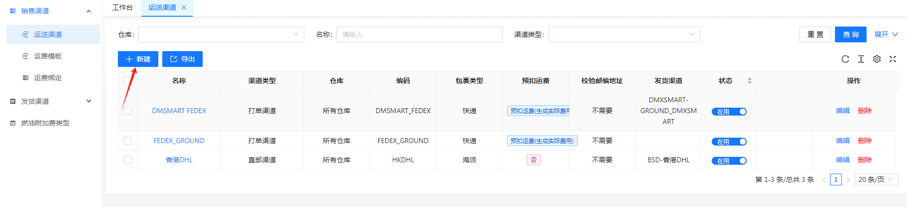

在**基本信息**栏录入渠道的名称、编码，渠道类型选择**打单渠道**，选择客户权限、是否校验邮编地址和承运商等基本信息。

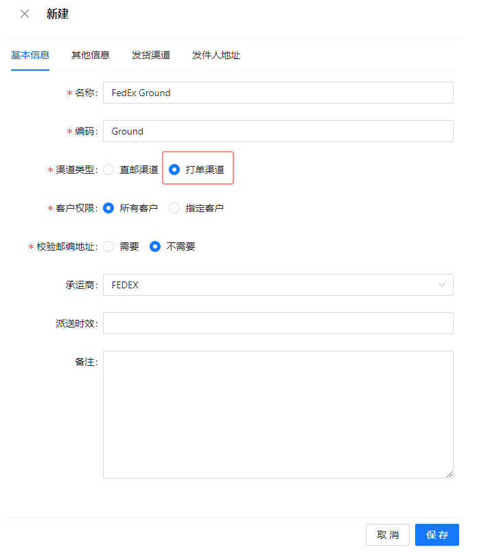

在**其他信息**栏设置该渠道的接口信息。

【名词释义】

**系统单号**：适用于仓库自营的物流渠道，根据跟踪号码库中存储的运单号码来为订单分配跟踪单号。

**API接口参考号码**：调用渠道商接口信息的参考编号。

**触发物流接口**：调用渠道商接口的时机。

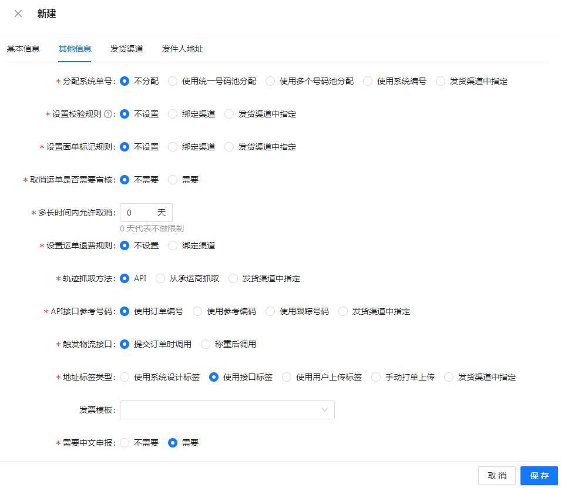

可在其他信息栏中设置打单的取消和退费规则

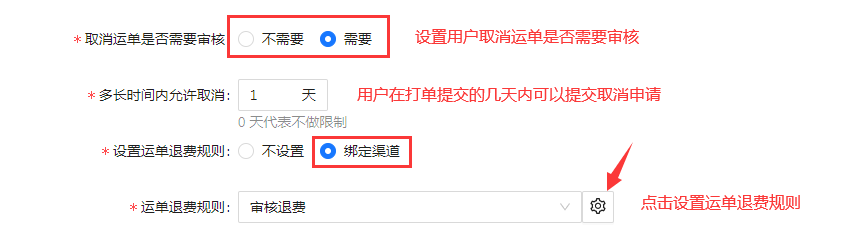

点击设置图标可自定义运单退费规则。

**立即退费**：客户取消后，会立即退费。

**审核退费**： 客户取消运单后，并不会立即退费，需要管理员对取消中的运单进行审核后，才会真正退费。

**计划退费**： 客户取消后，运单会按照计划时间延迟相应天数后再进行退费，中途管理端也可以对运单直接退费。

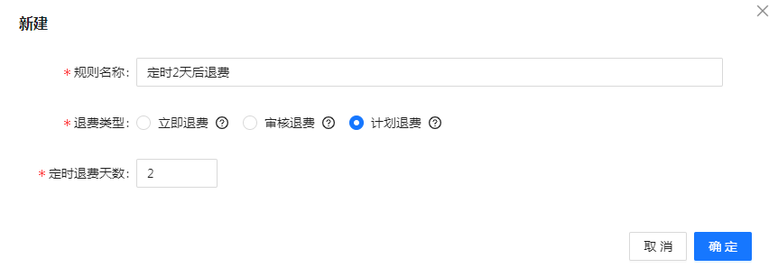

在**发货渠道**栏添加创建好的代理渠道

一般一条销售渠道对应一条发货渠道，当销售渠道对应多条代理的发货渠道时，可选择使用**路由规则**来为销售渠道匹配代理渠道。

系统支持按目的地国家、发货仓库以及订单重量等信息来设置包裹的路由规则。

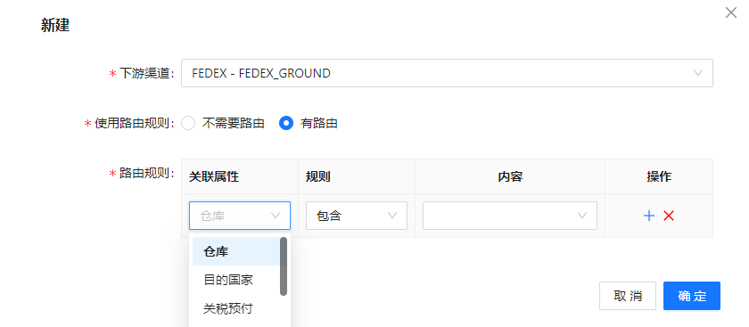

信息编辑完成后**确定**保存，可在渠道列表中重新编辑以及设置渠道使用状态。

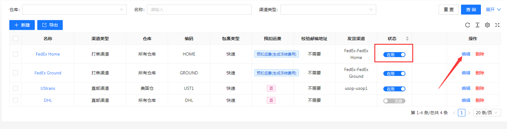

## 运费绑定

为销售渠道绑定价格，也可根据不同的客户设置不同的渠道价格。

【**功能入口**】（**渠道**—**销售渠道**—**运费绑定**—**新建**）

选择运送方式即运送渠道，添加该运送方式的价格模板。

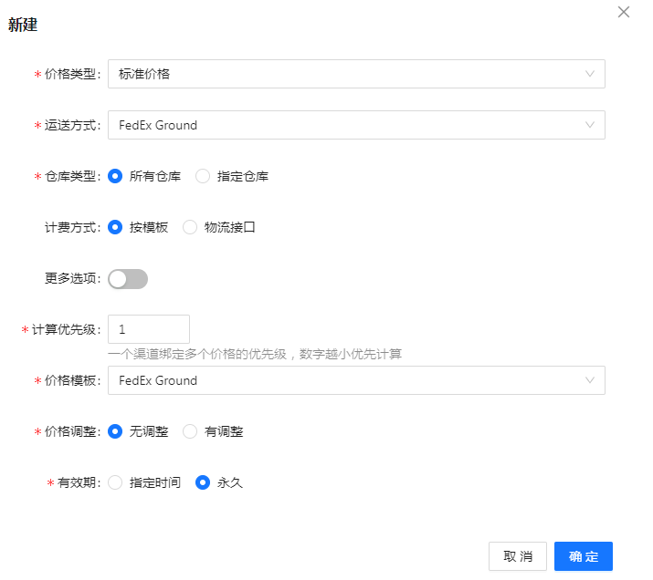

**客户等级价格**按照不同的客户等级调整运费模板价格

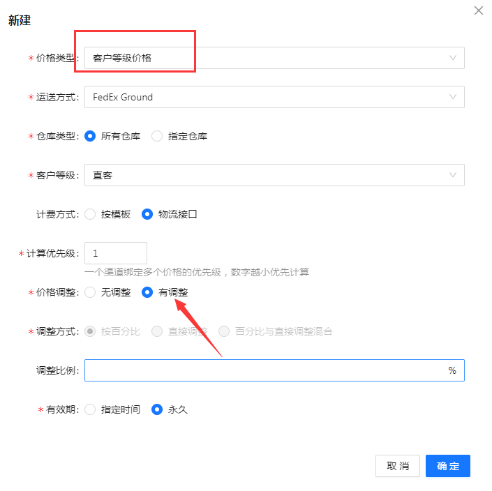

**客户特殊价格**为指定的客户调整运费价格

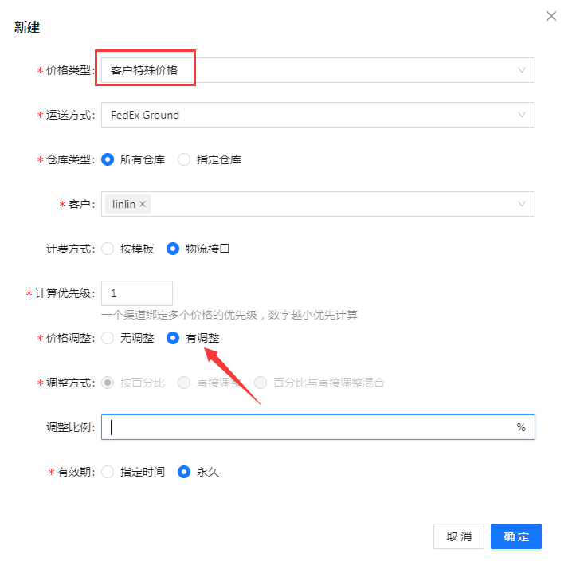

信息编辑完成后**确定**保存，可在列表中编辑或停用该价格设置。

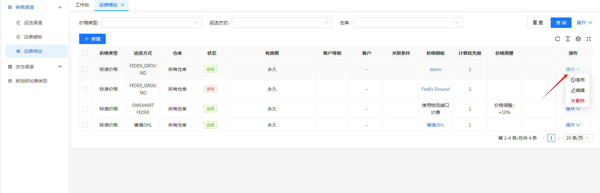

<!-- 源页面：https://help.dmxsmart.com/docs/printer/FunctionTerminal/ManagementInit/ChannelSettings/DistributionChannel -->
