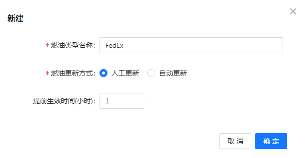
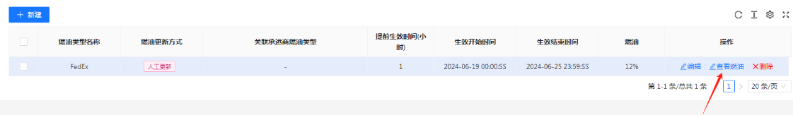
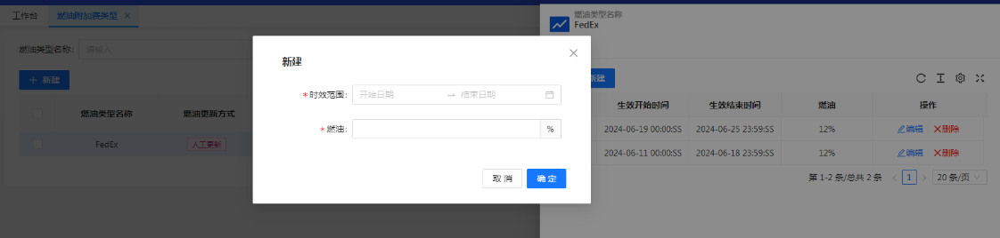
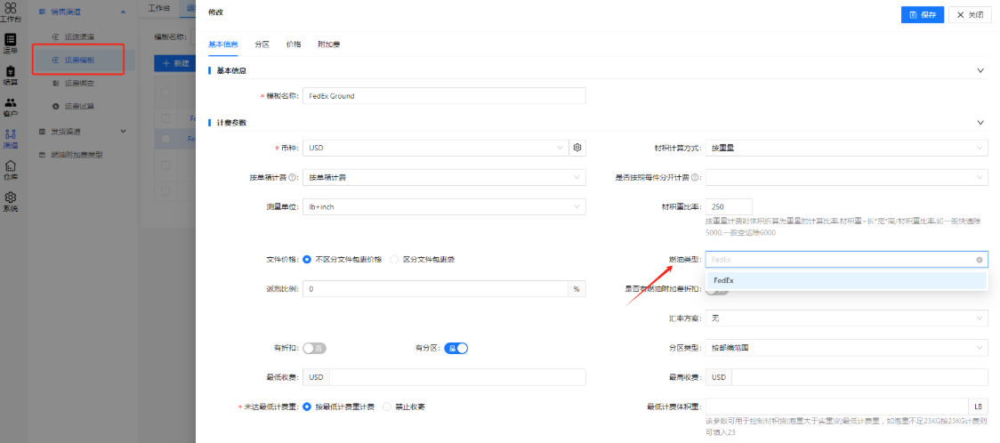

# 燃油附加费

需要计算燃油的渠道可提前设置好燃油费添加到运费模板中。  
【**功能入口**】（**渠道**—**燃油附加费类型**）  
点击**新建**，选择燃油类型，设置燃油更新方式和提前生效时间后确认保存。

  
点击**查看燃油，**设置燃油费的起止时间和费率后确认保存。  

  

  
在运费模板**基本信息**的燃油类型处选择使用。  

<!-- 源页面：https://help.dmxsmart.com/docs/printer/FunctionTerminal/ManagementInit/ChannelSettings/FuelSurcharge -->
