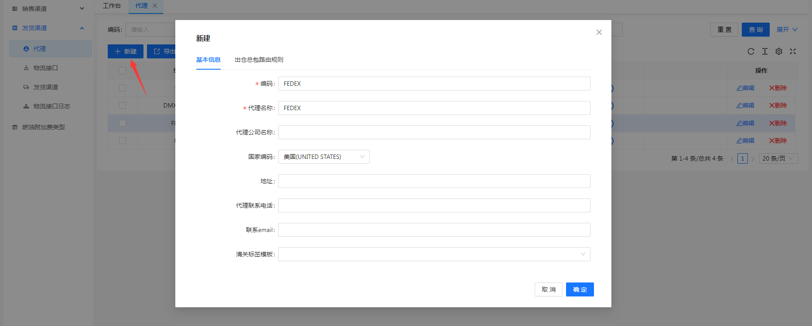
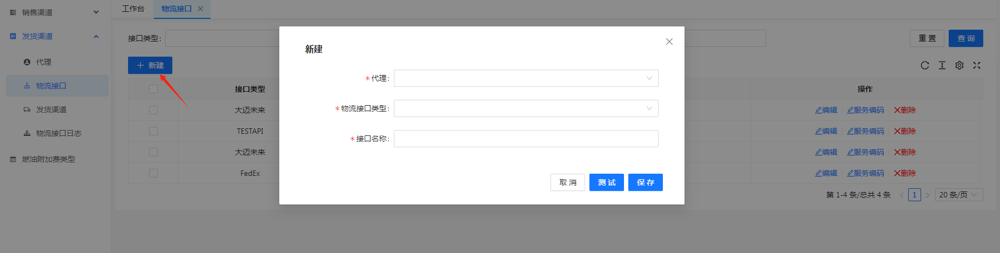
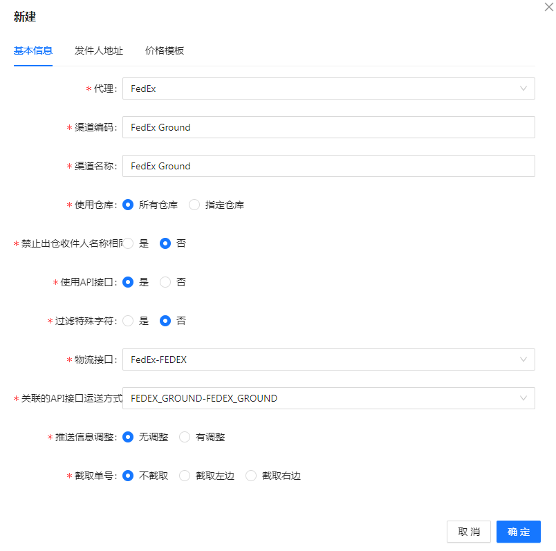
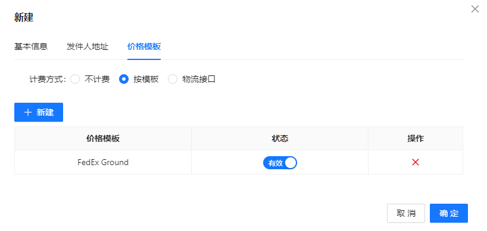

# 发货渠道

发货渠道即所代理的物流商渠道，通过发货渠道绑定API接口和渠道成本价，用于订单的自动推送下单以及财务核算渠道毛利。

## 新建代理

【**功能入口**】（**渠道**—**发货渠道**—**代理**—**新建**）

代理**编码**可以由字母和数字组成，便于人员区分，**代理名称**填写渠道名称，录入发货渠道所在地国家等信息后**确定**保存。

## 设置物流接口

【**功能入口**】（**渠道**—**发货渠道**—**物流接口**—**新建**）

物流接口的对接工作请提供服务商账号、密码、Token等接口信息给到我司技术部人员完成对接工作。

## 设置发货渠道

【**功能入口**】（**渠道**—**发货渠道**—**发货渠道**—**新建**）

点击**新建**，在基本信息栏中选择创建好的代理名称，渠道编码可以由字母和数字组成，录入渠道名称，需要调用服务商接口的，选择**使用API接口**关联对应的接口信息。

在**价格模板**中，

选择**按模板**，点击**新建**添加设置好的运费模板信息，此**运费模板**的价格将作为渠道成本价核算。

选择按**物流接口**，则以接口返回的费用作为渠道成本价核算。

设置完成后**确定**保存，该发货渠道设置完成。

#####

<!-- 源页面：https://help.dmxsmart.com/docs/printer/FunctionTerminal/ManagementInit/ChannelSettings/ShippingChannel -->
