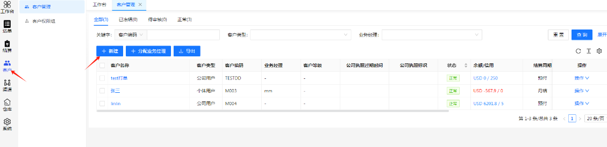
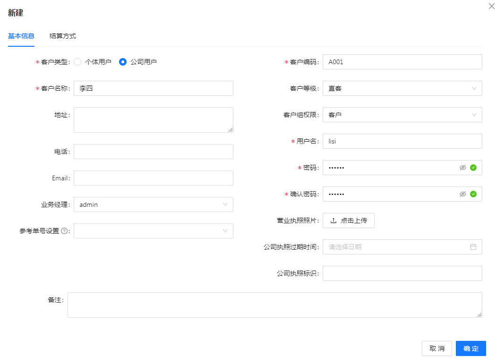
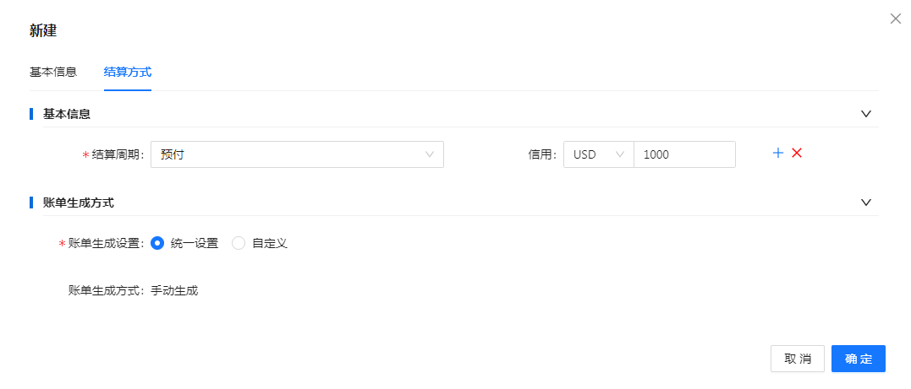
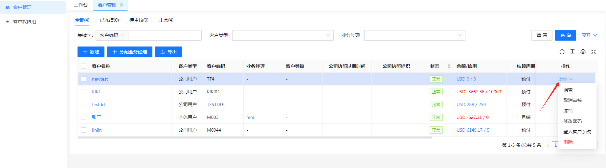
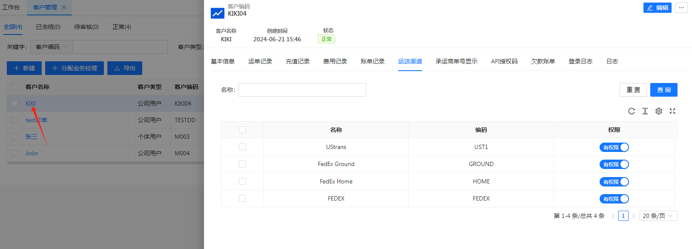
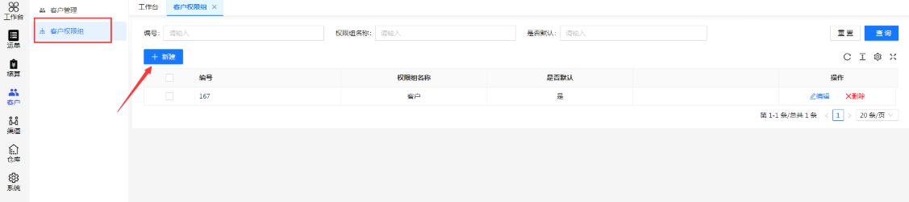
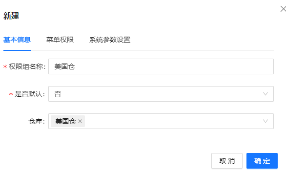
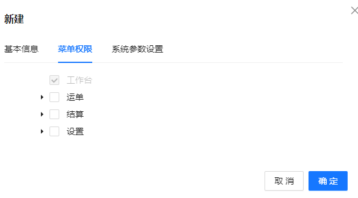
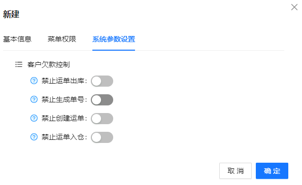
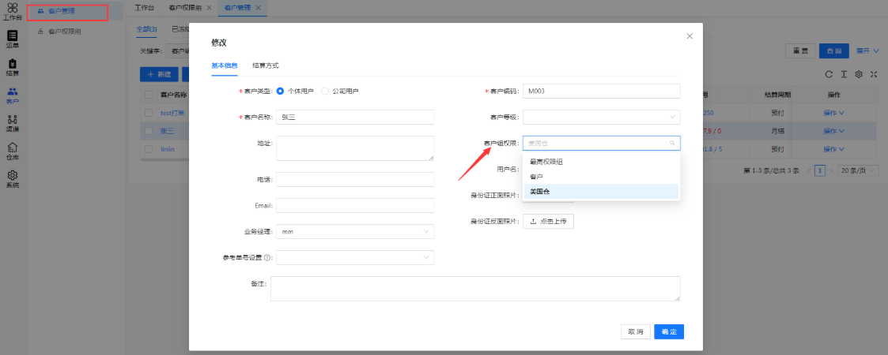

# 客户设置

## 客户管理

通过系统给客户开设账户，设置登录账号、密码等操作。  
【**功能入口**】（**客户—客户管理**）

  
在**基本信息**中录入客户信息,创建登陆账号及密码。  
**客户编码**根据客户需求自定义。  
**客户等级**用于区分不同等级的客户，运费绑定可为不同等级的客户设置不同渠道价格。  

  
在**结算方式**选择客户结算方式和账单生成方式。  
**结算周期**设置客户费用的结算时间，预付、周结、月结等结算周期。  
当信用额度用完后客户将无法下单，需充值核销后才能继续操作订单  

创建成功的客户信息会展示在客户列表中，可以对客户信息进行编辑或修改密码等操作。

点击客户名称可查看客户的相关信息并设置运送渠道权限。

## 客户权限组

系统支持创建不同仓库或者不同功能菜单权限，用于分配给不同客户进行精确化的客户管理功能。  
【**功能入口**】（**客户—客户权限组**）

  
在**基本信息**栏录入权限组名称，选择使用权限的仓库。  

  
**菜单权限**处勾选分配给客户的系统菜单功能，工作台权限必须勾选，其它菜单功能可自行勾选分配。  

  
**系统参数设置**中设置当客户欠款时不可进行的操作。  

  
客户权限组创建成功后，在**客户管理**处为客户分配仓库和菜单权限。  

<!-- 源页面：https://help.dmxsmart.com/docs/printer/FunctionTerminal/ManagementInit/CustomerSetup -->
