# 支付宝

## 1.注册支付宝企业账户

注册链接：[注册 - 支付宝](https://memberprod.alipay.com/account/reg/index.htm)

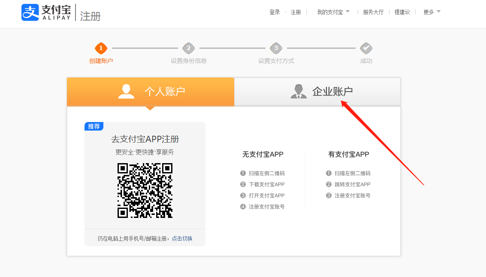

准备相关材料完成支付宝企业账户的注册及认证  

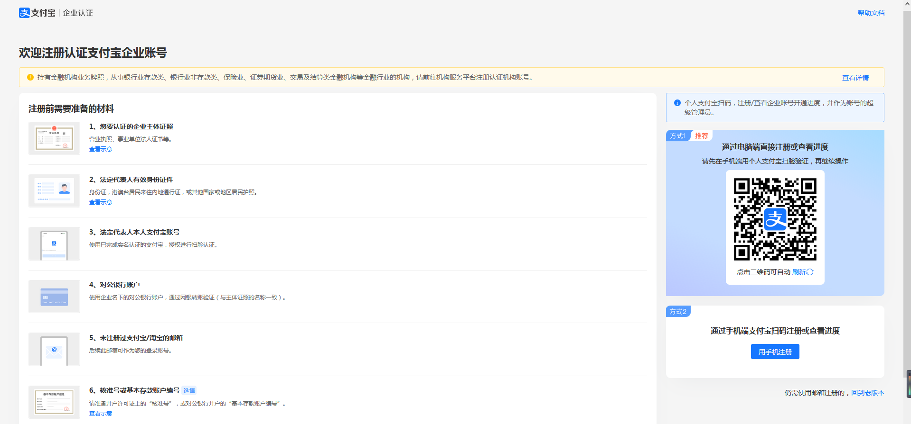

## 2.开通支付宝当面付

[支付宝商家中心-国内领先的第三方支付和金融服务平台](https://b.alipay.com/signing/productDetailV2.htm?productId=I1011000290000001003)  
根据官方文档流程签约支付宝当面付

## 3.创建应用

登陆支付宝企业账户，进入控制台创建**网页&移动应用**

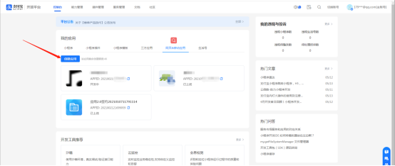

  
创建完成后为应用配置加密的秘钥  
操作指南：[小程序文档 - 支付宝文档中心](https://opendocs.alipay.com/common/02kdnc)  

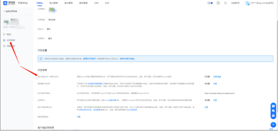

  
直接用支付宝开放平台开发助手生成秘钥(需要下载)  
公钥分为支付宝公钥和应用公钥  

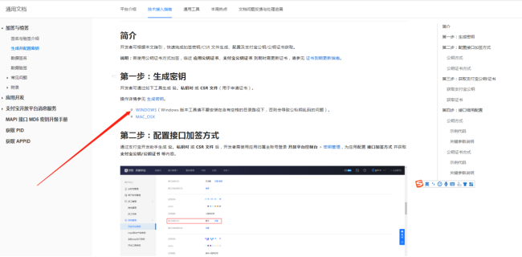

  
注意：应用必须审核通过后才能使用，否则即使配置好也没办法使用.  

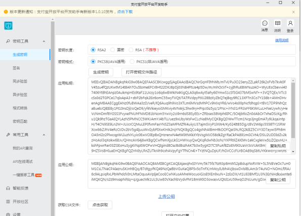

  
系统参数对应项  
**pid**  

  
**appid**  

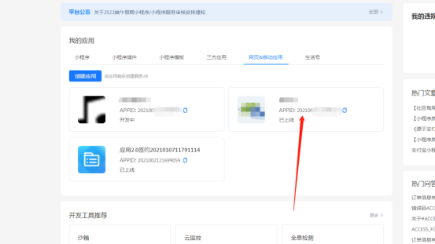

  
**private_key**  

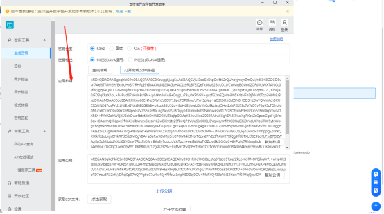

  
**public_key**  

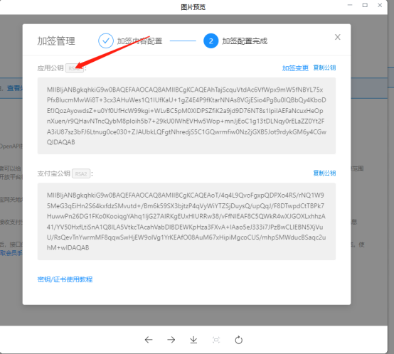

  
**alipay_public_key**  

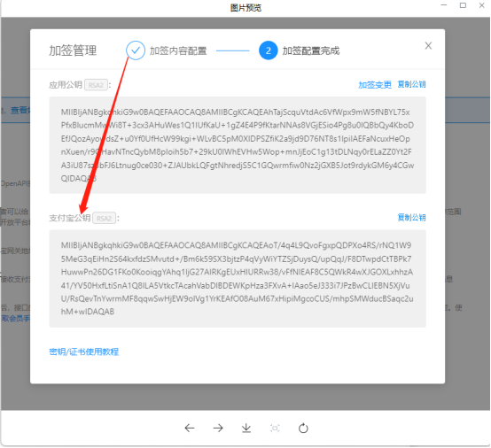

  
支付宝企业账号成功绑定后，客户在客户端使用支付宝在线支付功能进行线上充值，充值金额将自动转入客户余额.  

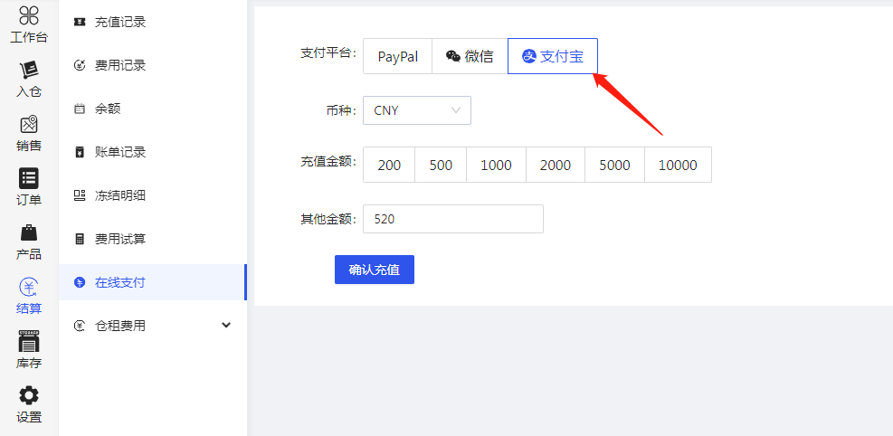

<!-- 源页面：https://help.dmxsmart.com/docs/printer/FunctionTerminal/ManagementInit/PaymentInterface/Alipay -->
