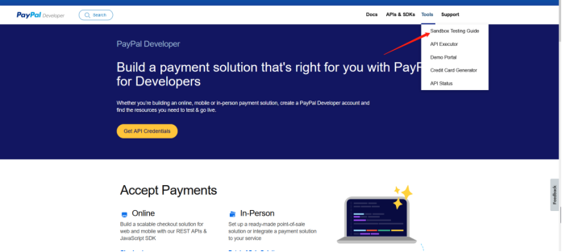
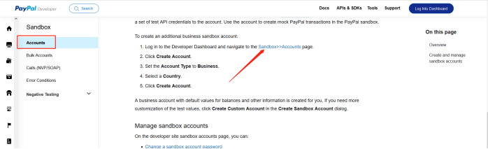
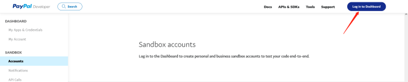
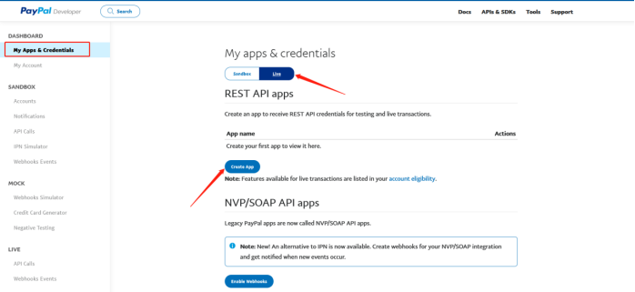
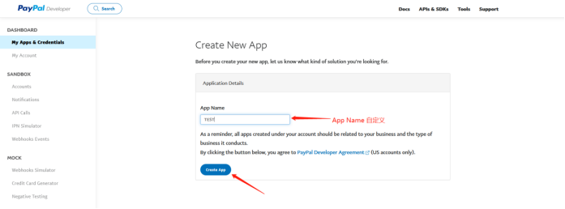
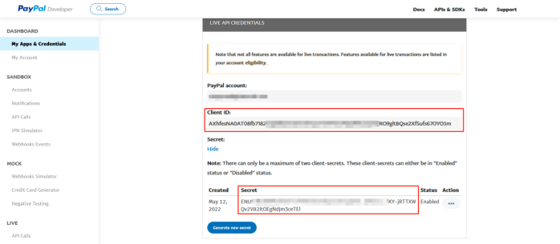
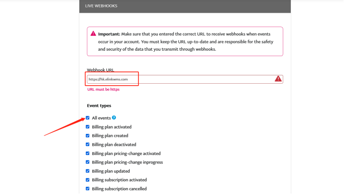
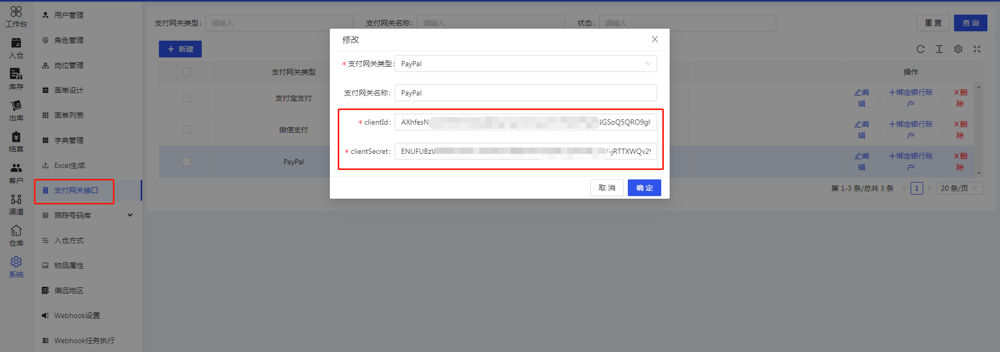
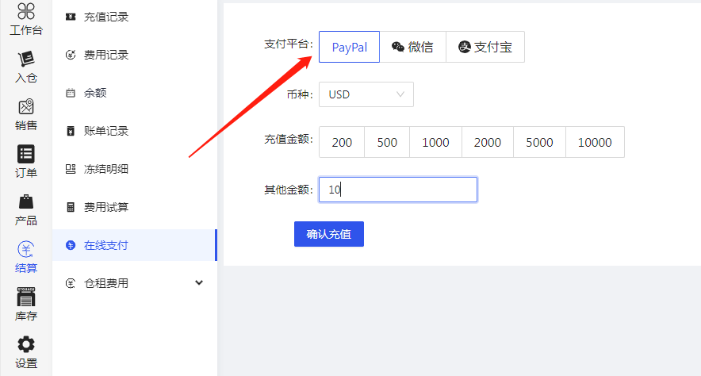

# PayPal

Paypal开发者中心：[PayPal Developer](https://developer.paypal.com/home)  
点击上方**Tools----Sandbox test accounts**

  
点击**Log in to Dashboard**登录Paypal账号  

  
**Create APP**  

  
创建成功后将获取到**Client Id**和**Client Secret**

  
**Webhook URL **处录入：<https://hk.elinkwms.com/api/pay/paypal/unifiedorder>  
**Event types** 勾选 **All events**  

  
将**Client Id **和**Client Secret** 复制粘贴到系统对应框内  

PayPal 账号成功绑定后，客户在客户端使用PayPal 在线支付功能进行线上充值，充值金额将自动转入客户余额.  

<!-- 源页面：https://help.dmxsmart.com/docs/printer/FunctionTerminal/ManagementInit/PaymentInterface/PayPal -->
