# 微信

## 1.注册微信支付商户号

[微信支付 - 中国领先的第三方支付平台 ｜ 微信支付提供安全快捷的支付方式](https://pay.weixin.qq.com/index.php/core/home/login?return_url=%2F)  
注册审核流程参考微信官方文档：[微信支付商户接入指引](https://kf.qq.com/faq/210423UrIRB7210423by6fQn.html)

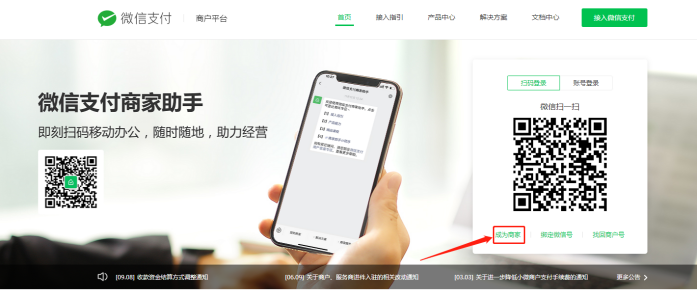

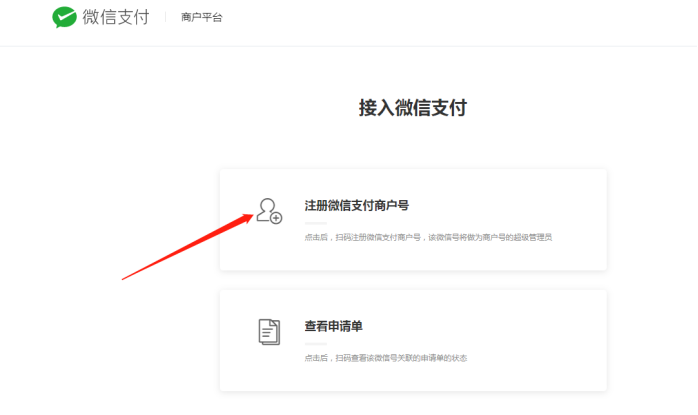

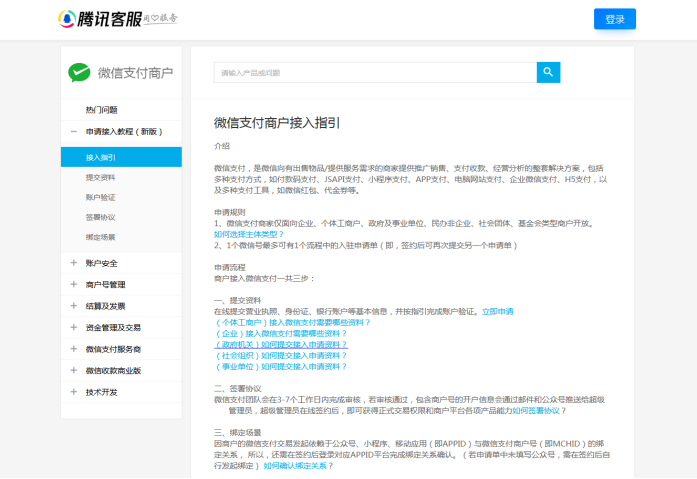

  
按照接入教程指引完成提交资料、账户验证、签署协议、绑定场景.  
注意：填写商户信息时**经营场景**选择PC网站，网站授权函联系我司客户经理提供.  

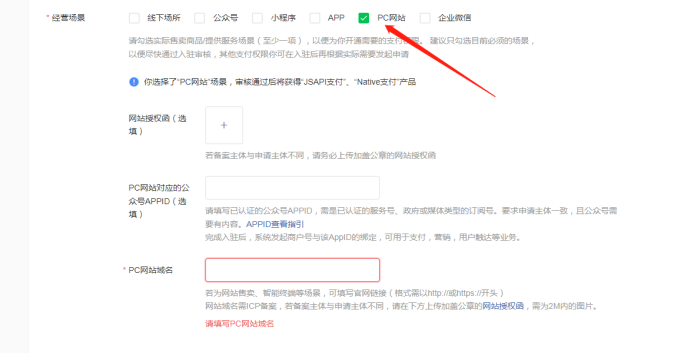

## 2.**登陆微信支付商户平台获取商户API证书**

API证书获取指引：[什么是APIv2密钥？如何设置或修改？](https://kf.qq.com/faq/180830UVRZR7180830Ij6ZZz.html)

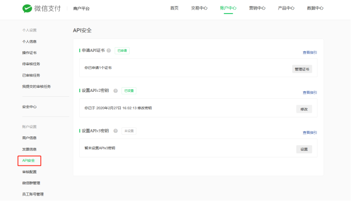

  
（请务必妥善保管证书及私钥，因为私钥文件只能通过证书工具导出，若私钥丢失，则无法找回，只能作废后重新申请。）

## 3.设置APIv2秘钥

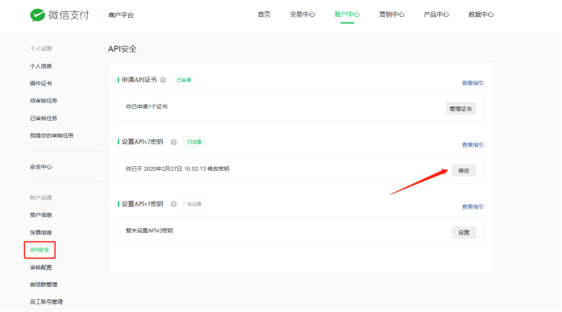

  
秘钥自动生成工具：<http://www.12564.cn/show-237.html>  
秘钥设置指引：[什么是APIv2密钥？如何设置或修改？](https://kf.qq.com/faq/180830UVRZR7180830Ij6ZZz.html)

## 4. 申请开发者资质认证

流程指引：[open认证流程](https://kf.qq.com/faq/170824URbmau170824r2uY7j.html)

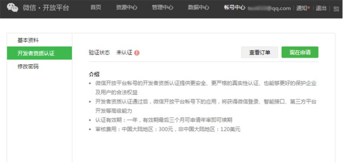

  
申请通过后将获得**AppID**  
**AppID及其主体信息查询指引：**[AppID及其主体信息查询指引](https://kf.qq.com/faq/181105JJNbmm181105eUZfee.html)

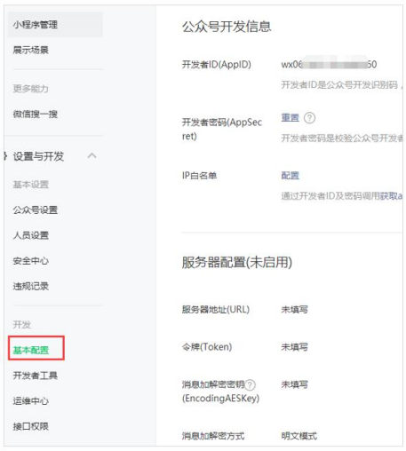

## 5.AppID 账号管理关联 AppID

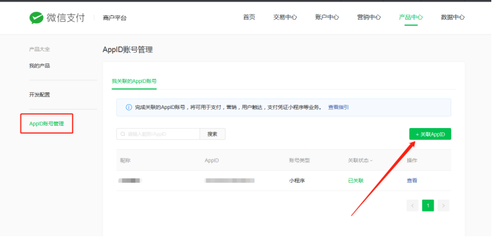

  
最后将AppID、APIv2秘钥和微信支付商户号设置到系统中.  

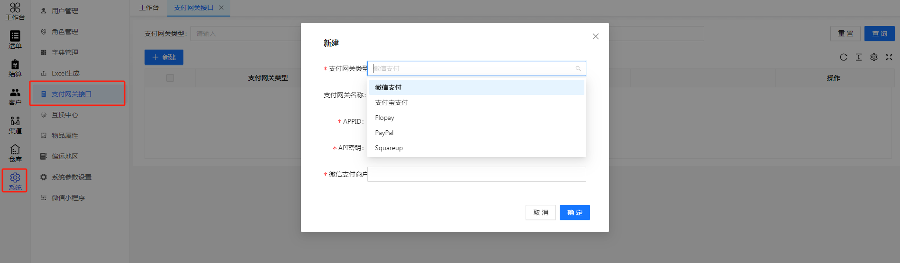

  
微信商户账号成功绑定后，客户在客户端使用微信在线支付功能进行线上充值，充值金额将自动转入客户余额.  

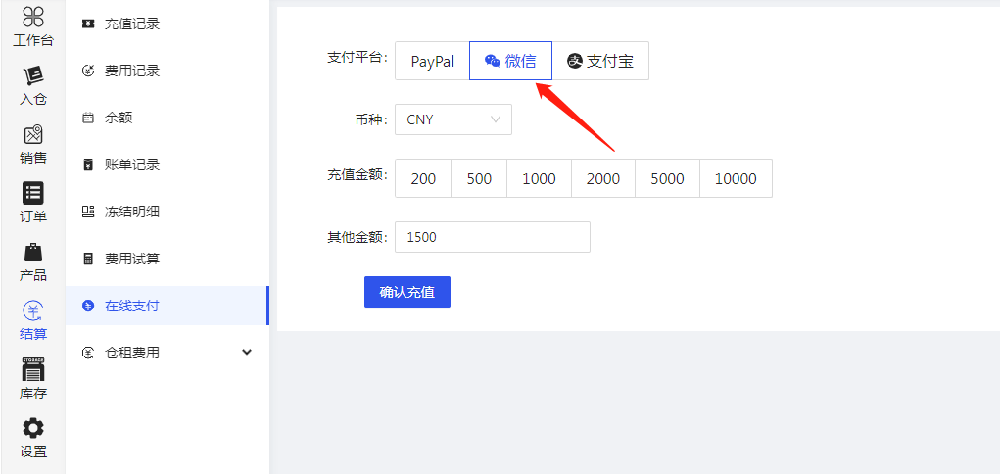

<!-- 源页面：https://help.dmxsmart.com/docs/printer/FunctionTerminal/ManagementInit/PaymentInterface/WeChat -->
