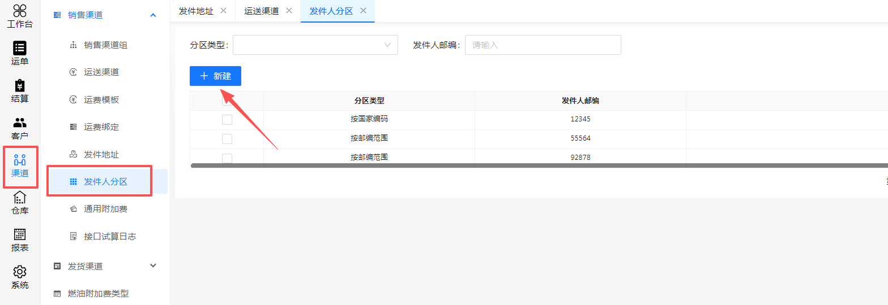
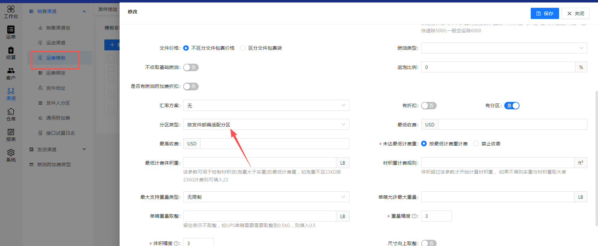
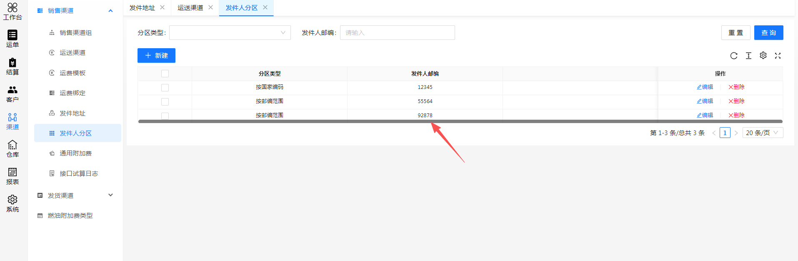
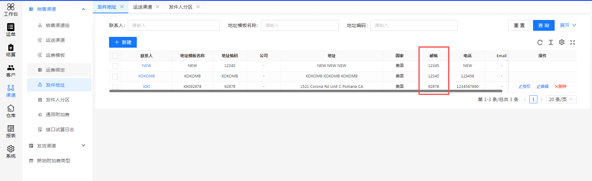

# 发件人分区

若多个发件地址报价相同但分区不同，可在系统设置中配置发件人分区与报价。下单时，系统将根据发件地址自动匹配对应分区及报价。

## 设置发件人分区

新建发件人分区

## 配置报价分区

将报价的分区类型设置为 按发件邮编适配分区

发件人分区邮编与发件地址的邮编匹配。下单时，系统会根据发件人邮编去寻找对应的分区价格

<!-- 源页面：https://help.dmxsmart.com/docs/printer/FunctionTerminal/ManagementInit/SenderZone -->
