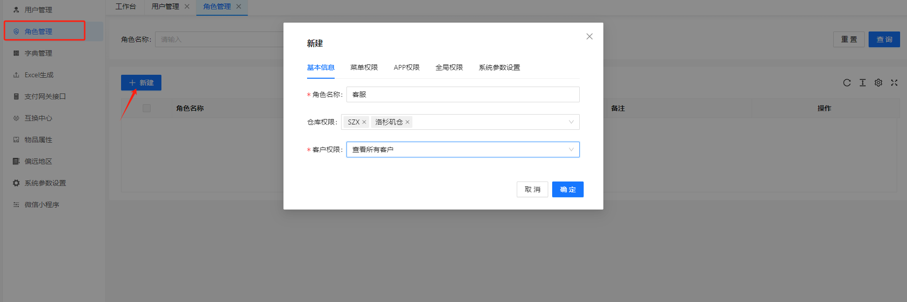
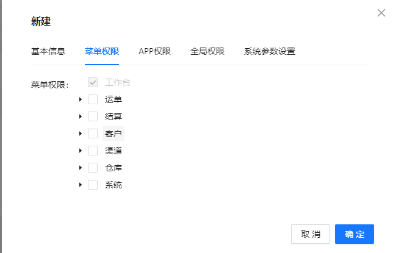
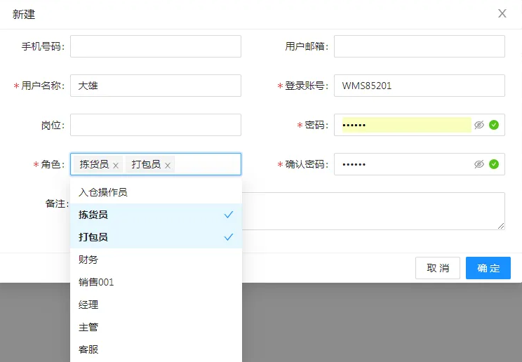

# 系统设置

## 角色管理

仓库中有不同的岗位角色，各个角色可以拥有不同的操作权限以及登陆账号，在系统中对用户角色的操作权限进行设置，例如配货员、打包员、客服、销售等。  
【**功能入口**】（**系统**—**角色管理**）  
点击**新建**，创建好角色名称，选择操作仓库，在**菜单权限、全局权限**列表中为该角色分配系统的操作权限。

  

  

## 用户管理

【**功能入口**】（**系统**—**用户管理**）角色权限配置完成后，给不同的角色开通登陆账号。  
点击**新建**，设置登陆账号和密码，选择角色，不同的角色所分配的操作权限不同，也可以为该账号同时添加多个角色。*号为必填项

<!-- 源页面：https://help.dmxsmart.com/docs/printer/FunctionTerminal/ManagementInit/SystemSettings -->
