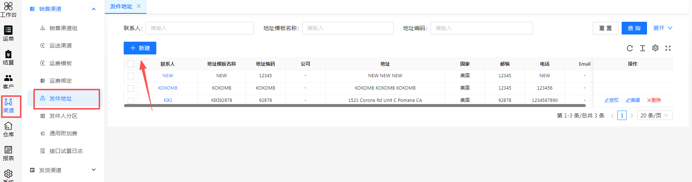
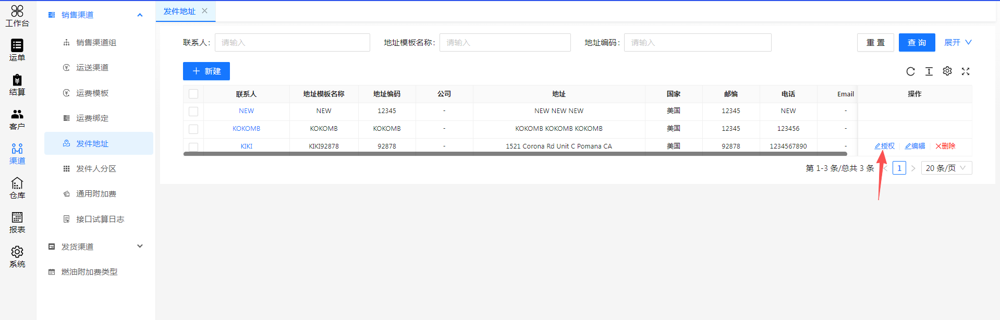
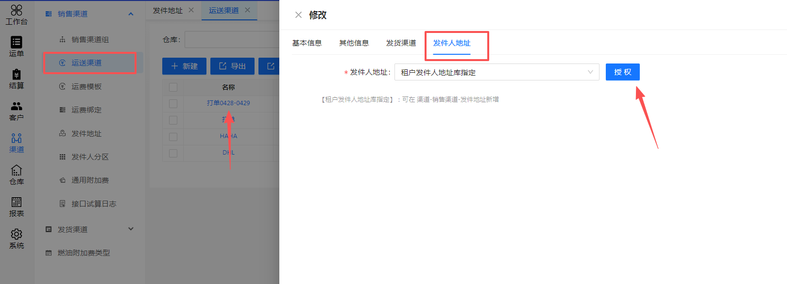

# 发件地址

## 设置发件人地址

新建发件人地址

## 授权使用

给可用该发件地址的客户进行授权

将发件地址授权给渠道使用

当客户和渠道拥有该发件地址权限时，客户方可使用此发件地址和渠道来下单。

<!-- 源页面：https://help.dmxsmart.com/docs/printer/FunctionTerminal/ManagementInit/mailingAddress -->
