# 应收结算

## 充值记录

系统支持线上充值，仓库财务需对客户线上支付金额进行审核，才能将支付金额充值到客户账号中。线上支付通道支持微信、支付宝和PayPal。如需开通线上支付需要绑定相应支付通道所需的密钥，详情请咨询我司客服或者技术人员。

【**功能入口**】（**结算—应收结算—充值记录—新建**）  
可为线下充值的客户手动创建充值单进行充值，并上传水单截图。

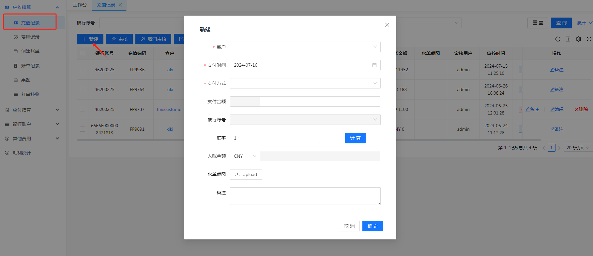

如果客户的支付币种与入账到系统的币种不同，我们可以通过录入不同的汇率来进行充值，系统会根据输入的汇率自动进行换算。录入收款银行账号，系统会记录该银行账户的每笔充值流水，便于财务核算公司资产。  

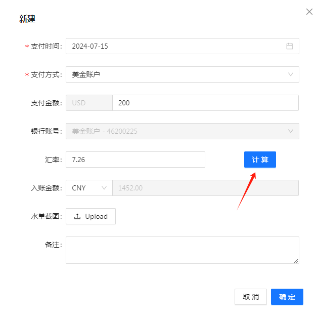

  

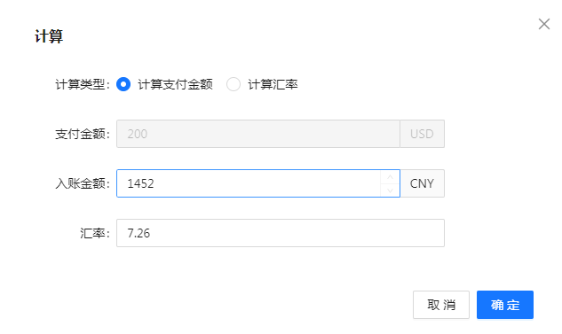

客户的充值单创建成功后，点击审核，入账的金额将转入客户余额中完成充值。  
客户端也能够创建充值记录，由管理端进行审核。

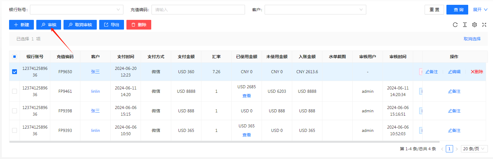

## 费用记录

客户提交到系统的所有业务产生的费用明细都可以在费用记录中查询到，还可以为客户某一运单单独创建其它费用。  
【**功能入口**】（**结算—应收结算—费用记录**）

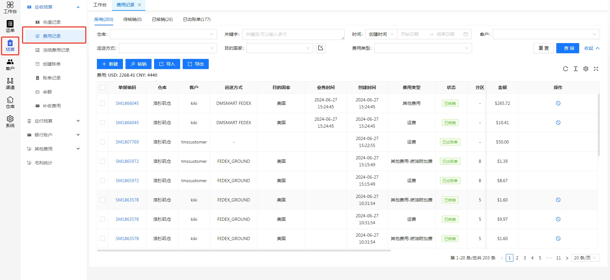

点击**新建**，录入与客户业务相关联的单据，选择费用类型并录入金额保存，费用创建成功。

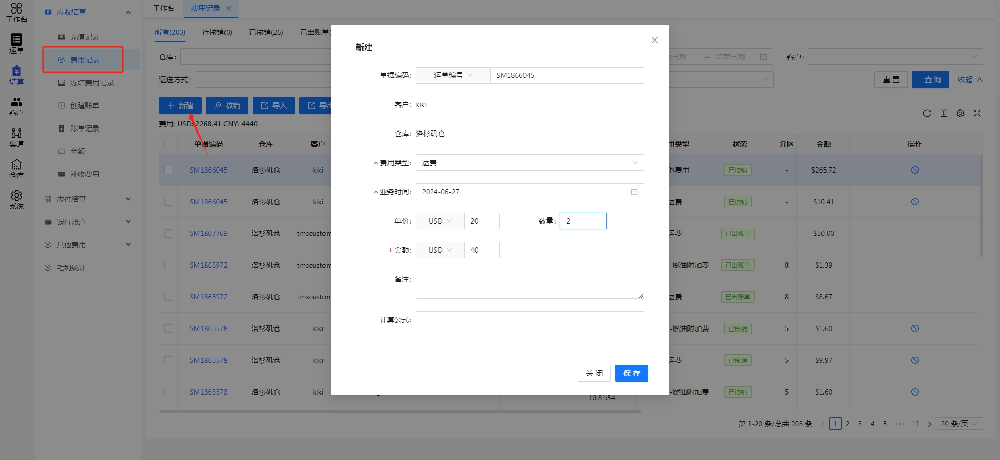

手动创建的费用会添加到**待核销**列表，财务人员需要对费用详情进行核销后，该费用才会生成客户的账单费用，并产生计费。

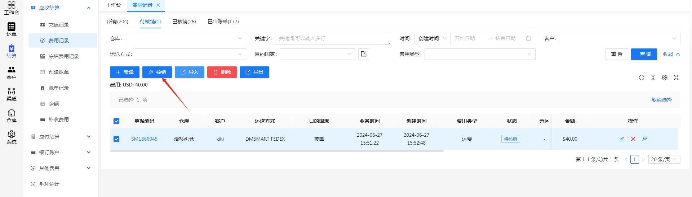

通过系统计费规则自动计算的费用，系统会自动进行核销。

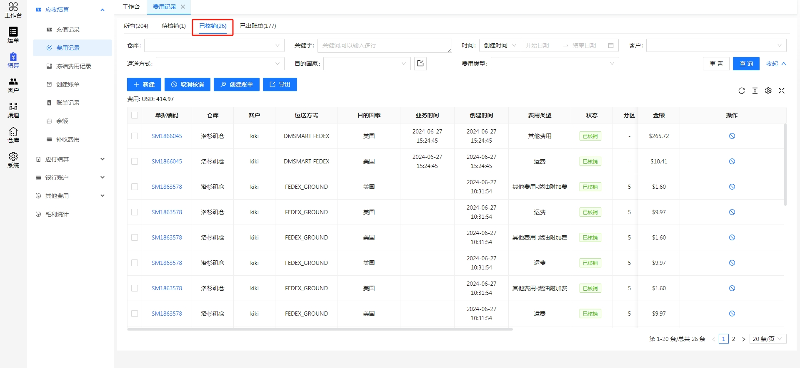

## 创建账单

通过系统生成每个客户的费用账单，便于客户账单查询、对账以及财务销账。  
【**功能入口**】（**结算—应收结算—创建账单**）

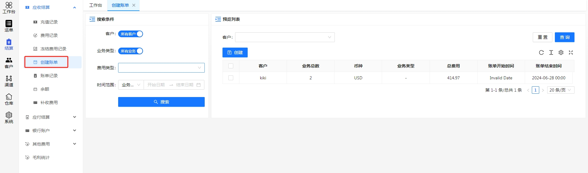

选择客户

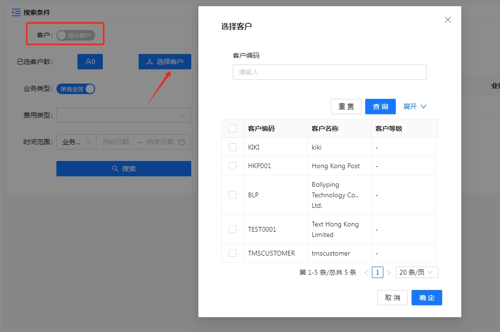

业务类型可以选择全部业务，也可以选择部分业务。

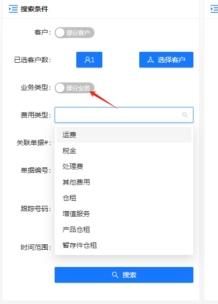

设置账单的起始时间，后点击搜索。

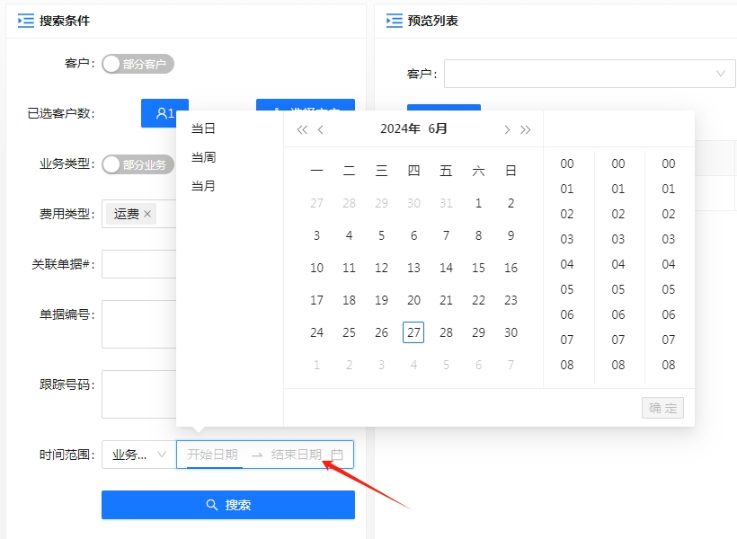

系统会根据设置的条件搜索出账单费用后，点击创建，账单创建成功。

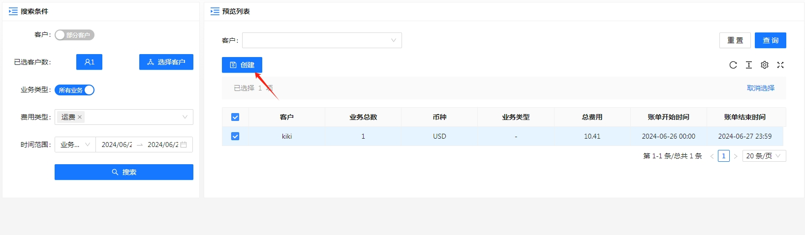

## 账单记录

根据账单金额对客户进行扣款，账单明细、发票的导出。  
【**功能入口**】（**结算—应收结算—账单记录**）

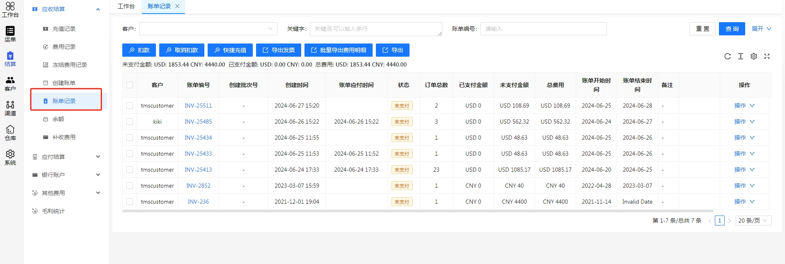

对未支付的账单进行扣款，点击后方**操作**，可以导出账单明细、发票等操作。

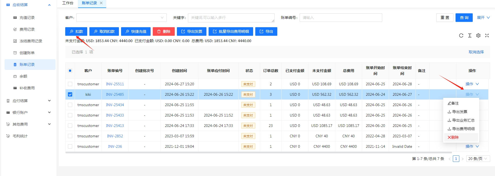

  
未支付的账单允许删除后重新创建，已扣款的账单不能再进行删除操作。

## 余额

客户账户余额显示，同一客户允许充值不同币种进行结算，点击操作，可以给客户设置信用额度、设置押金和退还押金。  
【**功能入口**】（**结算—应收结算—余额**）

**充值总额**：账号充值的总金额  
**总费用**：业务产生的所有费用总额  
**余额**：余额=充值金额-总费用-押金  
**信用额度**：由管理端对客户设置的信用额度  
**可用余额**：客户还可以使用的金额，可用余额=余额+信用额度-冻结总额  
**未付账单金额**：已创建账单费用还未扣款的金额  
**已付账单金额**：已扣款或已支付费用的账单金额  
**账单结余**：客户充值金额扣除已支付的账单金额后的账户结余。账单结余=充值金额-已付账单-押金

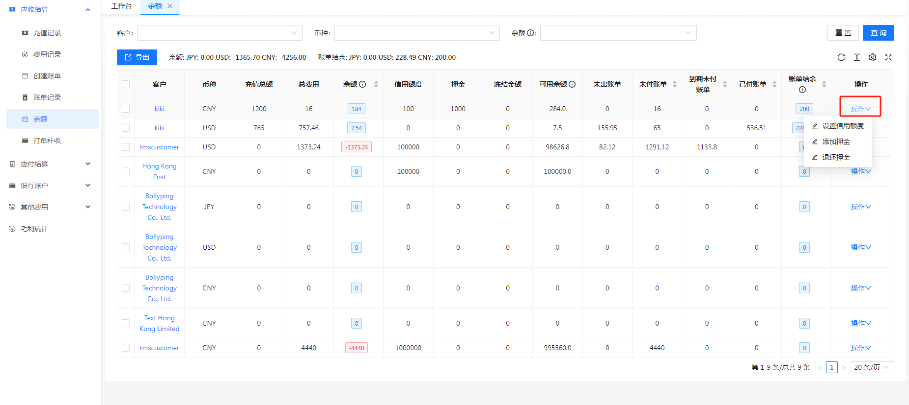

  
设置信用额度  

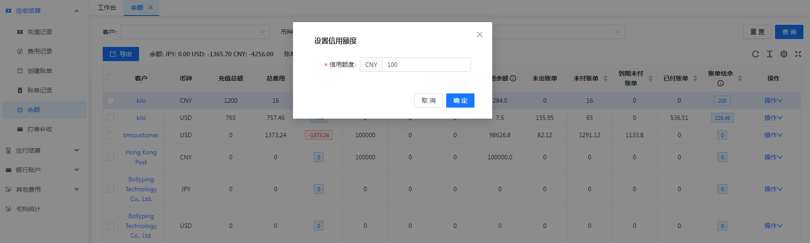

  
设置押金，可选择扣款来源进行扣款。  

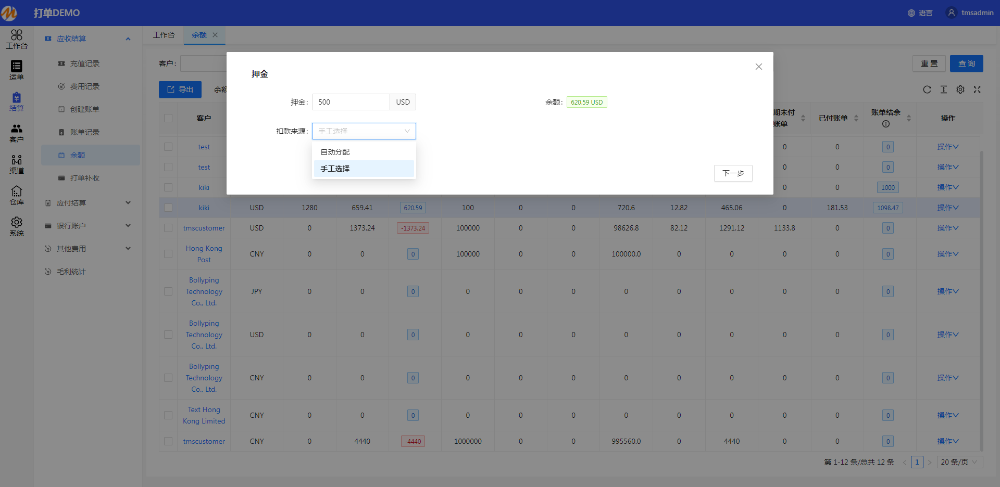

  
退还押金，可选择退还方式，退还全部押金或退还部分。  

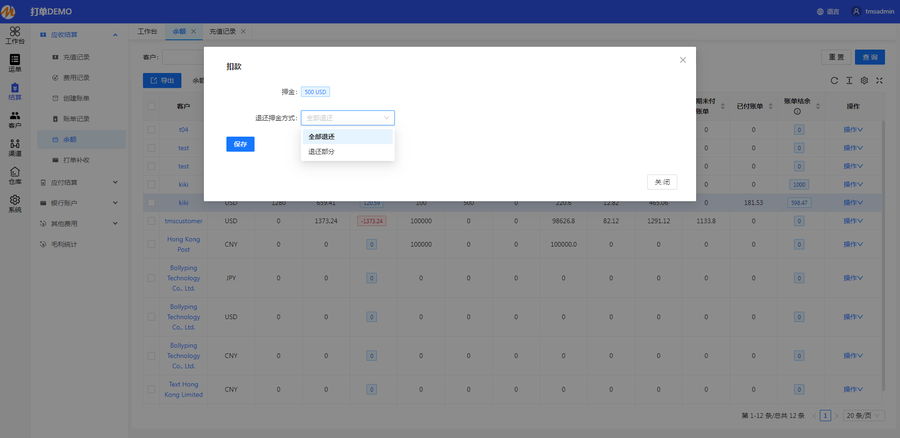

## 打单补收

【**功能入口**】（**结算—应收结算—打单补收**）  
在打单补收中可批量对运单费用进行补收。下载模板进行补收，可选择系统内置的模板也可自定义导入模板。  
其中，单据类型、单据编码为必填项，单据类型为**运单**。当选择按子单号分开计费时，子单号为必填项。

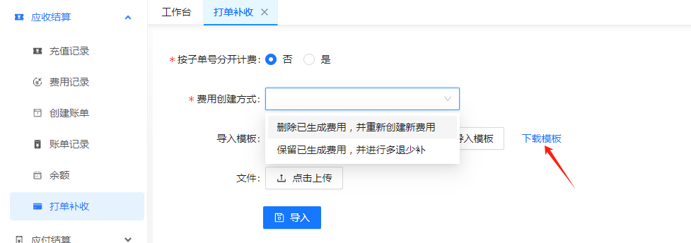

<!-- 源页面：https://help.dmxsmart.com/docs/printer/FunctionTerminal/Settlement/AccountsReceivableSettlement -->
