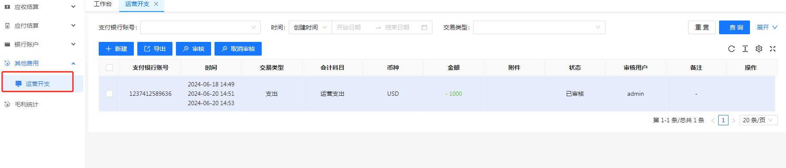
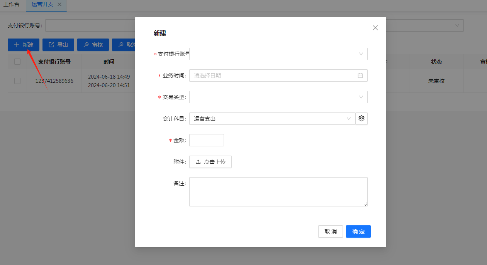
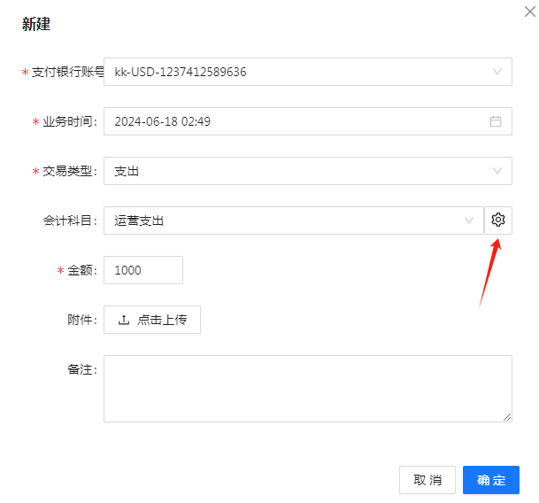
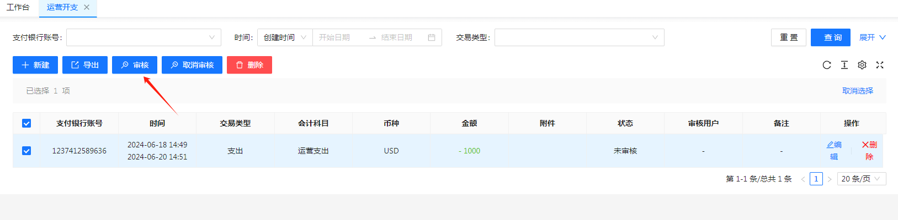
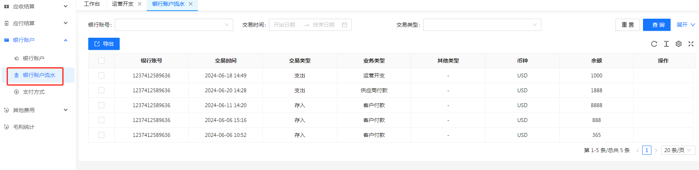

# 其他费用

统计公司运营中出现的一些其它开支费用，管理公司的每一笔收支明细，帮助公司财务进行成本核算。  
【**功能入口**】（**结算—其他费用—运营开支**）

  
点击新建   

选择发生交易的银行账户，交易类型可选择是**支出**或者**收入**，会计科目通过后方**设置**图标新增类型，录入金额后确定保存。

交易创建成功后，点击审核，账户结算完成并生成相应的交易流水。

  

<!-- 源页面：https://help.dmxsmart.com/docs/printer/FunctionTerminal/Settlement/OtherExpenses -->
