# 入门指引

操作前需在管理端进行系统相关初始化设置（详见管理端初始化 [点击查看](https://help.dmxsmart.com/docs/printer/FunctionTerminal/ManagementInit/InitializationProcess)）

## 打单操作

创建打单

步骤：**OMS ＞运单 ＞创建打单 ＞新建 ＞填写信息 ＞ 保存草稿/下单**

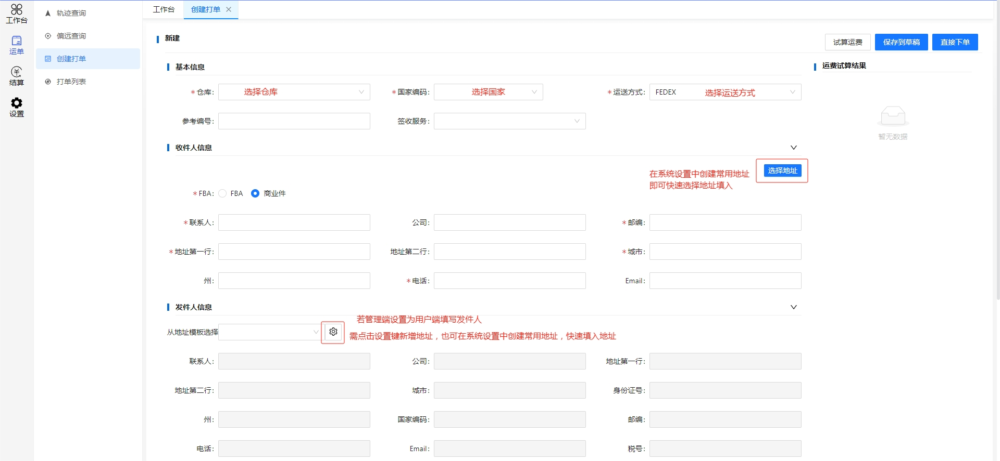

下单前可进行运费试算，选择最优渠道下单

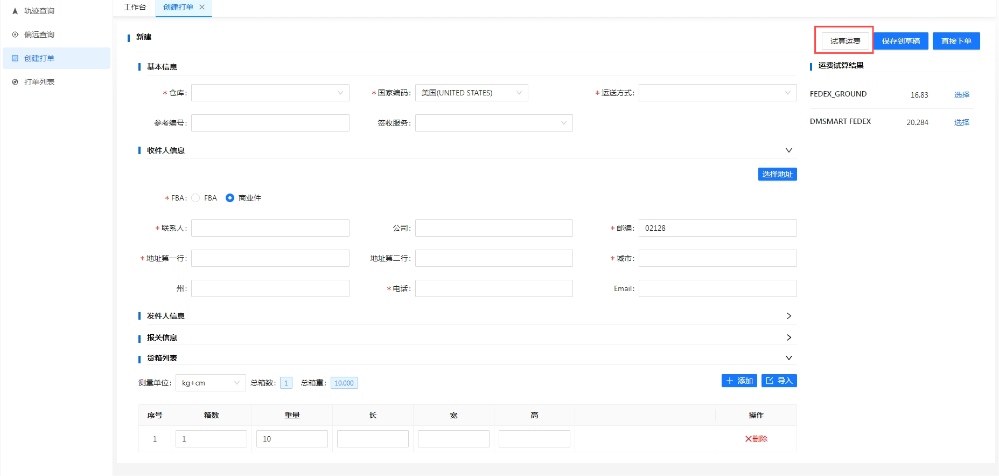

信息填写完毕后，点击**保存到草稿**，打单将转为**草稿**状态，点击**直接下单**，打单为**已打单**状态。

可在 **OMS ＞运单 ＞打单列表 ＞已打单** 中查看。

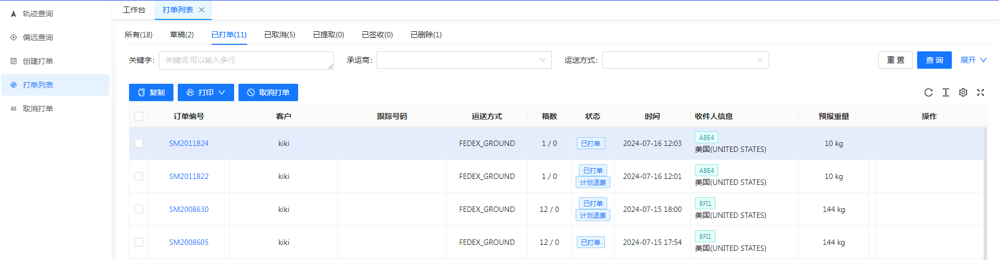

**草稿**状态下可以编辑提交打单或删除打单。

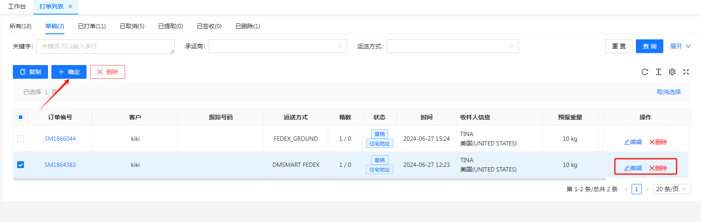

**已打单**的运单可以选择取消打单，如果管理端设置了取消规则，则需要管理端审核后取消打单。

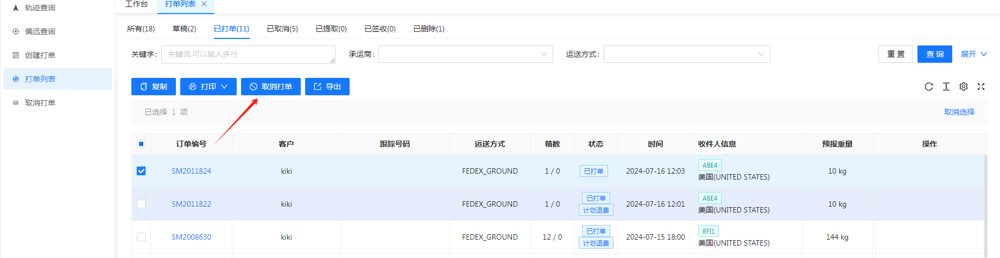

等待管理端审核的取消申请在 **OMS ＞运单 ＞取消打单 **中查看进度。

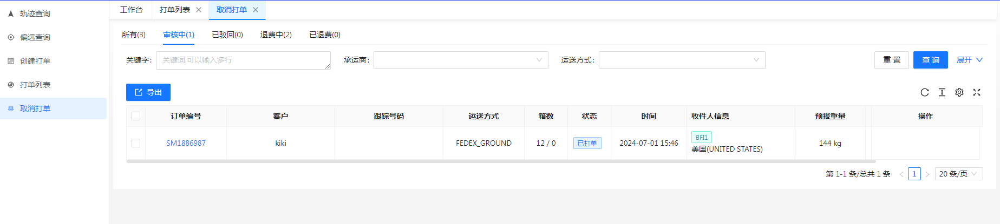

取消打单流程如下：

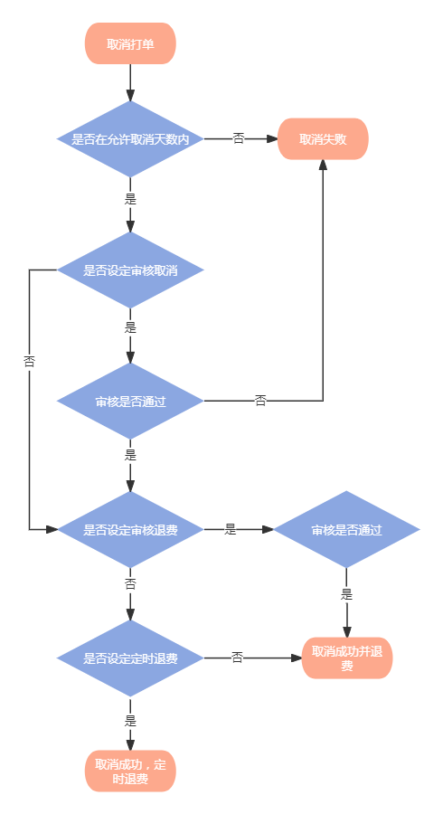

点击订单编号，可以查看此订单的基本信息、费用信息和操作记录等信息。

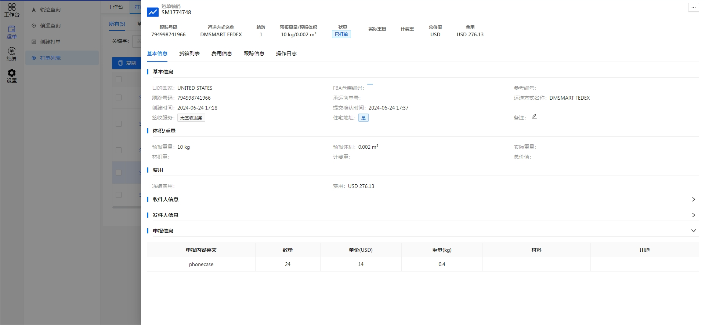

## 查看费用详情

状态为“**已打单**”的订单可点击订单编号查看订单费用信息。

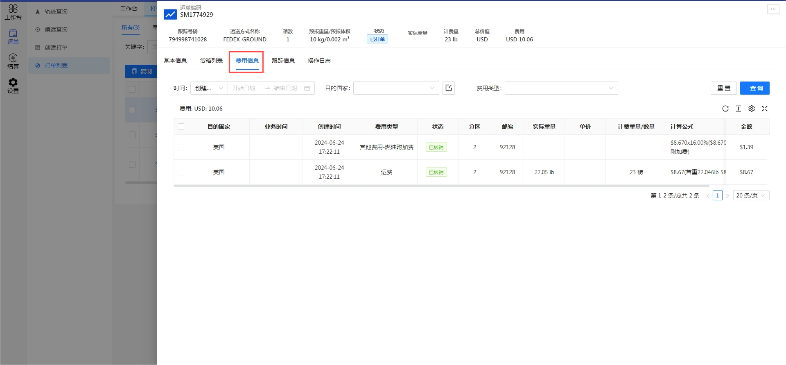

也可在 **OMS ＞结算 ＞费用记录** 中查看费用详情、费用明细，通过关键字搜索查询每单费用信息，选中单据可一键导出多个单据的费用记录。

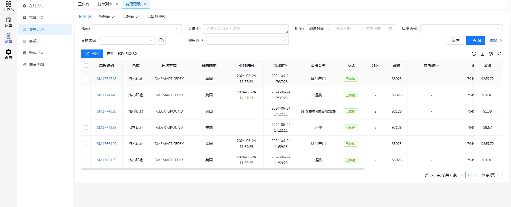

## 查看账单

在 **OMS ＞结算 ＞账单记录** 中查看账单。账单由管理端创建，客户无法对账单费用进行任何编辑、修改等操作，已生成的账单通过操作可以导出发票、账单明细等动作。

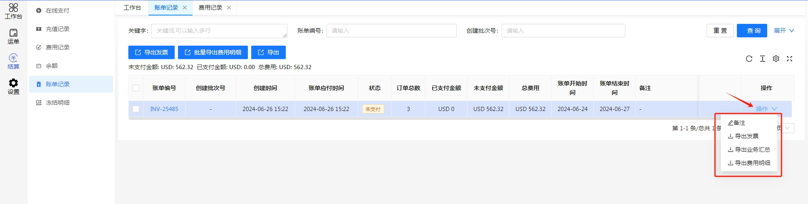

## 账户余额管理

管理端对接微信和企业支付宝账号后，余额充值可在**OMS ＞结算＞在线支付**中进行在线充值。

在 **OMS ＞结算＞充值记录**中可以查看到充值记录，客户端可创建充值记录由管理端审核充值。

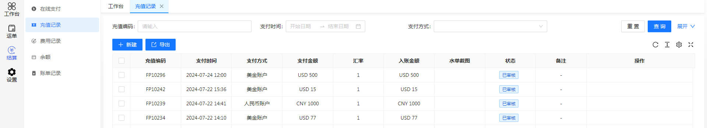

可下单金额=账户余额+信用额度，当可下单金额为0将无法提交单据，请管理端进行余额充值或是信用额度修改。

在 **OMS ＞结算＞余额**中可查看账户余额

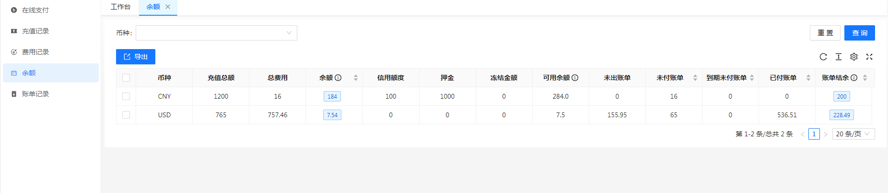

## API授权

在 **OMS ＞设置＞API授权码 **新建API授权码

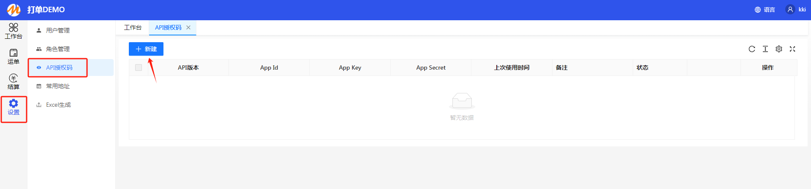

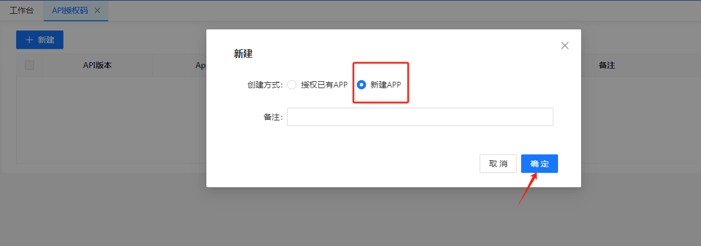

点击查看详情

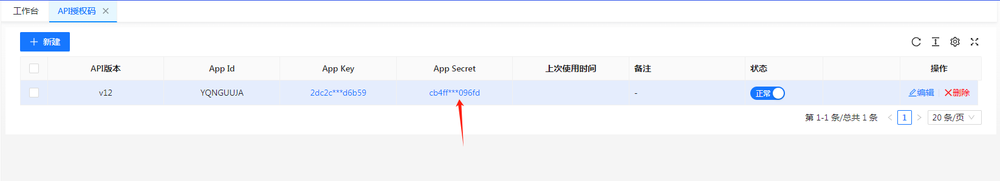

## 平台订单打单

绑定销售平台账号。选择销售平台的账户类型，录入销售平台提供的对接信息进行对接

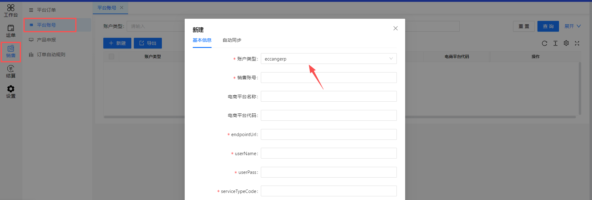

从平台拉单，点击**拉取订单**，选择销售平台账号和时间范围，系统会自动将销售平台订单拉取到系统中

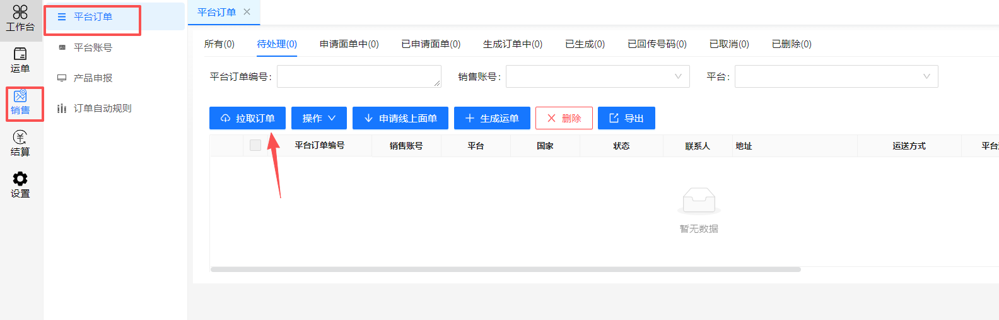

对订单的产品进行申报，录入产品的长宽高重量，申报数据将用于传给服务商打单

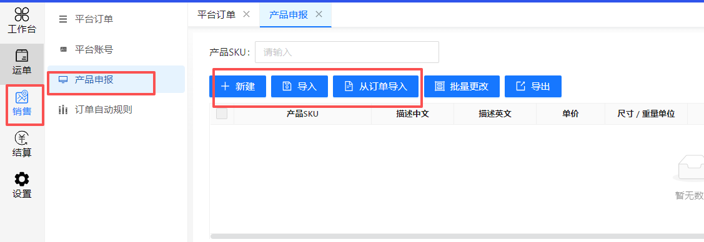

完成申报后，对订单补充申报信息。

可以提前将店铺的所有产品录好申报信息，这样从平台拉单后，系统会自动应用申报信息，无需手动操作补充申报信息

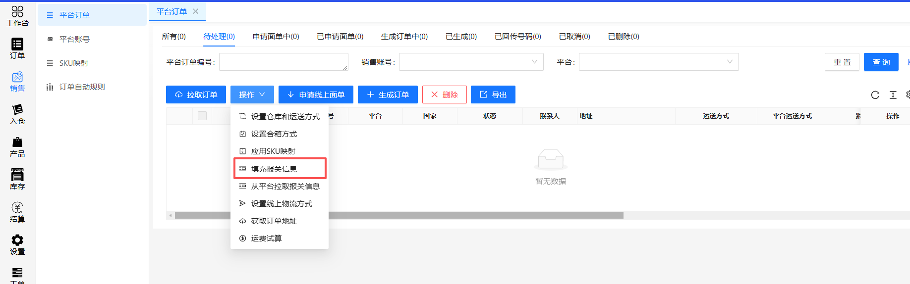

设置仓库和运送方式

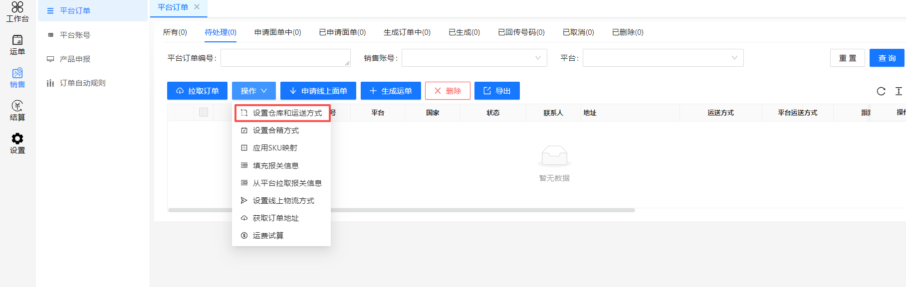

生成运单

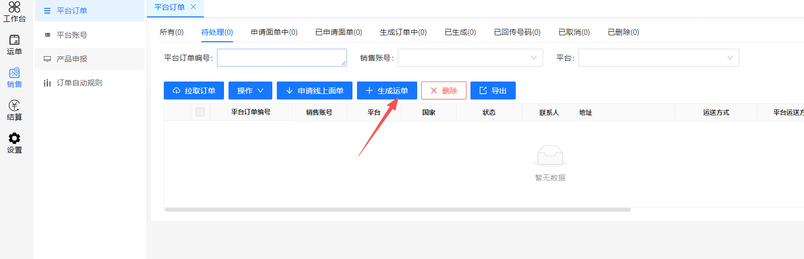

生成运单后即打单成功，在打单列表中可查看并打印标签

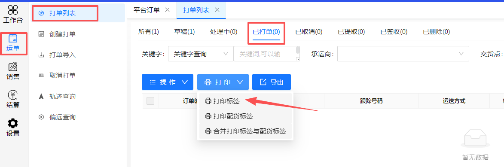

可配置订单自动规则，拉取平台订单后会根据条件自动配置仓库和运送方式

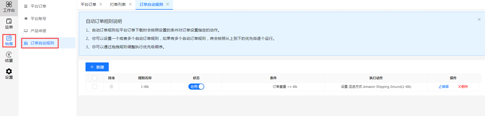

<!-- 源页面：https://help.dmxsmart.com/docs/printer/Introduction -->
