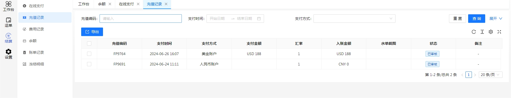
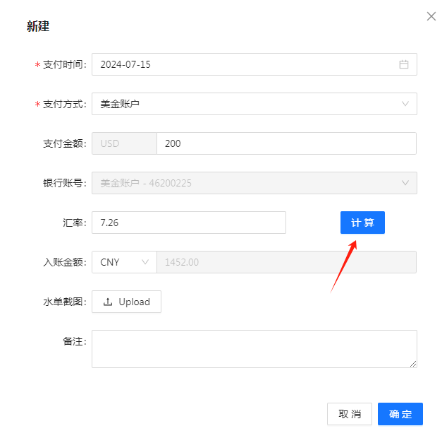
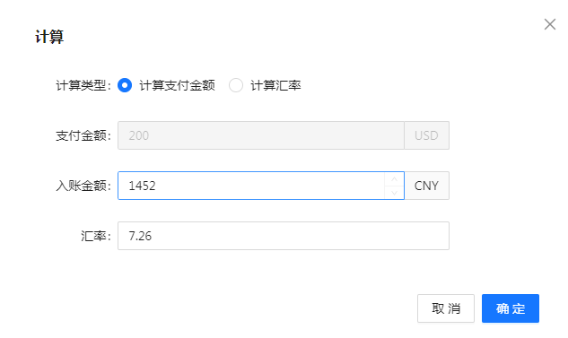
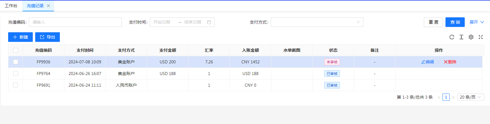
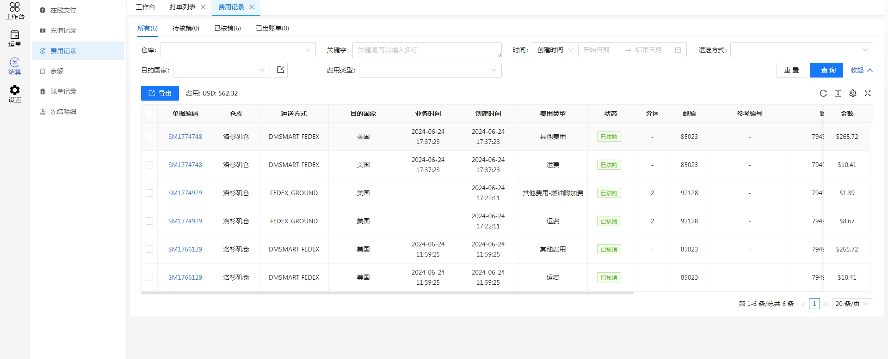
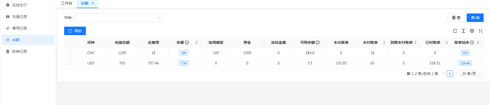
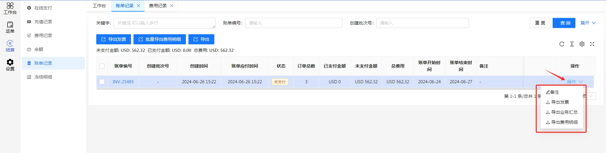

# 结算

## 充值记录

余额充值可在 **OMS ＞结算＞在线支付**中对接微信和企业支付宝账号后进行在线充值。  
在 **OMS ＞结算＞充值记录**中可以查看到在线充值和线下充值记录。线下充值记录创建后由管理端进行审核。

  
点击新建，创建充值记录，系统支持币种转换汇率计算功能。  

  

保存后充值记录需由管理端审核。

## 费用记录

在 **OMS ＞结算 ＞费用记录** 中查看费用详情、费用明细，通过关键字搜索查询每单费用信息，选中单据可一键导出多个单据的费用记录。

## 余额

在 **OMS ＞结算＞余额**中可查看账户余额。

**充值总额**：账号充值的总金额  
**总费用**：业务产生的所有费用总额  
**余额**：余额=充值金额-总费用-押金  
**信用额度**：由管理端对客户设置的信用额度  
**可用余额**：客户还可以使用的金额，可用余额=余额+信用额度-冻结总额  
**未付账单金额**：已创建账单费用还未扣款的金额  
**已付账单金额**：已扣款或已支付费用的账单金额  
**账单结余**：客户充值金额扣除已支付的账单金额后的账户结余。账单结余=充值金额-已付账单-押金

## 账单记录

在 **OMS ＞结算 ＞账单记录** 中查看账单。账单由管理端创建，客户无法对账单费用进行任何编辑、修改等操作，已生成的账单通过操作可以导出发票、账单明细等动作。

<!-- 源页面：https://help.dmxsmart.com/docs/printer/UserSideFunctionDescription/Settlement -->
