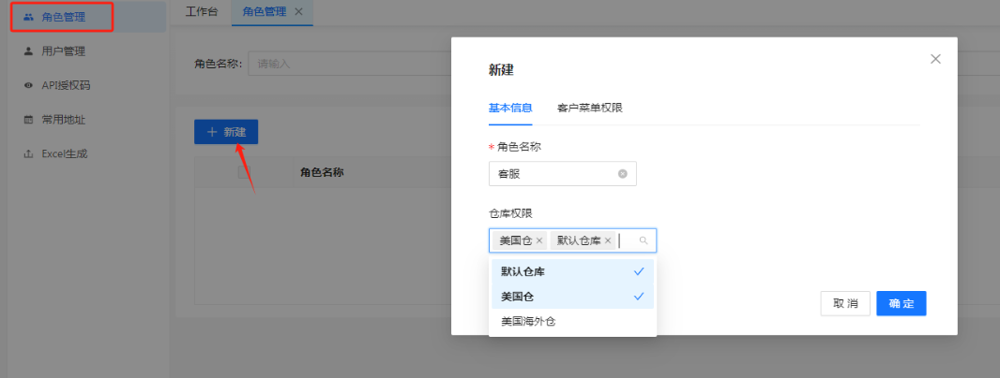
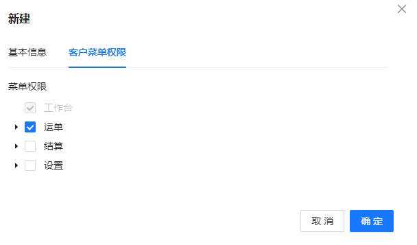
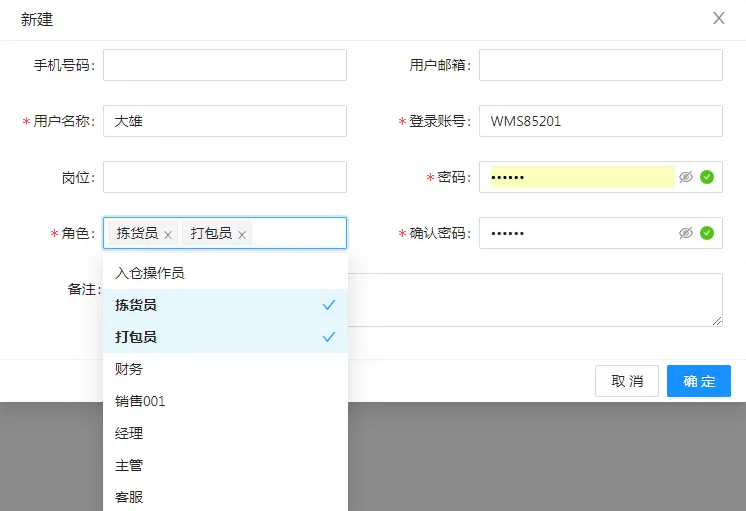
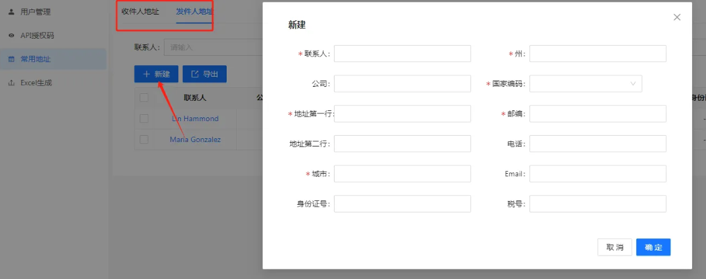
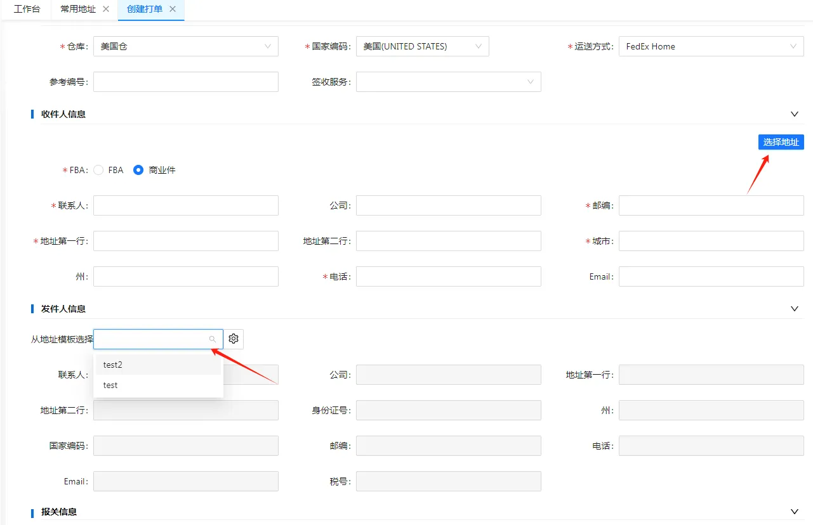

# 系统设置

## 角色管理

在 **OMS ＞设置 ＞角色管理**中新建角色，选择操作仓库，在**菜单权限**中为该角色分配系统的操作权限。

  

## 用户管理

角色权限配置完成后，在**OMS ＞设置 ＞用户管理**中给不同的角色开通登陆账号，点击**新建**，设置登陆账号和密码，选择角色，不同的角色所分配的操作权限不同，也可以为该账号同时添加多个角色。*号为必填项。

## 常用地址

在**OMS ＞设置 ＞常用地址**中编辑常用收件人地址和发货地址。   
点击新建，录入地址详细信息后确定保存，收件人地址和发件人地址创建好后可以在创建打单时选择使用。

  

<!-- 源页面：https://help.dmxsmart.com/docs/printer/UserSideFunctionDescription/SystemSettings -->
