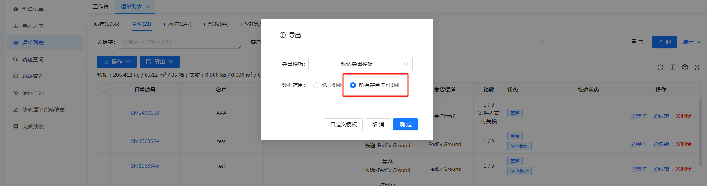
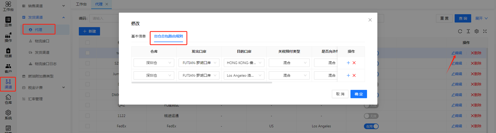
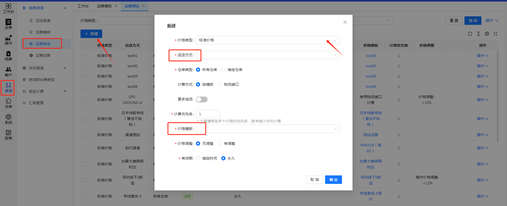
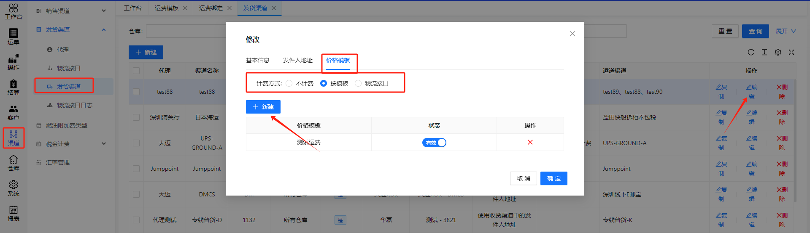
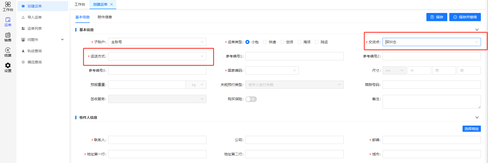
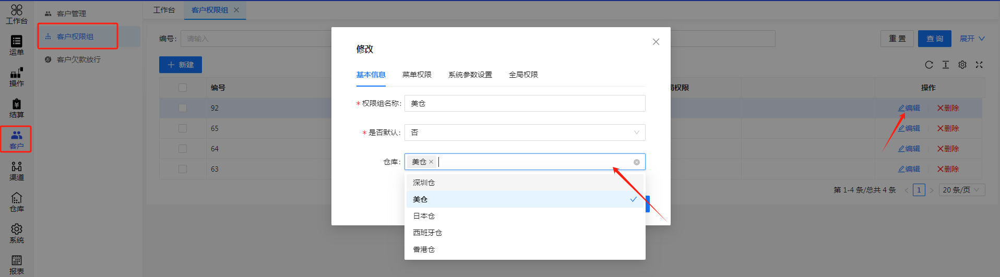
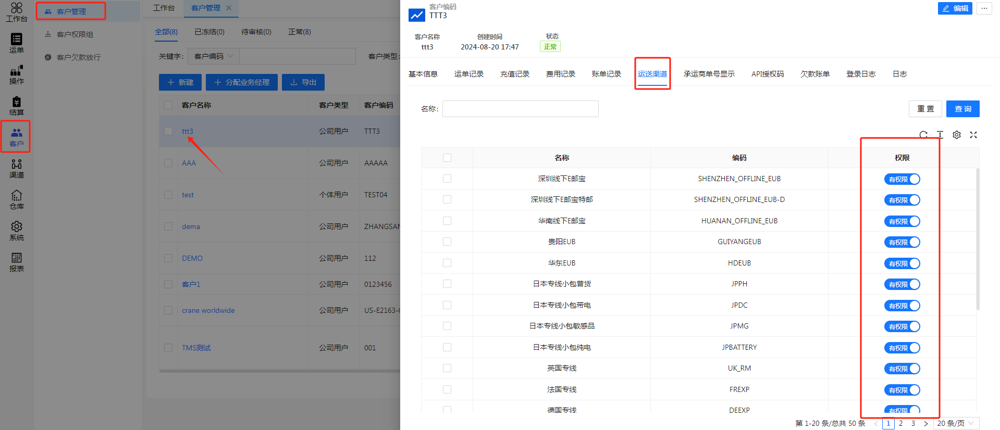
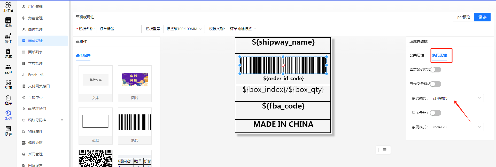
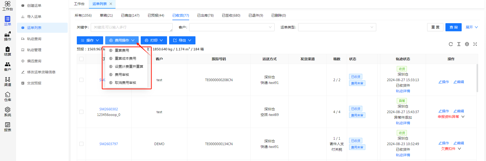

# 常见问题

### 如何一键导出相关信息

下载或导出信息时，全选并不能一次导出所有信息，应在导出界面数据范围中选择 **所有符合条件的数据**

### 提交出仓时提示代理未设置出仓路由

需在 **渠道-发货渠道-代理** 中给代理添加出仓总包路由规则

### 怎么设置渠道费用

无论是成本费用还是卖价，在系统中均在 **渠道-销售渠道-运费模板** 中创建，创建的运费模板并不会直接生效，需要将其绑定给客户或者成本渠道才会生效。

#### 设置对外渠道价格

在 **渠道-销售渠道-运费绑定** 中设置对外渠道价格

#### 设置成本价格

在 **渠道-发货渠道-发货渠道** 中，选择发货渠道在价格模板中绑定计费方式，可以选择运费模板作为成本计算，也可选择使用物流接口计费

### 客户下单时无法选择某个仓库或渠道

客户下单时无法选择某个仓库或渠道

  
在 **客户-客户权限组** 查看客户是否有该仓库权限  

  
在 **客户-客户管理** 点击客户名称，查看客户是否有该渠道的权限  

### 设计的面单打印出来时没有条码

查看面单 点击条码，在条码属性中需选择条码编码

### 设置了新的价格，怎样对已经产生费用的运单更新费用

在 **运单-运单列表** 中可对已收货的运单进行费用操作

<!-- 源页面：https://help.dmxsmart.com/docs/tms/CommonProblem -->
