# 税金设置

【**功能概述**】针对发往日本需要收取税金的产品，可在系统设置税金方案

## 汇率管理

【**功能入口**】（**渠道**—**汇率管理**）  
点击分类维护创建汇率方案名称

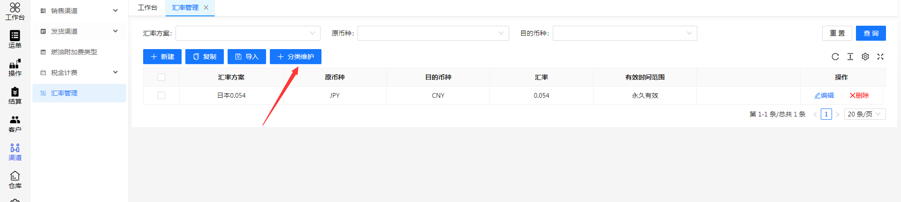

  

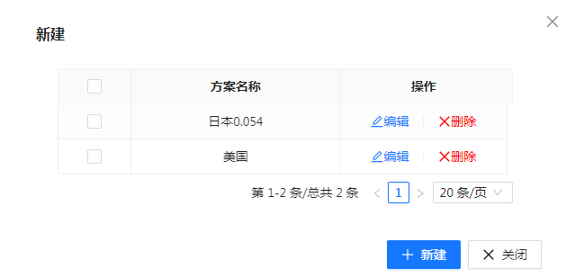

  
点击新建创建汇率方案  

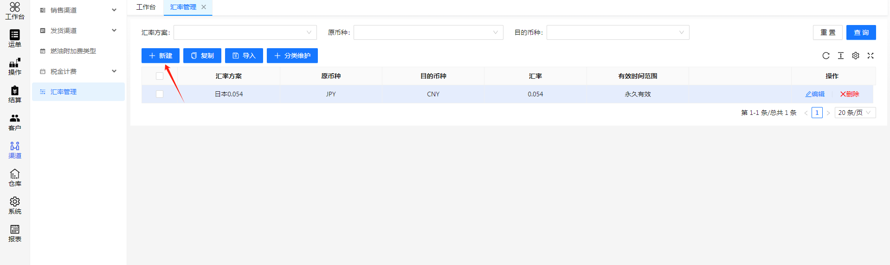

  
输入币种和汇率，选择有效时间  

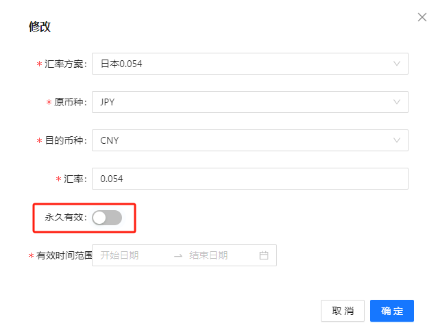

  
确定保存后可在列表对其进行编辑和删除  

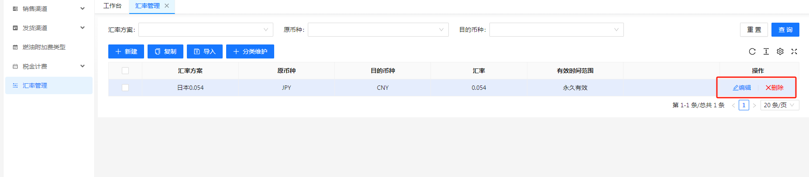

## 税金计费

【**功能入口**】（**渠道**—**税金计费**—**税金方案**）  
点击新建创建税金方案，在基本信息中输入方案名称，选择结算币种和创建好的汇率方案等

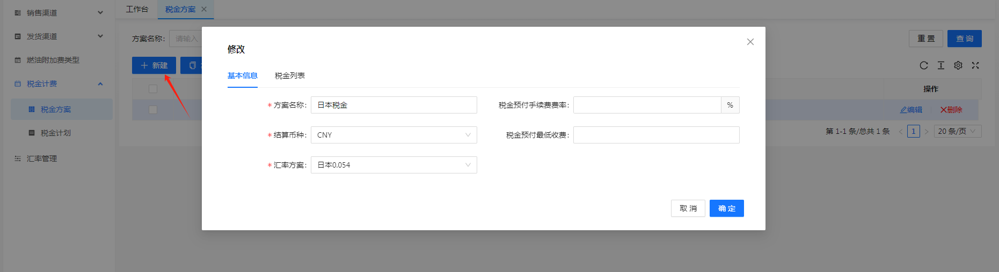

  
在税金列表处添加税率  

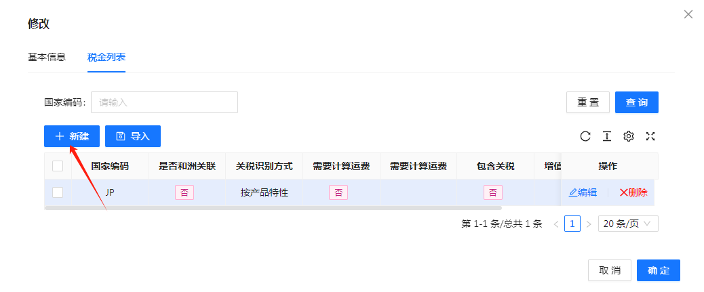

  
在基本信息中选择需要计算的税率  

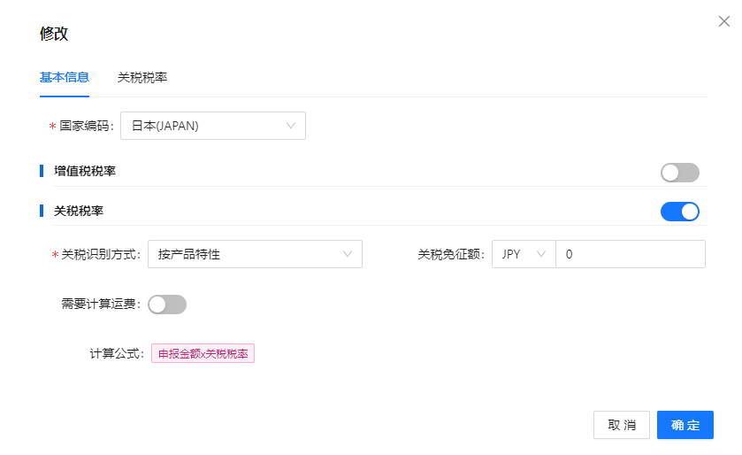

  
在关税税率处添加税率，设置完毕后点击确定保存  

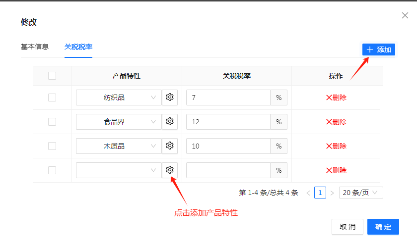

  
设定好的税金方案将展示在列表，可点击对其编辑和删除  

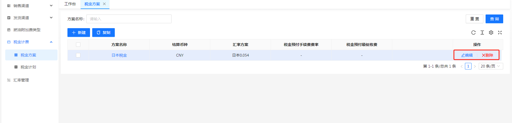

## 税金计划

【**功能入口**】（**渠道**—**税金计费**—**税金计划**）  
为税金方案绑定价格，也可根据不同的客户设置不同的税金方案。  
点击新建税金计划

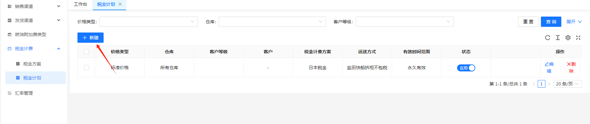

  
选择仓库、运送方式和税金方案  

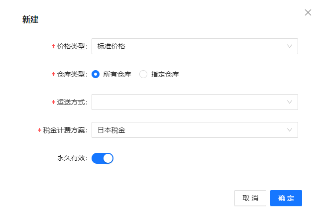

  
选择价格类型为客户特殊价格，可为不同客户设置不同税金计费  

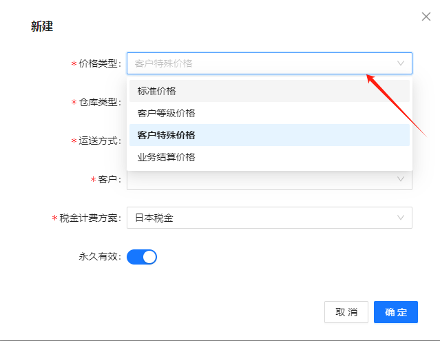

  
可在列表中查看到已保存的税金计划，点击对其进行编辑和删除  

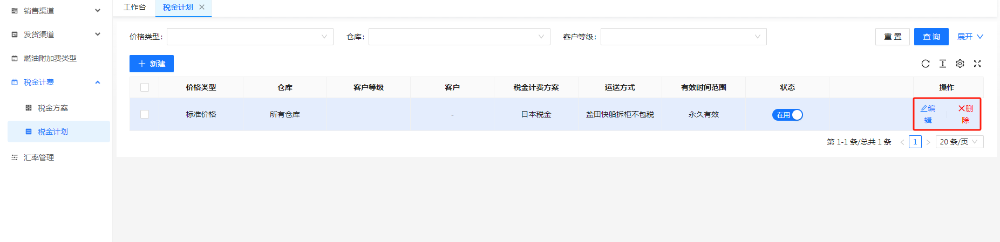

<!-- 源页面：https://help.dmxsmart.com/docs/tms/FunctionTerminal/BasicDataSettings/Costsetting/TaxSetting -->
