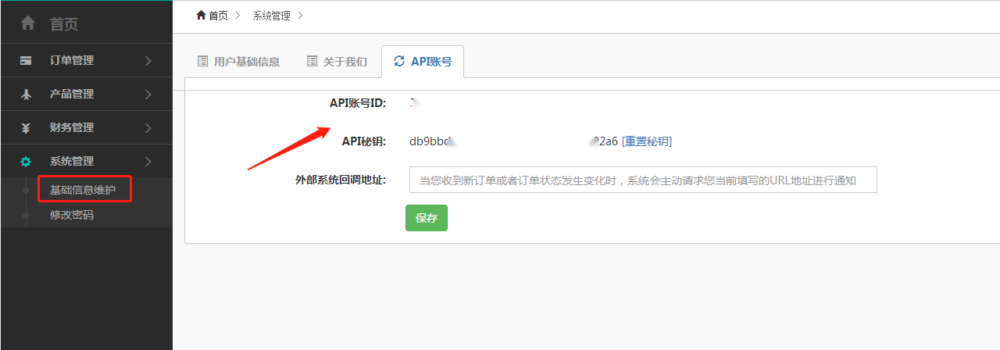
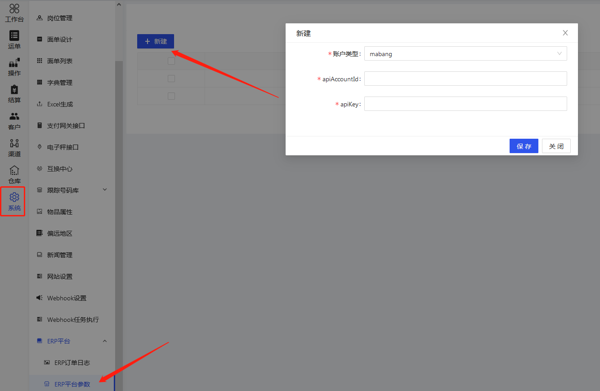
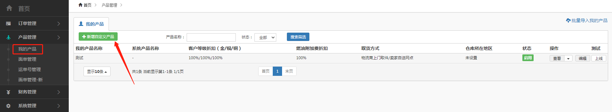
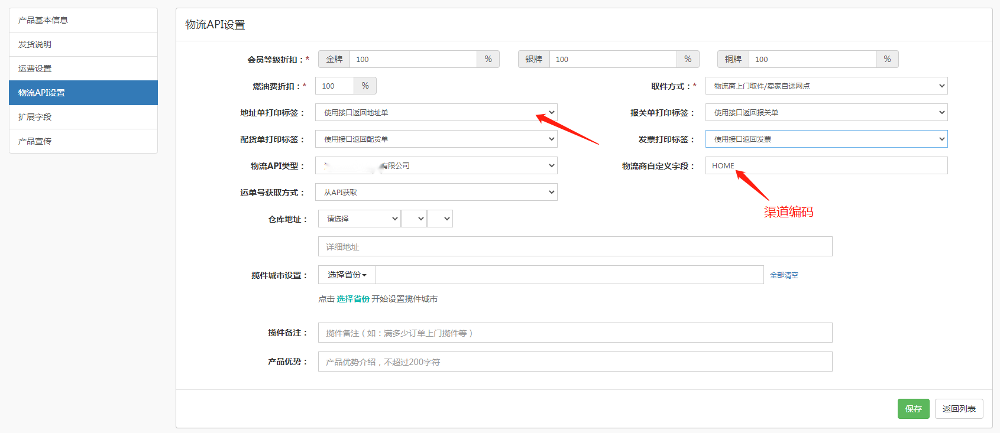
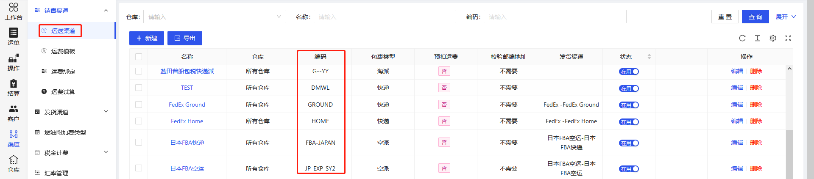
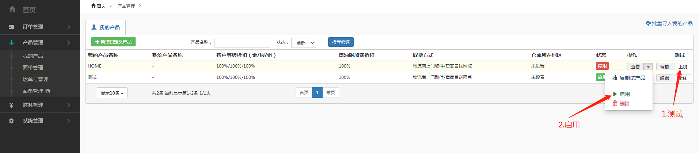

# 马帮ERP

注册马帮镖局账号，注册地址链接：[镖局物流-跨境物流开放平台](https://www.i8956.com/)  
账号注册后需要联系马帮开通物流API权限，权限费用租户自己支付，可联系马帮客服付费开通.  
登陆镖局账号，【系统管理】-【基础信息维护】-【API账号】

将镖局 API账号ID 和 API秘钥 复制到系统 apiAccountId 、 apiKey 处  

在镖局创建产品（运送渠道）  
【产品管理】-【我的产品】-【新增自定义产品】  

根据渠道要求填写产品基本信息、发货说明、运费设置等  
物流API类型选择马帮开通的API权限，地址标签、运单号、发票等选择使用接口返回  
注意：**物流商自定义字段**必须输入系统对应的**运送渠道编码**  

  
保存后还需要对产品上线测试，只有测试通过的产品才可以启用  

产品启用后，客户在马帮ERP搜索物流商名称进行授权，选择镖局启用的产品下单发货.

<!-- 源页面：https://help.dmxsmart.com/docs/tms/FunctionTerminal/BasicDataSettings/ERPAccount/MaBangERP -->
