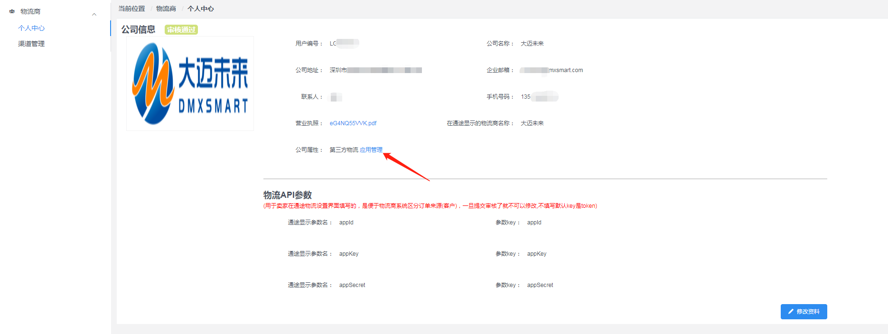
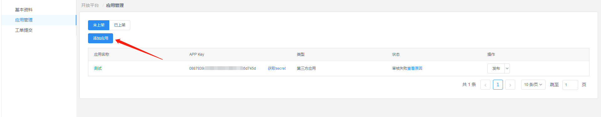
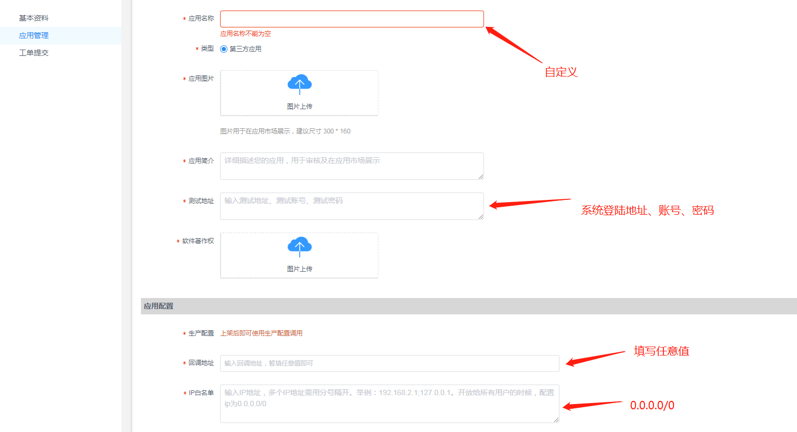
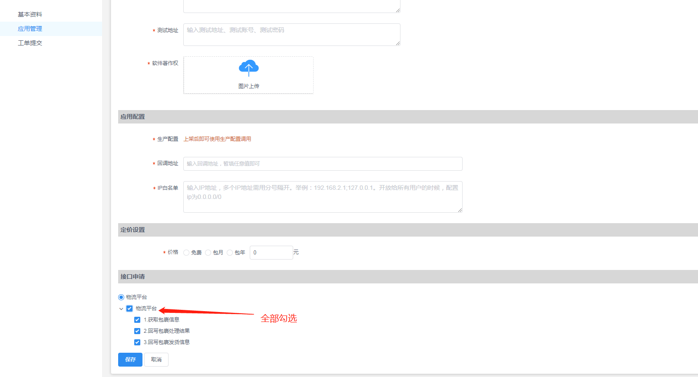
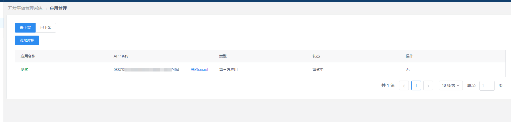
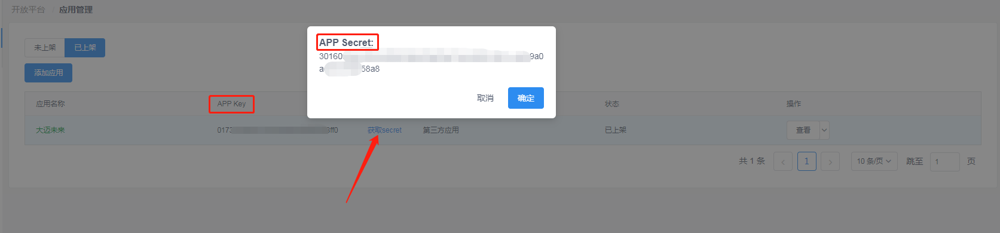
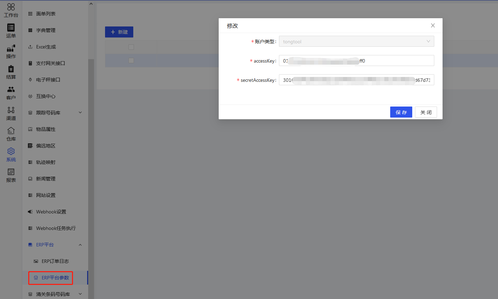
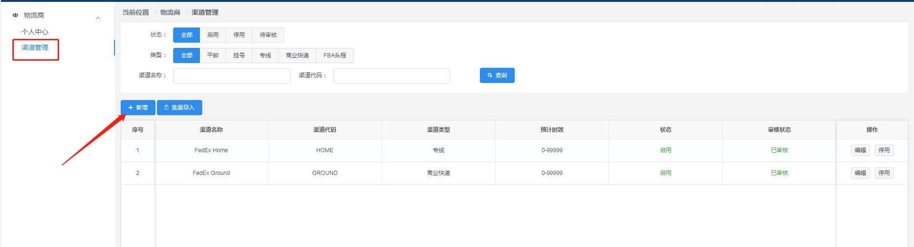
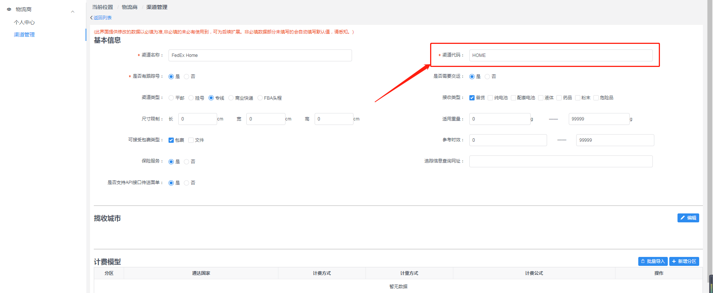
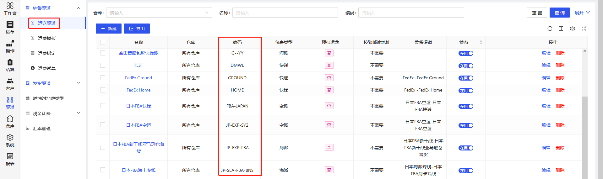

# 通途ERP

入驻通途物流平台  
账号注册以及公司资料审核流程参考下方链接：  
[通途,eBay订单管理,亚马逊订单管理,速卖通订单管理软件系统专家](https://help.tongtool.com/service.html?id=667&page=1&groupId=348)  
账号审核通过后点击应用管理，添加应用

**应用名称**、**应用图片 **自定义，可直接输入公司名称以及上传公司Logo  
**应用简介** 可描述 物流接口调用、获取以及回写相关包裹数据   
**测试地址** 输入系统登陆地址、账号、密码  
**软件著作权 **随意上传一张图片  
**回调地址** 填任意值  
**IP白名单录入 **0.0.0.0/0  
**接口申请** 全部勾选  

保存并发布应用，应用状态审核中  

审核时间一般一个工作日左右，如需加快审核可直接联系通途在线客服处理审核  
审核通过后应用上架，复制 APP Key 和 APP Secret.  

登陆系统，在【系统】-【ERP平台】-【ERP平台参数】点击新建，账户类型选择 **TongTool **   
将 APP Key 复制到 accessKey ，APP Secret复制到 secretAccessKey 后保存.  

返回通途物流平台选择渠道管理新建渠道  

根据渠道要求录入渠道基本信息  
注意：通途**渠道代码**必须和系统**运送渠道编码**一致  
如需回传面单给客户则在是否支持API接口传送面单处选择是  
右下角保存启用渠道  

客户在通途ERP授权物流商后方可使用创建的渠道进行下单发货.

<!-- 源页面：https://help.dmxsmart.com/docs/tms/FunctionTerminal/BasicDataSettings/ERPAccount/TongtuERP -->
