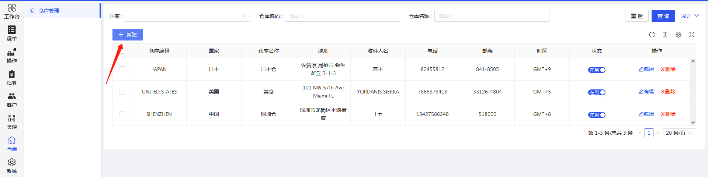
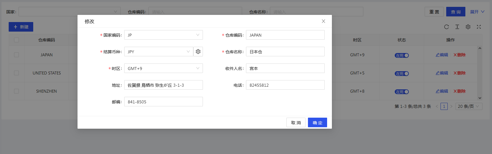
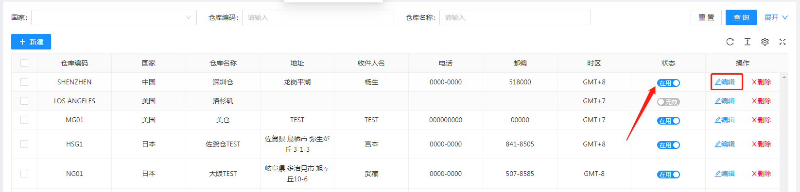

# 1.创建仓库

【**功能概述】**仓库初始化设置，在系统创建仓库的基本信息，包括仓库编码、名称、仓库所在国家以及仓库地址等信息。  
【**功能入口**】（**仓库**—**仓库管理**—**新建**）

仓库编码可由字母和数字组成，选择仓库所在国家时区，录入地址等信息后**确定**保存。**“*”**号为必填项

保存的仓库信息将展示在列表中，可以对仓库状态进行更改以及修改仓库信息。

<!-- 源页面：https://help.dmxsmart.com/docs/tms/FunctionTerminal/BasicDataSettings/NewWarehouse -->
