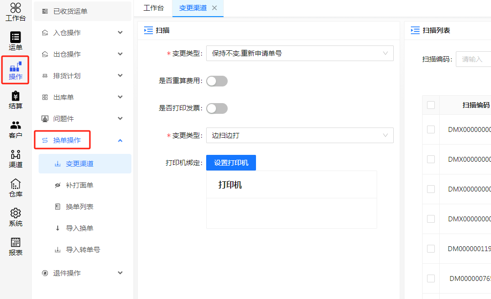
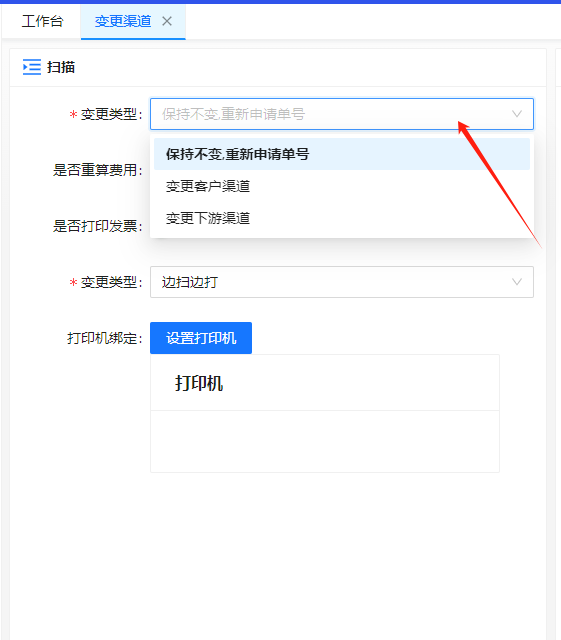
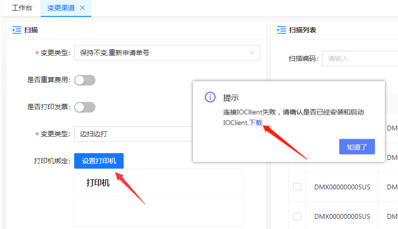

# 换单操作

【功能概述】对入仓的运单变更客户渠道和代理渠道，补打面单以及转单号的批量导入。

## 变更渠道

【功能入口】（操作—换单操作—变更渠道）

仓库收货后通过扫描面单上的快递单号，对货物的客户渠道或者代理渠道进行变更，并且打印新面单的操作。

**保持不变，重新申请单号**一般用于客户单号过期需要原渠道申请新快递单号的操作

**变更客户渠道**，对客户的原发货渠道进行变更

**变更下游渠道**，对出货渠道也就是代理渠道进行变更

通过安装系统插件连接打印机

<!-- 源页面：https://help.dmxsmart.com/docs/tms/FunctionTerminal/ChangeOrderOperation -->
