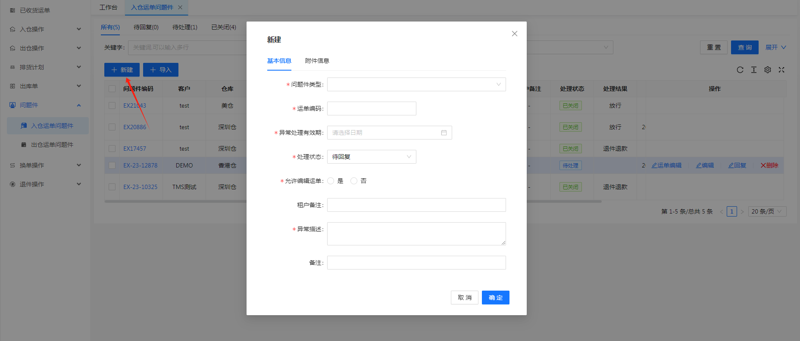
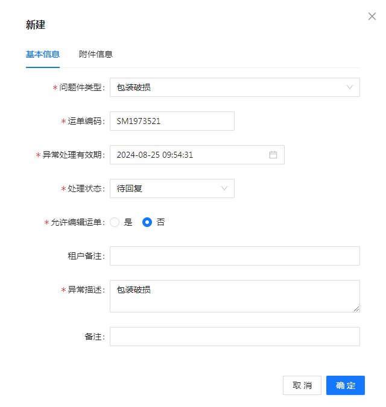
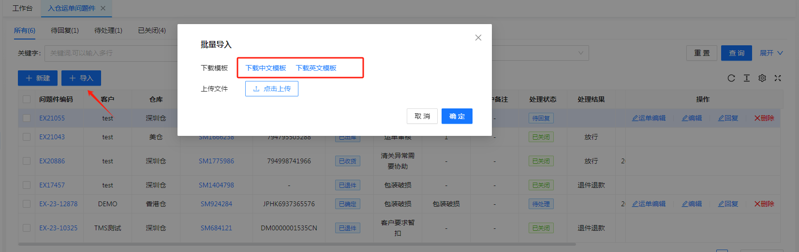
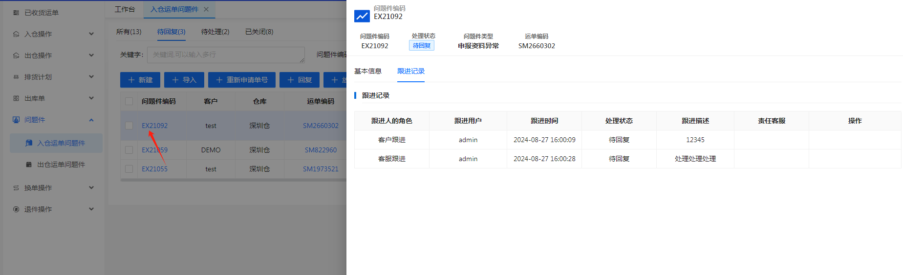
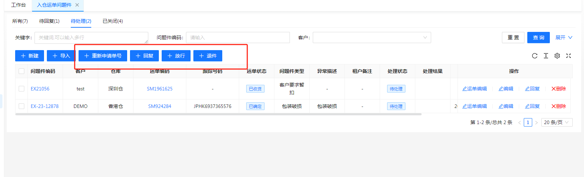
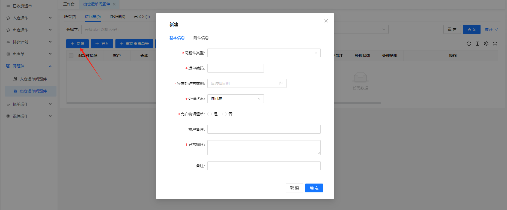
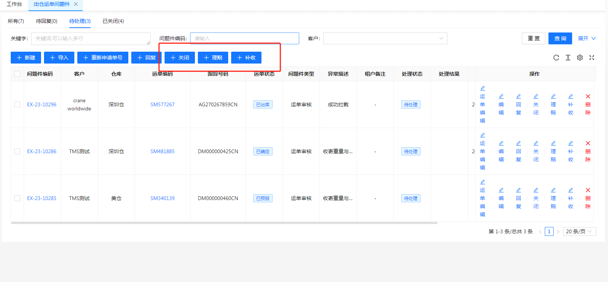

# 问题件处理

【功能概述】异常运单处理，当货物入/出仓后出现异常需要协助或要求暂扣等问题时，在问题件创建运单信息做异常运单以便跟进

## 入仓运单问题件

【功能入口】（操作—问题件—入仓运单问题件）  
点击新建

  
在信息栏中录入问题件信息和异常描述，点击确定保存  

  
也可点击导入下载模板上传问题件  

  
点击问题件编码可查看问题件历史跟进记录和内容  

  
对问题件进行相应处理。  
入仓问题件不允许出仓，点击放行允许运单出仓，问题件状态转为已关闭。  

  
预付客户可用余额不足时，运单入仓时将自动以欠费扣件列入问题件，需手动放行出仓。

## 出仓运单问题件

【功能入口】（操作—问题件—出仓运单问题件）  
点击新建问题件

  
对问题件做相应处理  

<!-- 源页面：https://help.dmxsmart.com/docs/tms/FunctionTerminal/ProblemHandling -->
