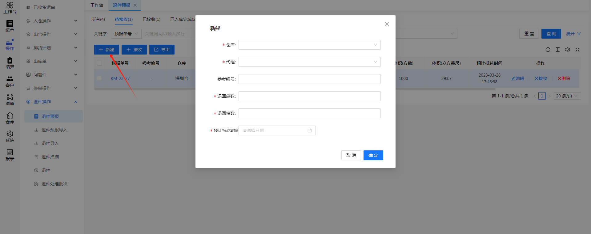
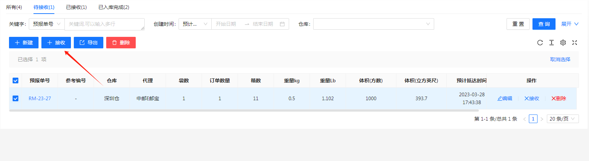
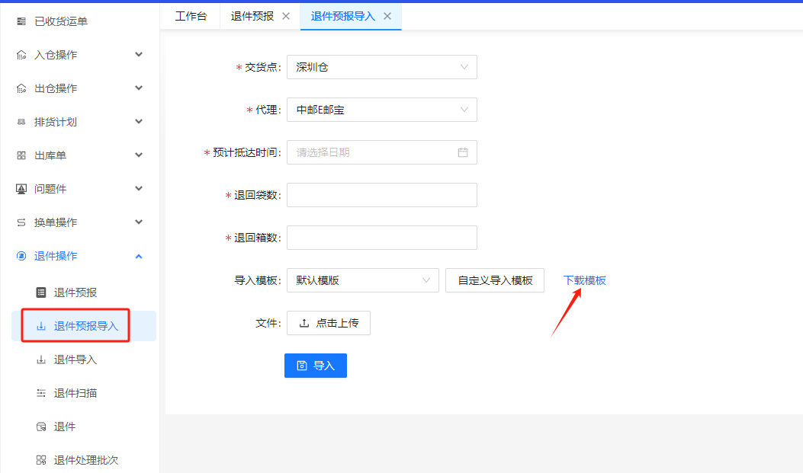
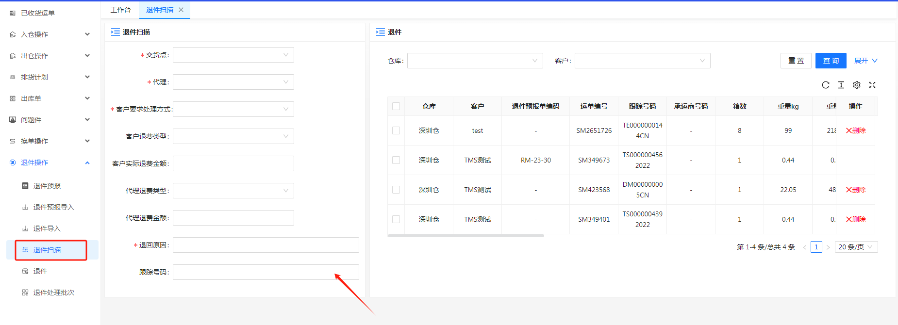
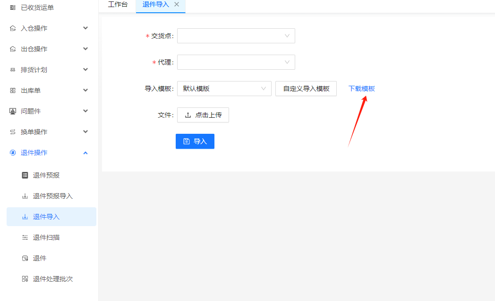
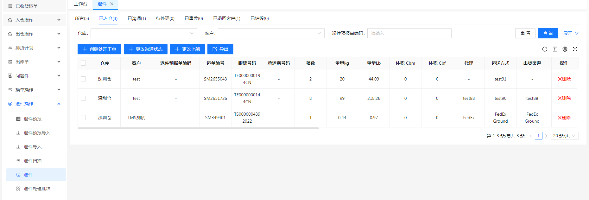

# 退件操作

## 退件预报

点击新建创建代理退件预报

  
选中接收和入仓  

  
也可下载模板导入退件预报  

## 退件

使用退件扫描录入退件跟踪号码，对运单操作退件

  
也可下载模板一键导入退件  

  
在退件中查看退件记录并处理退件  

<!-- 源页面：https://help.dmxsmart.com/docs/tms/FunctionTerminal/ReturnOperation -->
