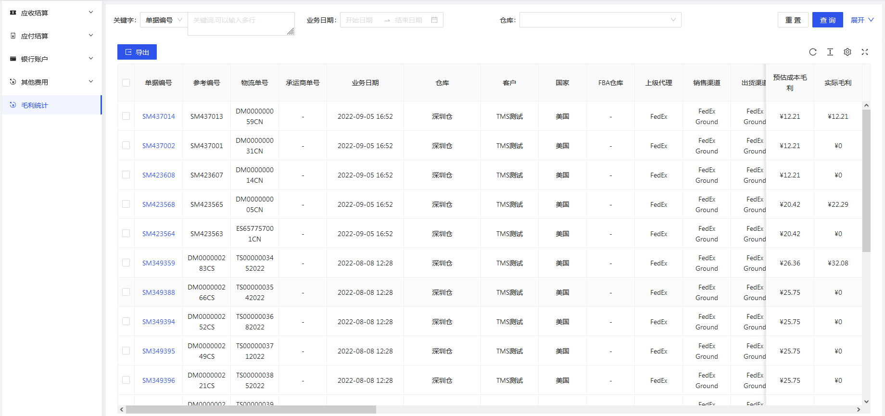
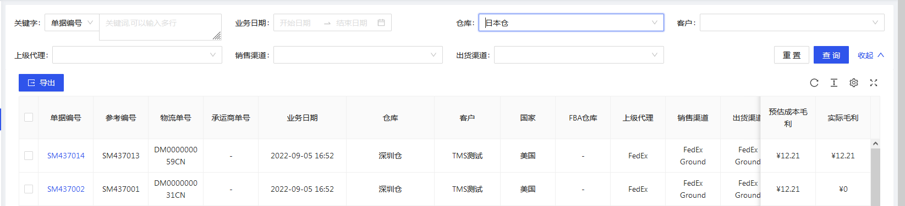

# 毛利统计

【**功能概述**】公司业务毛利统计，通过系统核算的每笔费用记录都会生成相应的毛利统计，在绑定了仓库成本价和渠道成本价后，系统对每条费用生成相应的**客户费用**、**预估成本**、**预估成本毛利**，当我们对费用进行对账后，系统会根据对账信息，核算每票的**实际毛利**。

通过上方的搜索可以查询出每票业务的毛利情况  

毛利自动统计功能，既降低了人工统计的出错概率，又能帮助公司管理层根据每票业务的毛利情况及时做出相应调整，提升公司决策效率。

<!-- 源页面：https://help.dmxsmart.com/docs/tms/FunctionTerminal/Settlement/GrossProfitStatistics -->
