# PDA操作

## 操作说明

下载我司提供的安装包文件安装到PDA，app样式如图

app权限需在tms系统管理端中的 **系统-角色管理** 中设定开启，并在用户管理中将角色分配给用户，使用系统账号登录app

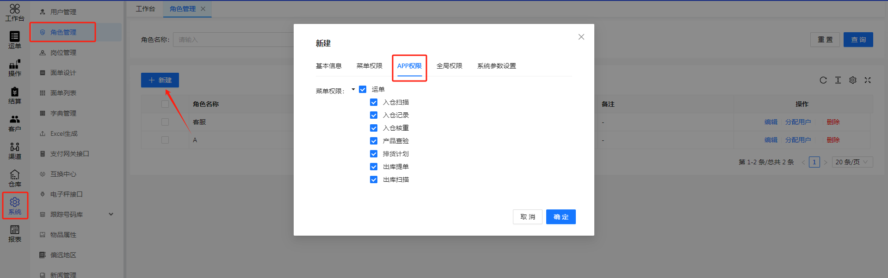

  

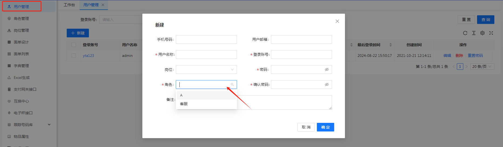

  

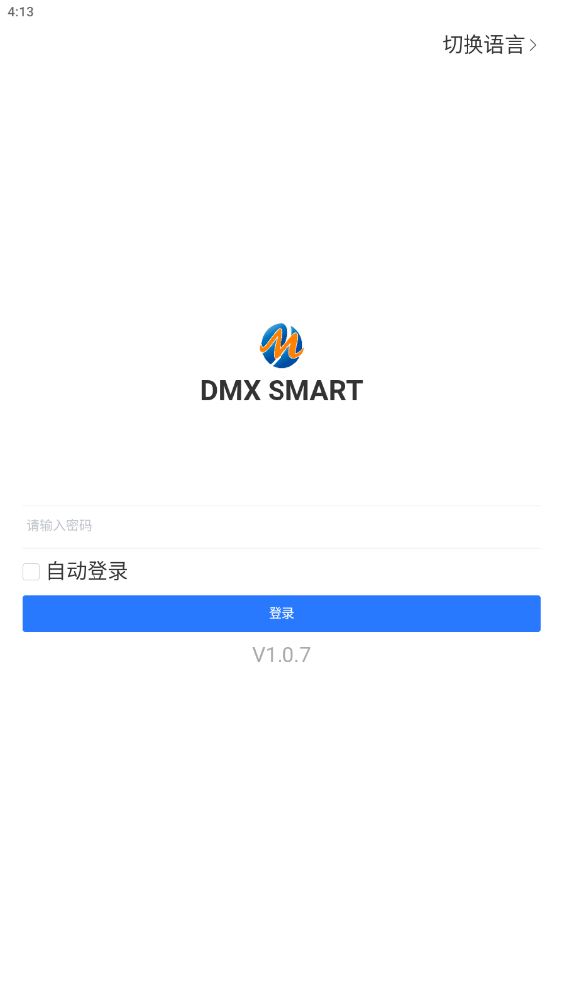

  
点击可切换语言  

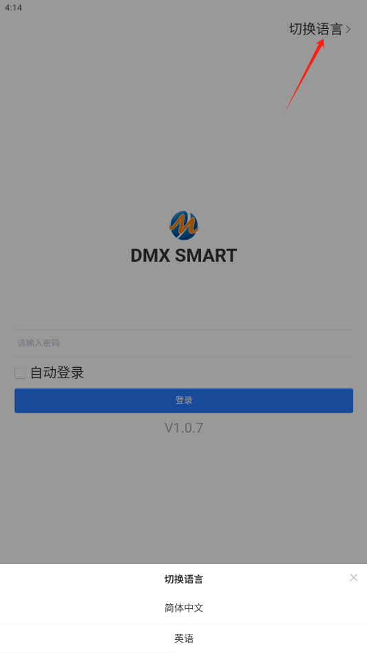

根据角色管理中设定的权限显示登录后的app界面

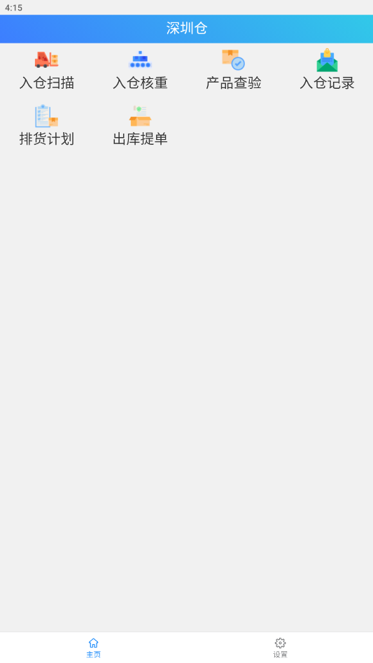

  
在设置中可更改密码和更换仓库操作  

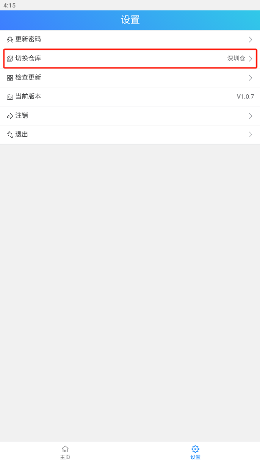

## 入仓扫描

客户货物发往仓库前需先创建运单并确定，打印运单标签贴在外包装箱上。货箱到库后仓库人员持PDA设备接收。  
使用入仓扫描扫描货箱条码，确认实收无误后点击保存即完成入仓。

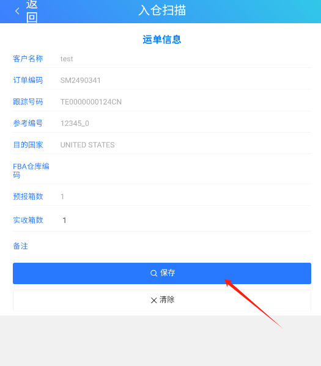

## 入仓核重

已经入仓的货物使用入仓核重录入货件实际体积、重量，点击保存确定

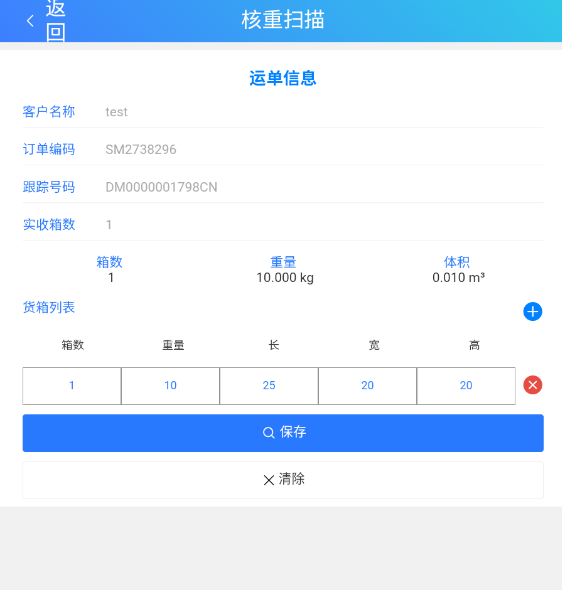

## 产品查验

使用产品查验对入仓货件拍照查验

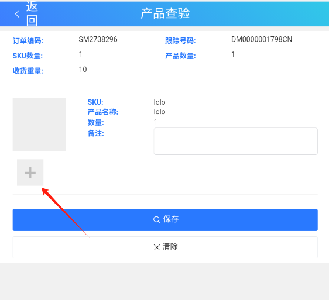

## 入仓记录

查看入仓记录，可对入仓货件进行核重、查验和取消入仓

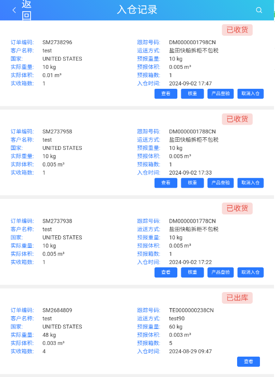

## 排货计划

完成审单、查验和核重的海派运单，在系统上创建排货计划对运单排柜出库

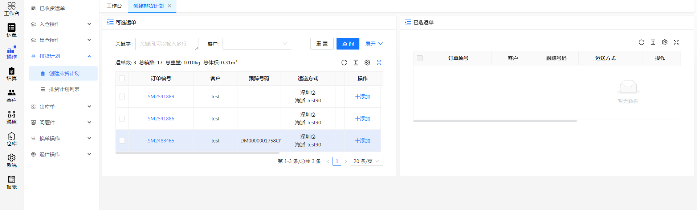

  
使用出库操作扫描该排货计划下的货箱条码，系统会自动创建出库单与之关联，运单转至已出库状态  

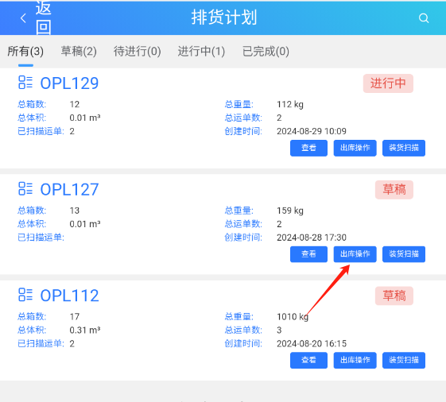

  
在系统-操作-出库单-出库单记录中可查看出库单并对其更新状态

## 出库提单

在系统创建的出库单可在出库提单中查看，点击对出库单操作装货、出库

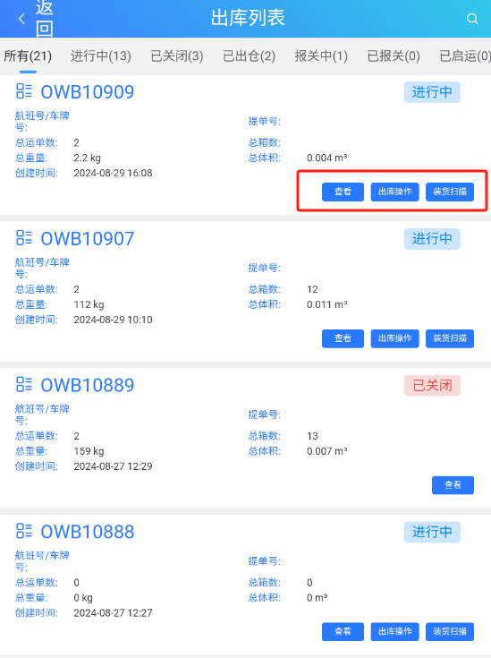

<!-- 源页面：https://help.dmxsmart.com/docs/tms/PDAOperation -->
