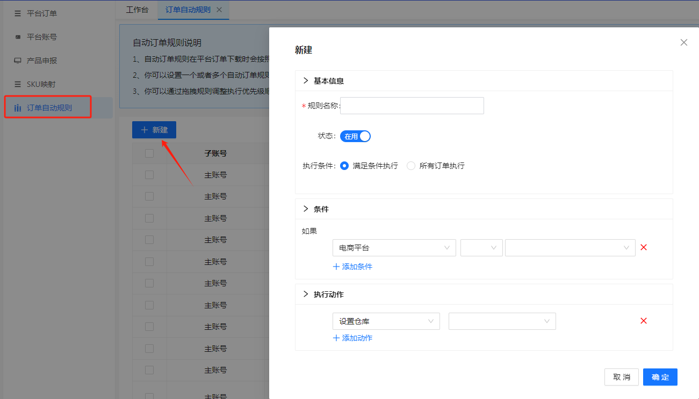
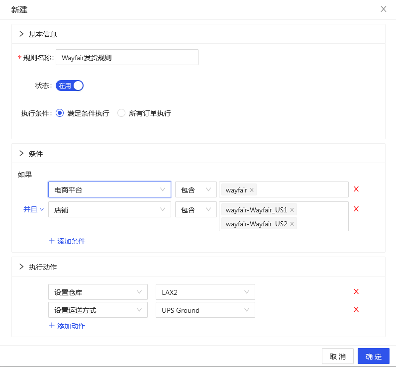
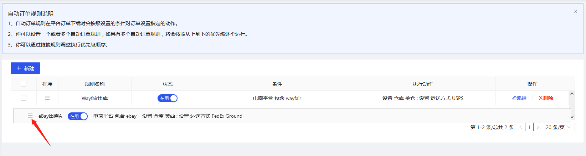

# 订单自动规则

【**功能概述**】订单发货规则设置，平台订单下载时给符合条件的订单自动分配发货仓、运送方式来提交出库，不用每个订单手动提交出库。

  
**规则名称**自定义  
**执行条件**选择所有同步的订单执行发货规格还是只有满足条件的订单执行发货规则  
设置规则条件以及需要执行的动作  

可以同时创建多个订单规则，系统将会按照从上到下的优先级逐个运行，通过拖拽规则排序调整优先级顺序。  

<!-- 源页面：https://help.dmxsmart.com/docs/tms/UserSideFunctionDescription/Sale/OrderAutomationRules -->
