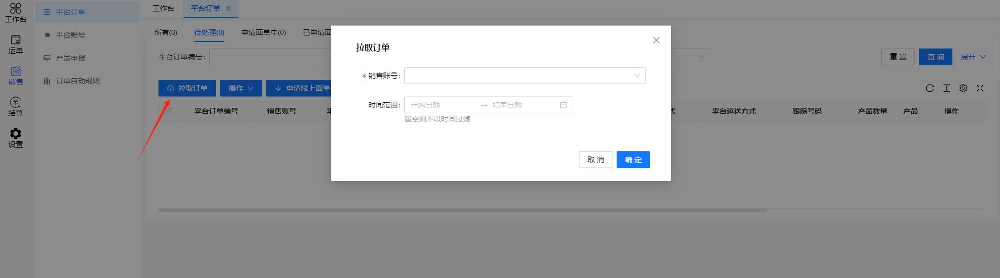
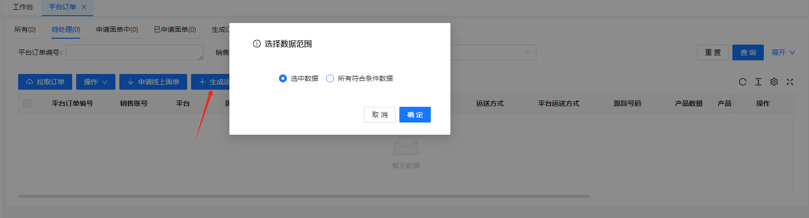
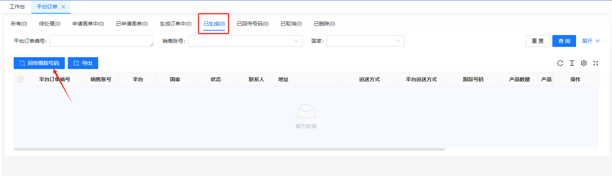
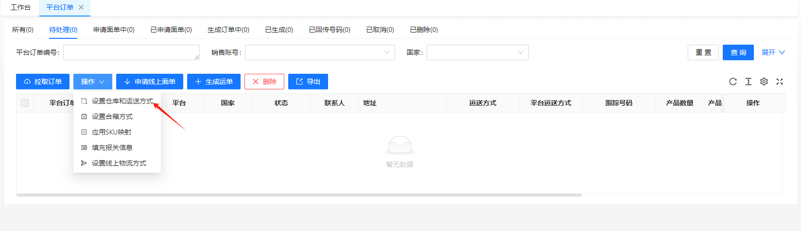

# 平台订单

【**功能概述**】系统绑定销售平台账号后，可以通过手动拉取订单的方式将销售平台订单同步到系统中来  
点击**拉取订单**，选择销售平台账号，系统会将销售平台订单拉取到系统中

  
订单拉取成功后，选择订单，点击**生成运单**来生成发货渠道的跟踪号码  

  
生成跟踪号的订单会转入**已生成订单**栏，选中订单点击**回传跟踪号码**，订单跟踪号会同步到销售平台中  

  
在待处理列表中，我们还可以通过操作来选择货物的发货仓库和运送方式  

  
SKU映射和报关信息填充都可以通过操作来设置提前录好的产品报关信息以及SKU映射关系。

<!-- 源页面：https://help.dmxsmart.com/docs/tms/UserSideFunctionDescription/Sale/PlatformOrders -->
