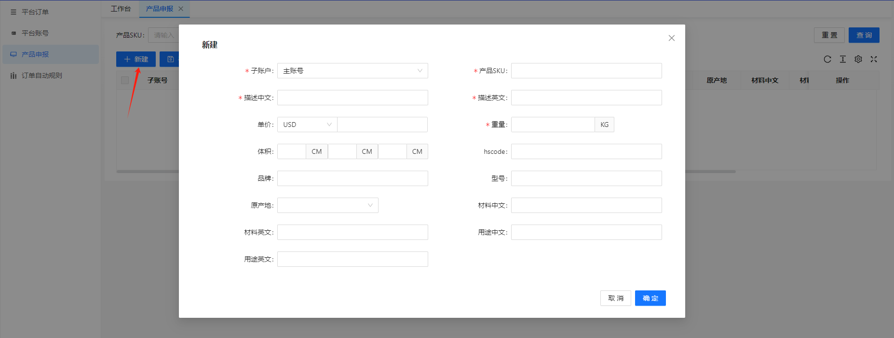
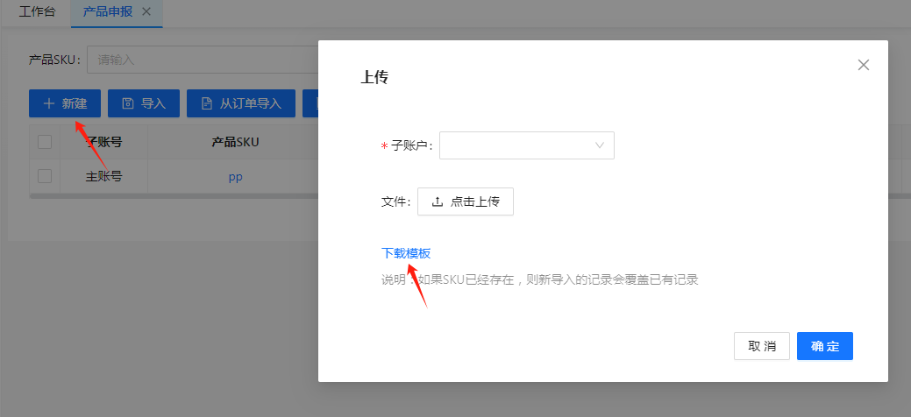

# 产品申报

【**功能概述**】需要录入产品申报信息的运单，可以提前将产品的申报信息录入到系统中，在订单提交时选择填充到报关信息中  
点击新建，录入申报信息后确定保存

  
通过批量导入的方式导入产品申报信息，点击导入，下载导入模板  

  
在模板中录入产品申报的各项信息后点击上传。

<!-- 源页面：https://help.dmxsmart.com/docs/tms/UserSideFunctionDescription/Sale/ProductDeclaration -->
