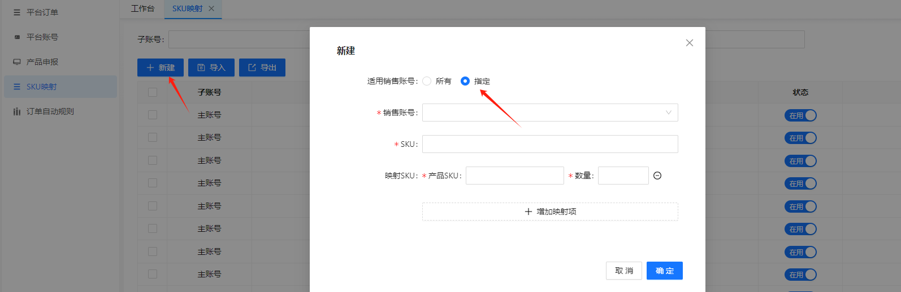
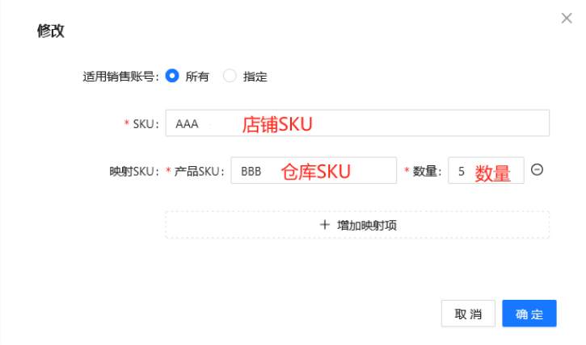
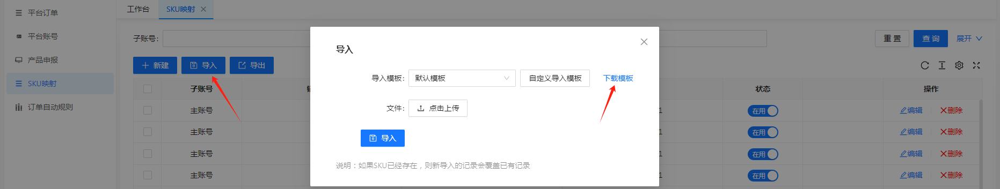

# SKU映射

【**功能概述**】同一产品在销售平台Listing的SKU和仓库发货的SKU不同时，可以通过SKU映射来进行产品的匹配  
点击新建，选择销售平台账号

  
录入销售平台Listing的SKU和映射仓库发货的SKU确定保存，点击增加映射项可对组合产品实现多映射  

SKU映射创建后，销售平台同步到系统的订单SKU会自动和仓库SKU进行匹配  
也可以通过批量导入的方式来进行SKU映射的创建

<!-- 源页面：https://help.dmxsmart.com/docs/tms/UserSideFunctionDescription/Sale/SKUMapping -->
