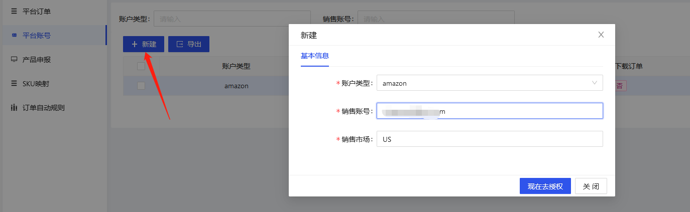
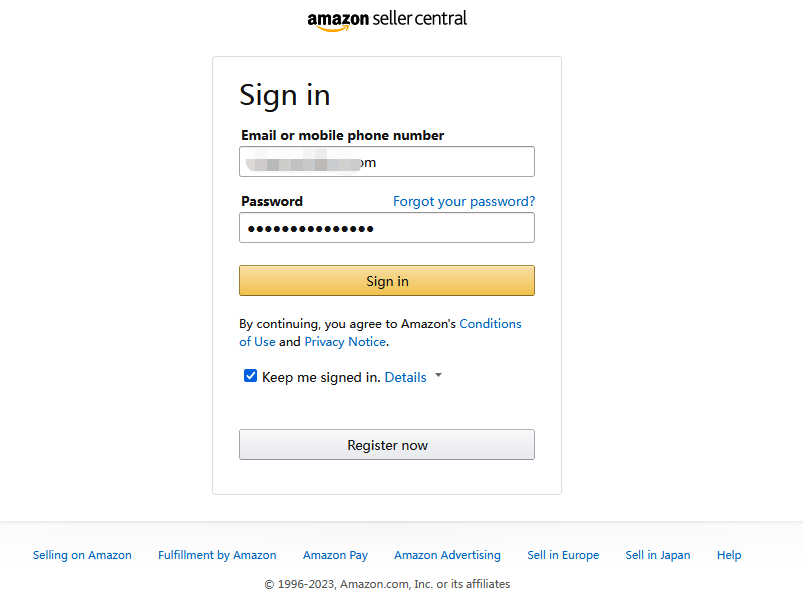
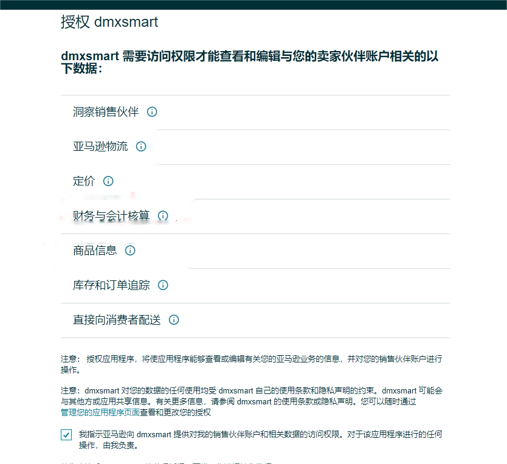
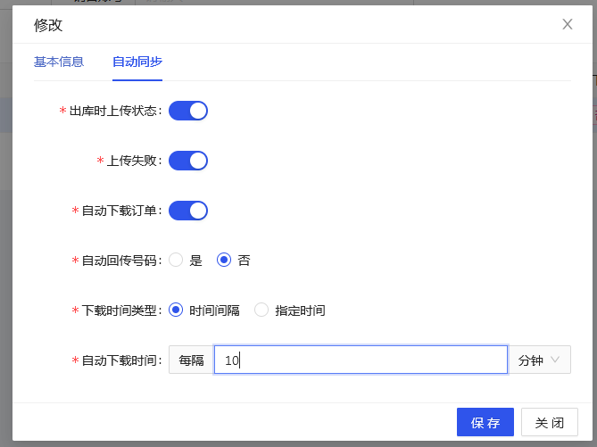
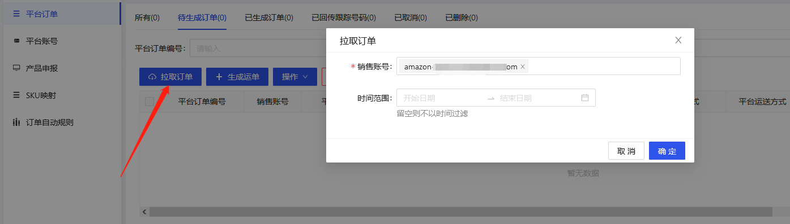

# Amazon

**销售---平台账号---新建**

**账户类型**：Amazon  
**销售账号**：自定义  
**销售市场：**根据账号销售站点进行录入，不同站点国家录入不同，例如美国站则录入US，其它站点参考以下录入** US、UK、Canada、Spain、France、Germany、Italy、Mexico、Brazil、Netherlands、Sweden、Poland、Egypt、Turkey、SaudiArabia、UAE、India、Singapore、Australia、Japa**   
点击授权后系统会自动跳转至Amazon登陆界面  

账号登陆成功后授权应用程序  

授权后返回系统设置订单自动同步或者手动拉取Amazon待发货订单  

  

<!-- 源页面：https://help.dmxsmart.com/docs/tms/UserSideFunctionDescription/Sale/SalesPlatformIntegration/Amazon -->
