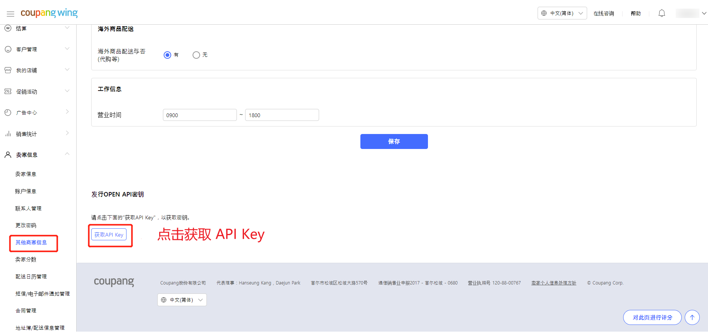
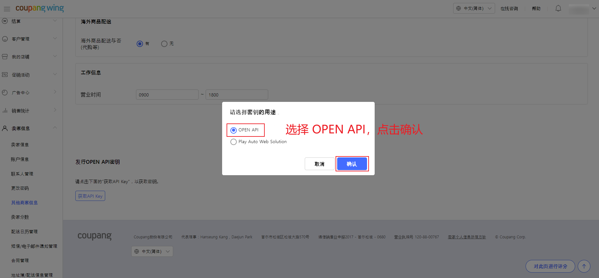
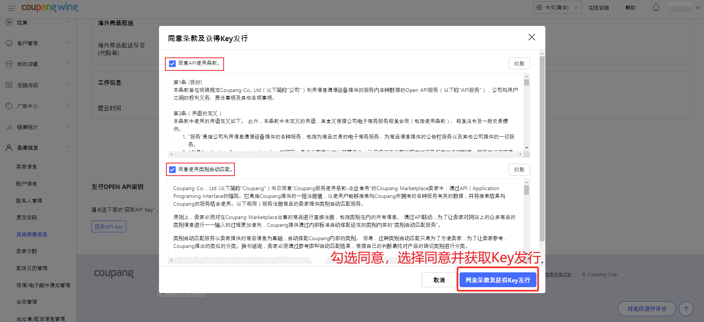
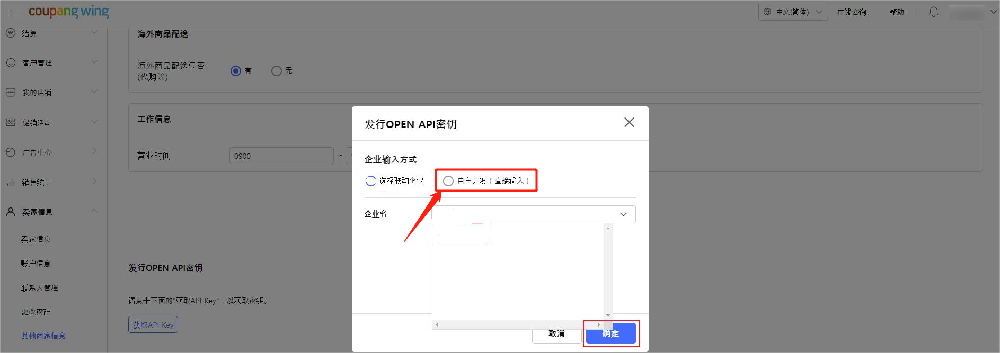
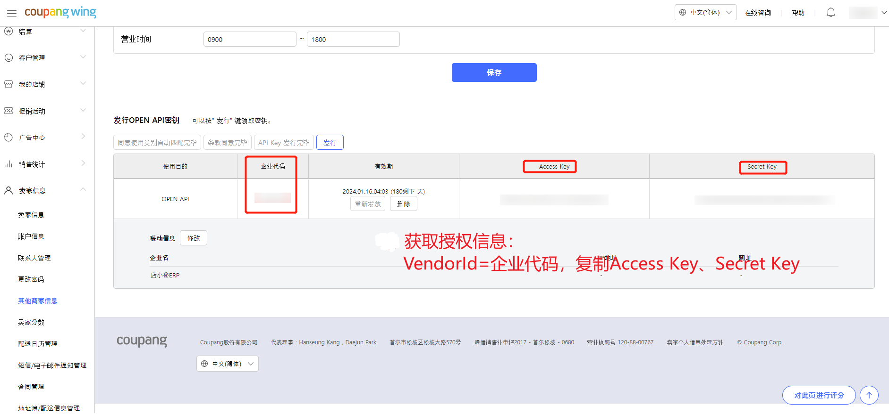
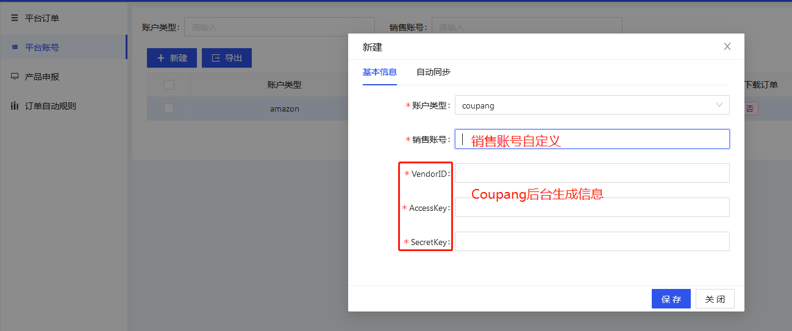

# Coupang

登陆Coupang后台，按截图步骤获取VendorId、Access Key、Secret Key 信息.

**销售---平台账号---新建添加授权**  

<!-- 源页面：https://help.dmxsmart.com/docs/tms/UserSideFunctionDescription/Sale/SalesPlatformIntegration/Coupang -->
