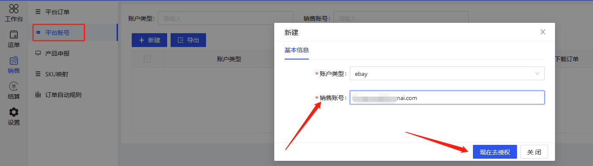
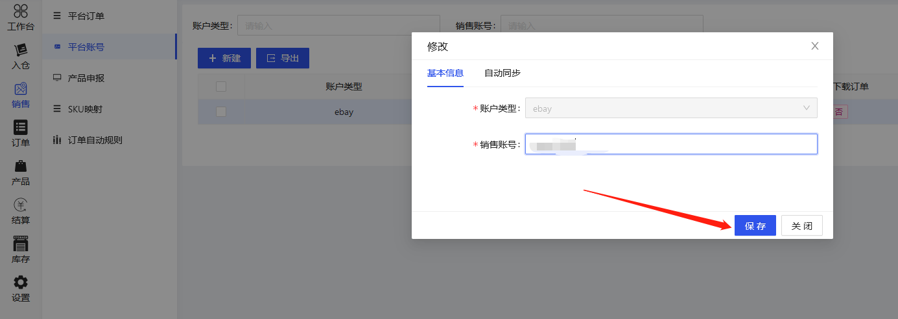

# Ebay

**销售---平台账号---新建**

**账户类型**：eBay  
**销售账号**：eBay登陆账号  
点击授权后系统会自动跳转至eBay登陆界面  

登陆eBay账号授权后返回系统保存完成账号对接.  

通过**自动同步**和**拉取订单**功能来同步eBay订单到系统提交出库.

<!-- 源页面：https://help.dmxsmart.com/docs/tms/UserSideFunctionDescription/Sale/SalesPlatformIntegration/Ebay -->
