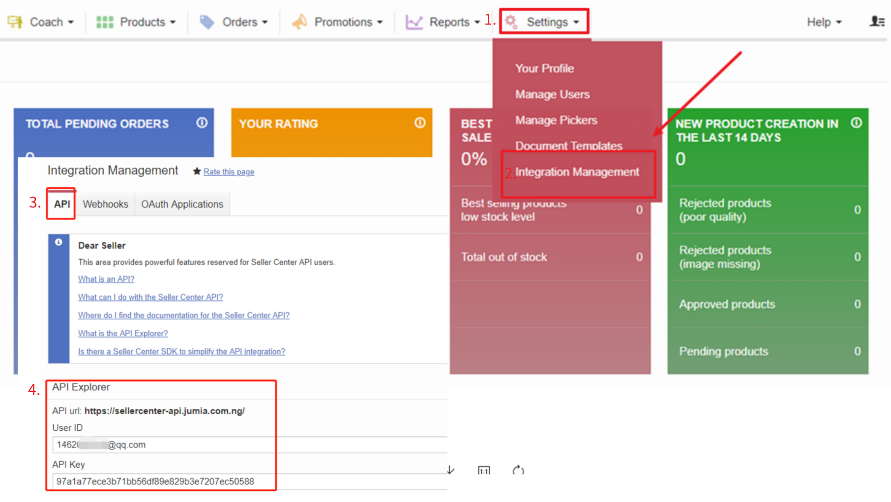
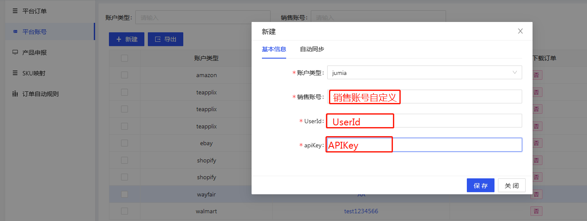
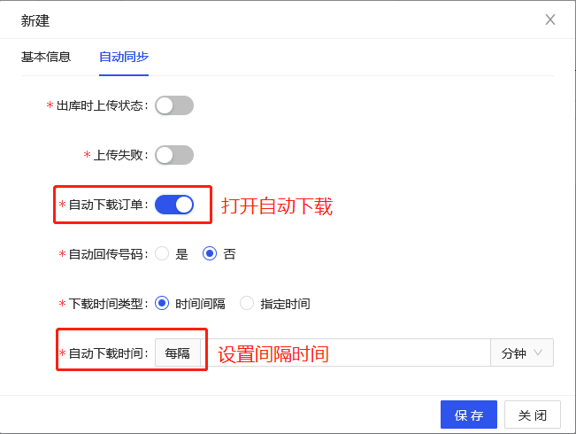

# Jumia

登陆**Jumia**，按照截图顺序获取**UserId**和**apiKey.**

登陆系统客户端**【销售】—【平台账号】新建**  
将**Jumia**后台获取的API信息复制到指定位置保存.  

点击自动同步设置订单下载时间.  

<!-- 源页面：https://help.dmxsmart.com/docs/tms/UserSideFunctionDescription/Sale/SalesPlatformIntegration/Jumia -->
