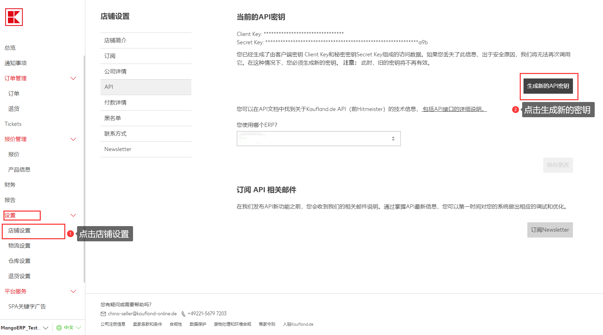
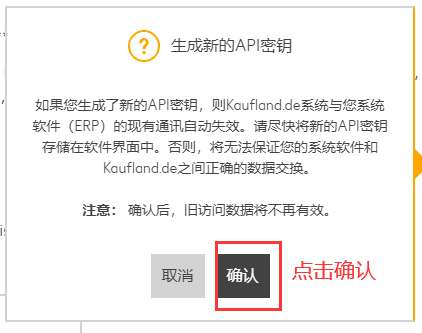
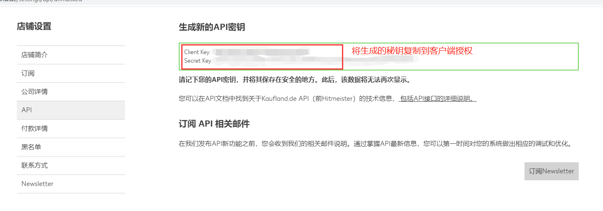
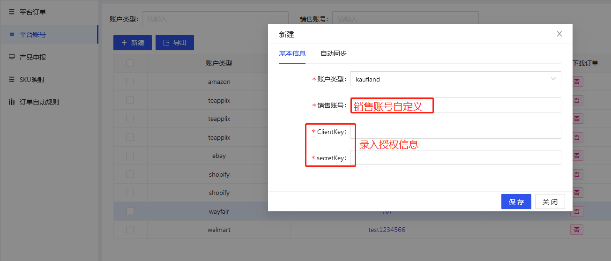
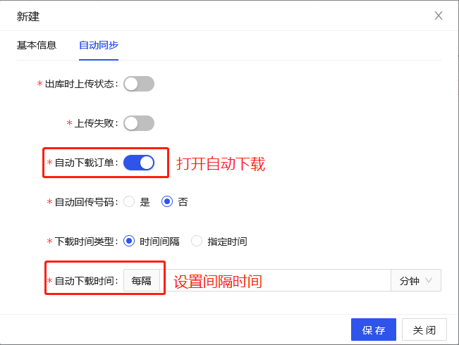

# Kaufland

登录**Kaufland**店铺后台，获取**Client Key**和**Secret Key.**

  

登陆系统客户端**【销售】—【平台账号】新建**  
将**Kaufland**后台获取的API信息复制到指定位置保存.  

点击自动同步设置订单下载时间.  

<!-- 源页面：https://help.dmxsmart.com/docs/tms/UserSideFunctionDescription/Sale/SalesPlatformIntegration/Kaufland -->
