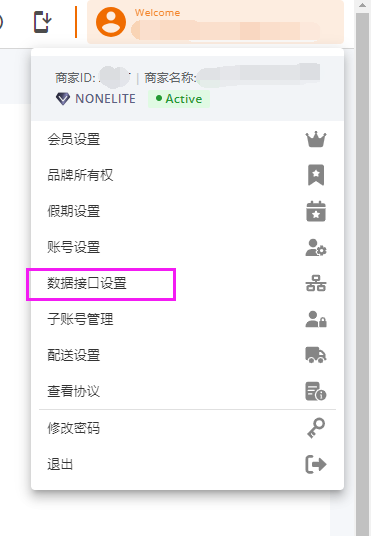
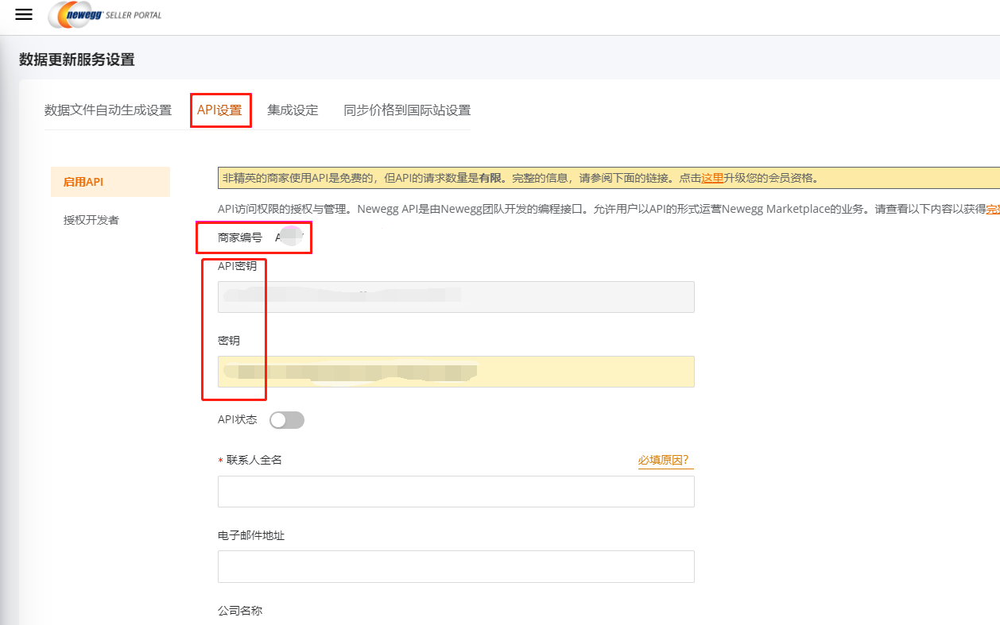
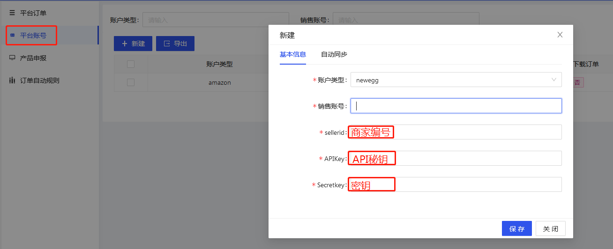
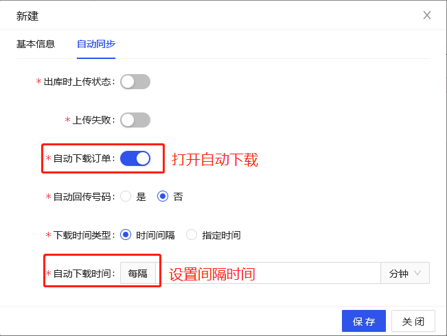

# NewEgg

登陆NewEgg后台，点击【**数据接口设置**】

  
在【**API设置**】获取**商家编号**、**API秘钥**、**密钥**信息.  

登陆系统客户端**【销售】—【平台账号】新建**  
将NewEgg后台获取的API信息复制到指定位置保存.  

点击自动同步设置订单下载时间.  

<!-- 源页面：https://help.dmxsmart.com/docs/tms/UserSideFunctionDescription/Sale/SalesPlatformIntegration/NewEgg -->
