# Shopify

登陆 Shopify 账号进入设置界面

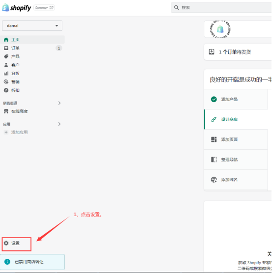

  
点击**应用和销售渠道**  

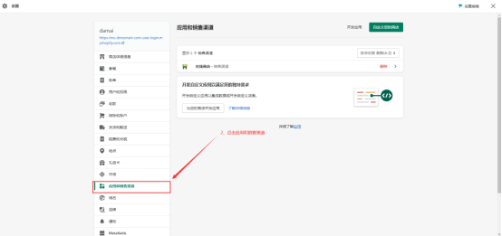

  
点击**开发应用**  

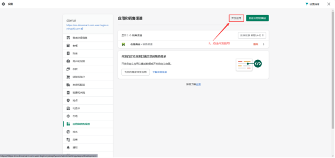

  
在应用开发中**创建应用**  

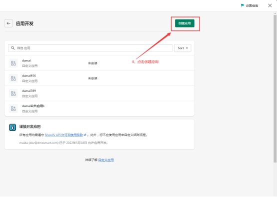

  
**应用名称**自定义  
**应用开发者**：maida([dev@dmxsmart.com](mailto:dev@dmxsmart.com))  
注意事项：店铺主账号默认是应用开发者，如遇到应用开发者无法输入的情况，可以随便选择一个已有的应用开发者.  

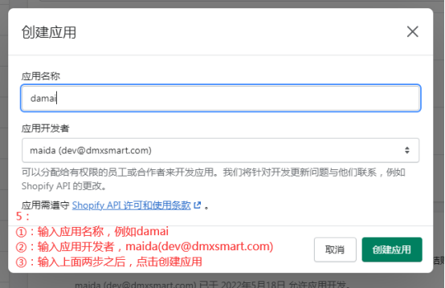

  
应用创建成功后，点击**配置后台API范围**  

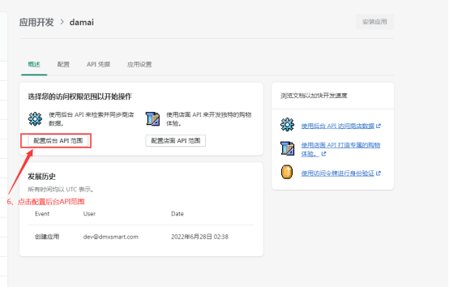

  
将以下参数全部勾选上并保存  

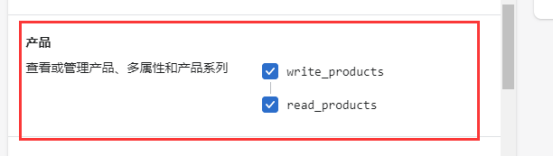

  

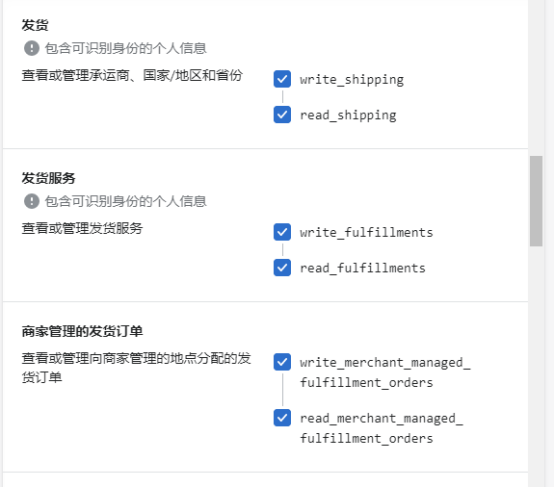

  

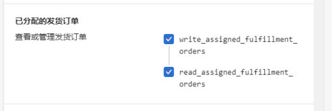

  

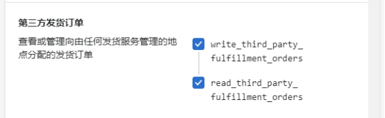

  

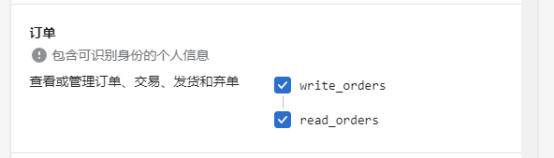

  

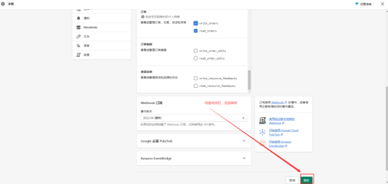

  
在应用开发中选择配置好的应用，点击**安装应用**  

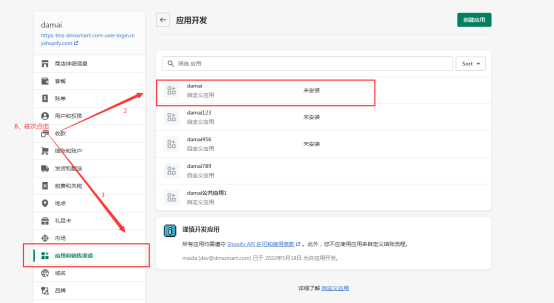

  

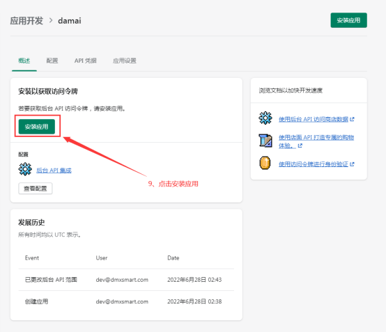

  

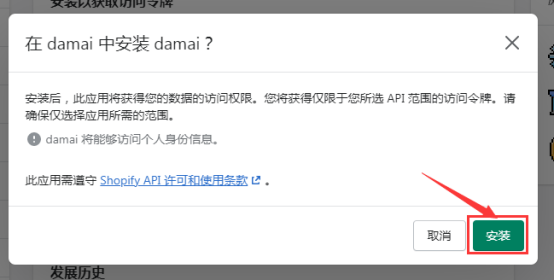

  
完成安装后会生成**后台API访问令牌**（API Token）  

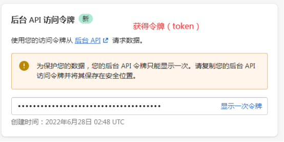

进去系统**销售**---**平台账号**---**新建**  
**账户类型**选择Shopify  
将API令牌（Token）复制粘贴到系统的 accessToken 处

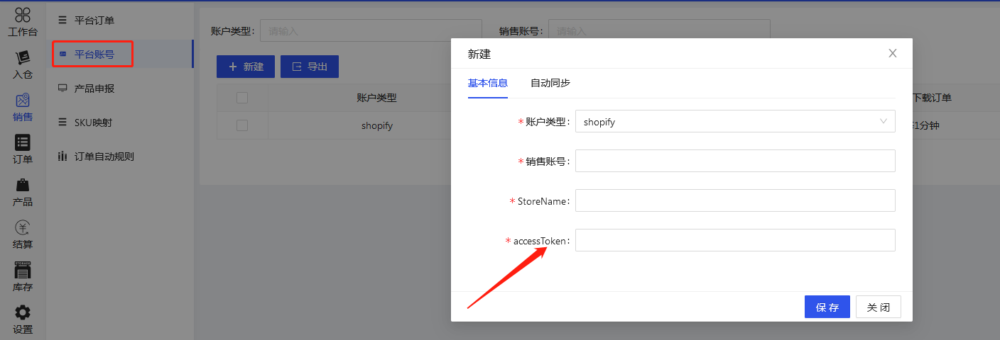

**销售账号**：自定义  
 **StoreName**：填入 .myshopify.com 前面的文字  
（例如店铺网站是damai123.myshopify.com那么StoreName 就填damai123）  
录入后保存，完成Shopify账号对接.  
通过**自动同步**和**拉取订单**功能将Shopify订单同步到系统提交出库.

<!-- 源页面：https://help.dmxsmart.com/docs/tms/UserSideFunctionDescription/Sale/SalesPlatformIntegration/Shopify -->
