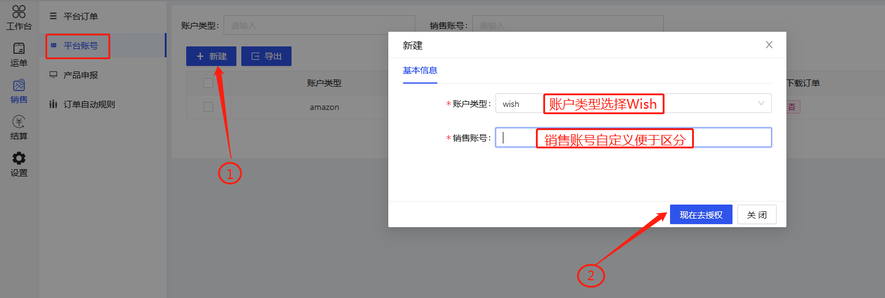
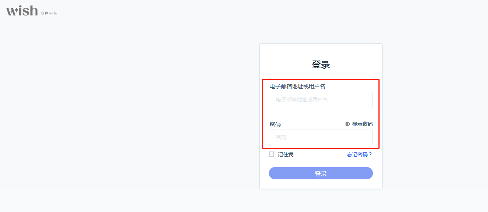
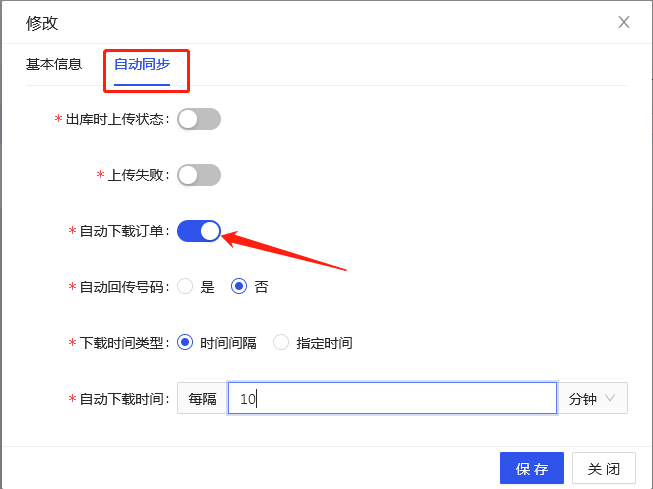

# Wish

**注意：授权Wish店铺需要登录Wish账号，请在登录Wish后台的常用电脑和网络下操作授权！**  
**销售---平台账号---新建**

输入Wish账号密码，点击登陆.  

授权成功后返回系统可开启订单同步功能.  

<!-- 源页面：https://help.dmxsmart.com/docs/tms/UserSideFunctionDescription/Sale/SalesPlatformIntegration/Wish -->
