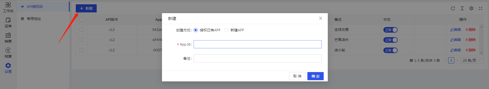
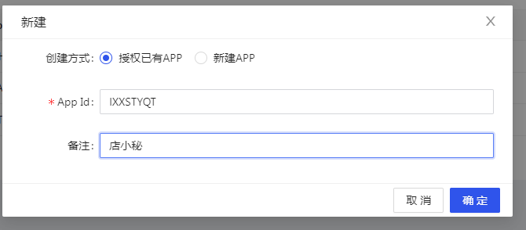
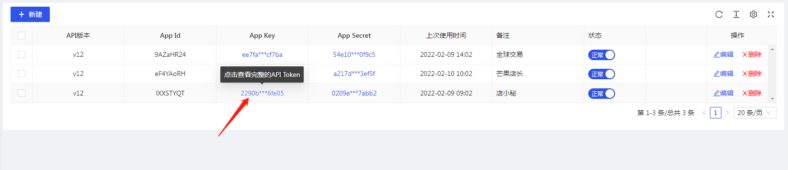
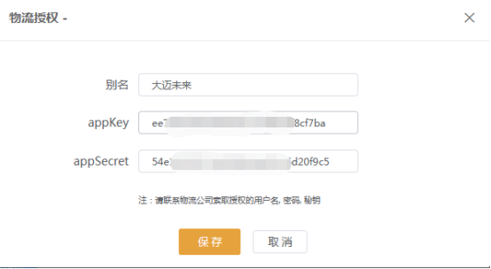
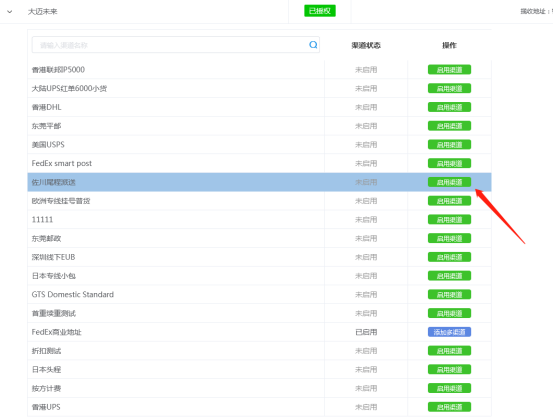

# API授权说明

【**功能概述**】第三方ERP授权，客户可以通过ERP推送订单到系统中来进行发货处理，目前系统对接的ERP有**店小秘**、**全球交易助手**和**芒果店长**，客户可以通过API授权来进行ERP的对接.  
点击**新建**，选择**授权已有APP**

  
店小秘 App Id：**lXXSTYQT**  
芒果店长 App Id：**eF4YAoRH**  
全球交易助手 App Id：**9AZaHR24**  
在**App Id**处录入上方需对接的ERP App Id，点击确定  

  
系统会自动生成ERP对接所需的**App Key**和**App Secret**,点击可查看完整的API Token  

  
到ERP物流商处搜索**大迈未来**，用系统中生成的**App Key**和**App Secret**对账号进行授权，货代名称、别名自定义编辑.  

  
点击**保存**ERP对接完成，最后对物流商提供的渠道进行启用就可以将ERP的订单推送到系统中了  

<!-- 源页面：https://help.dmxsmart.com/docs/tms/UserSideFunctionDescription/SetUp/APIAuthorization/APIAuthorizationInstructions -->
