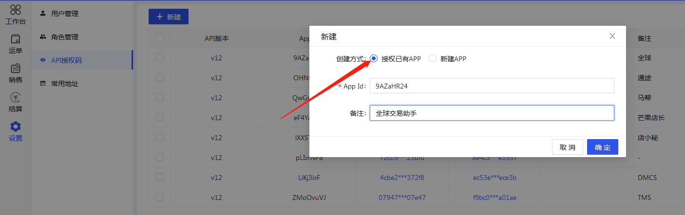
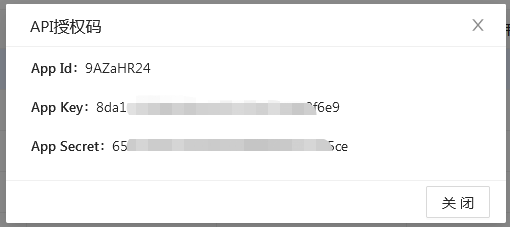
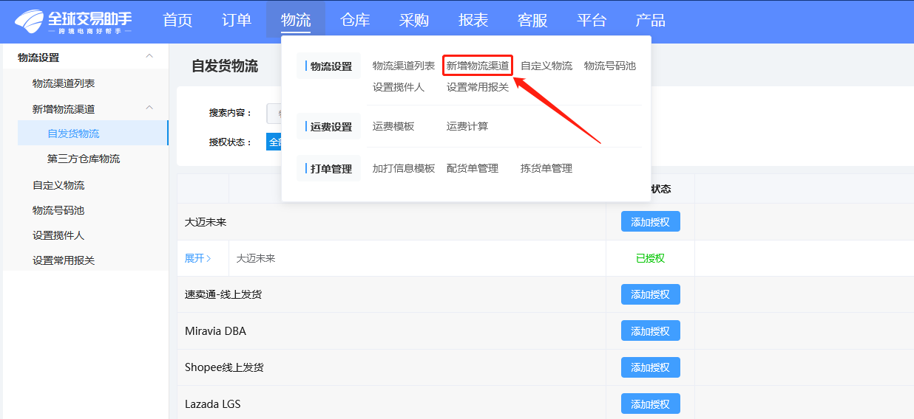
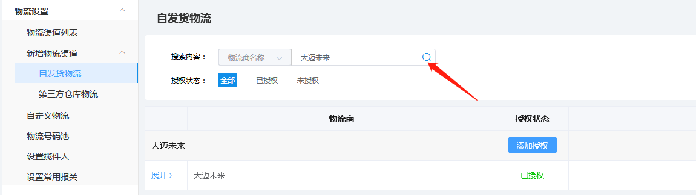
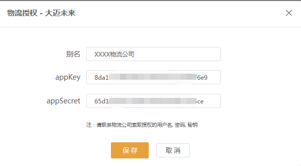
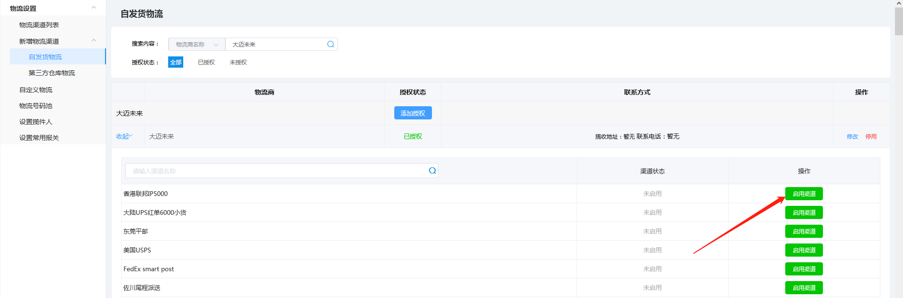

# 全球交易助手

新建，选择授权已有APP，App Id 录入**9AZaHR24**，点击确定生成API授权码

  
登陆全球交易助手，选择**【物流】**---**【物流设置】**---**【新增物流渠道】 ****自发货物流**搜索栏录入**大迈未来**搜索  

添加授权，别名自定义， 将系统生成的appKey 和 appSecret 复制到相应框内保存.  

  
启用物流渠道  

<!-- 源页面：https://help.dmxsmart.com/docs/tms/UserSideFunctionDescription/SetUp/APIAuthorization/GlobalTradingAssistant -->
