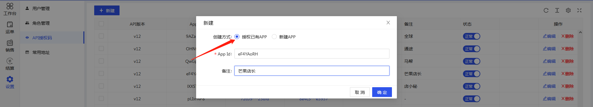
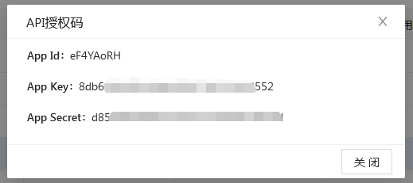
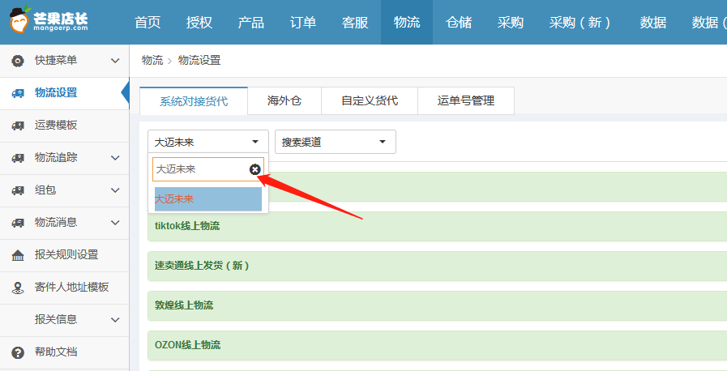
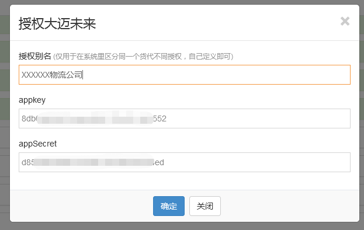
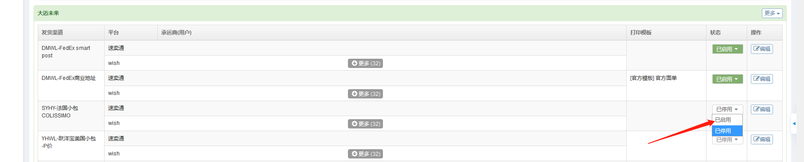

# 芒果店长

新建，选择授权已有APP，App Id 录入eF4YAoRH，点击确定生成API授权码.

  
登陆芒果店长ERP，进入物流---物流设置，搜索货代---**大迈未来**添加授权  

  
授权别名自定义，将系统生成的**App Key**和**App Secret**复制到对应的输入框中确定授权.  

  
授权成功后，对发货渠道进行启用.  

<!-- 源页面：https://help.dmxsmart.com/docs/tms/UserSideFunctionDescription/SetUp/APIAuthorization/MangoStoreManager -->
