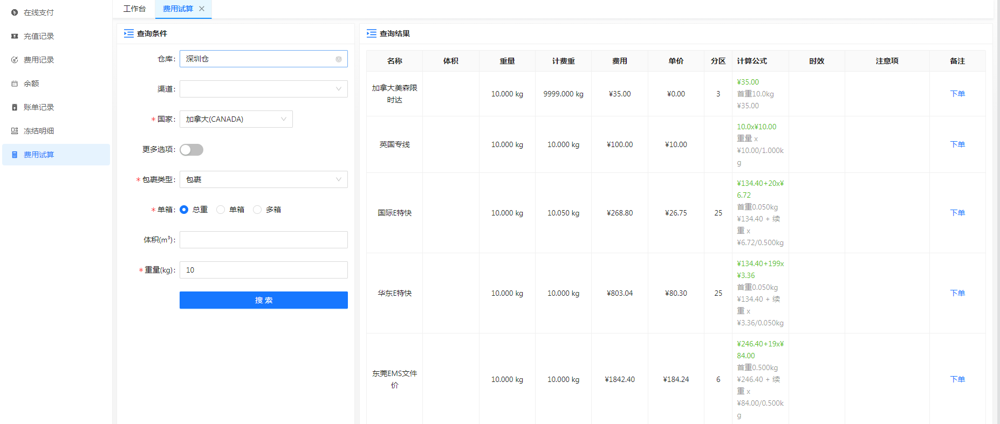
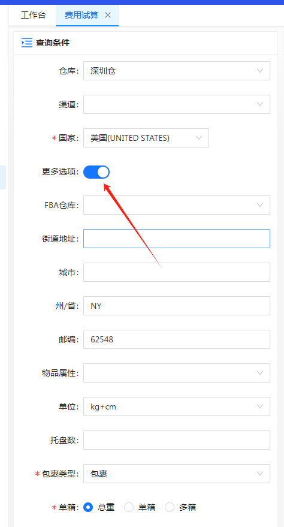
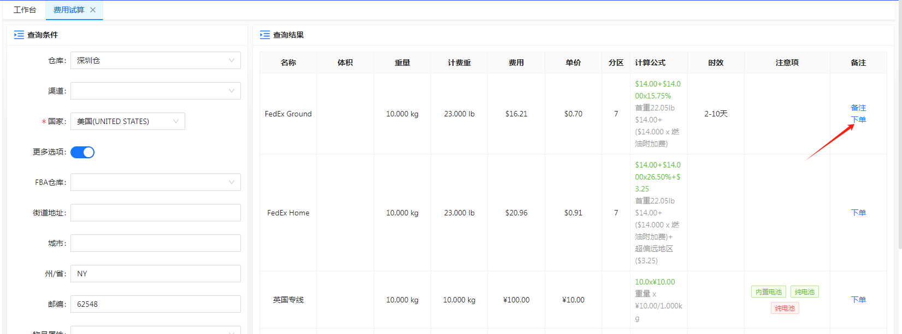

# 费用试算

【**功能概述**】输入收件人地址、包裹重量等条件查询运送渠道价格

打开**更多选项**输入详细的收件人地址信息试算  

  
查询结果后方的**下单**操作，可直接选择相应渠道创建运单。  

<!-- 源页面：https://help.dmxsmart.com/docs/tms/UserSideFunctionDescription/Settlement/CostTrialCalculation -->
