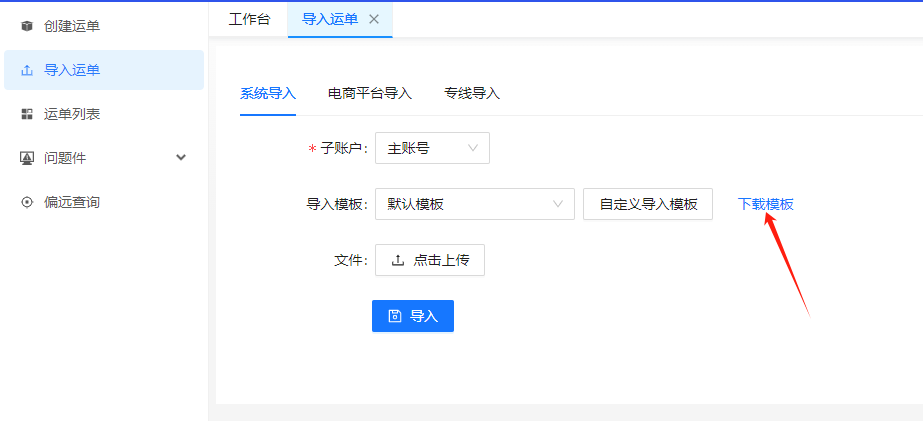
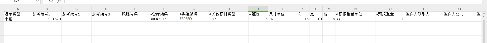
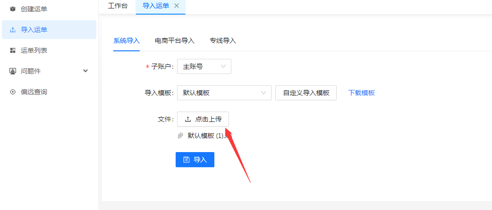
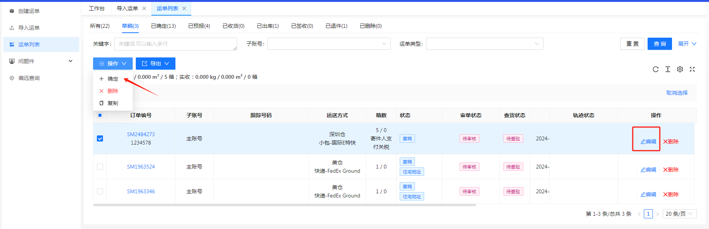
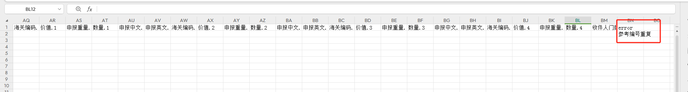
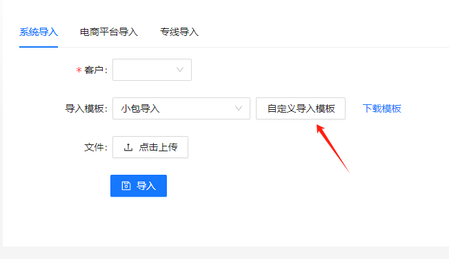
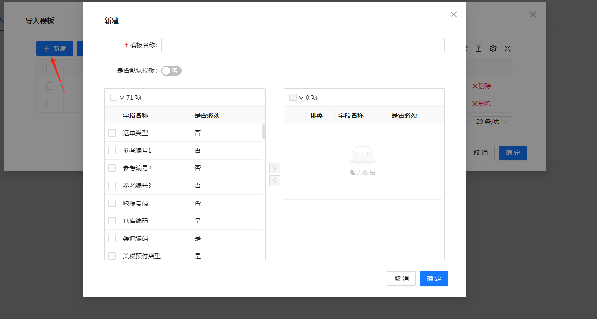
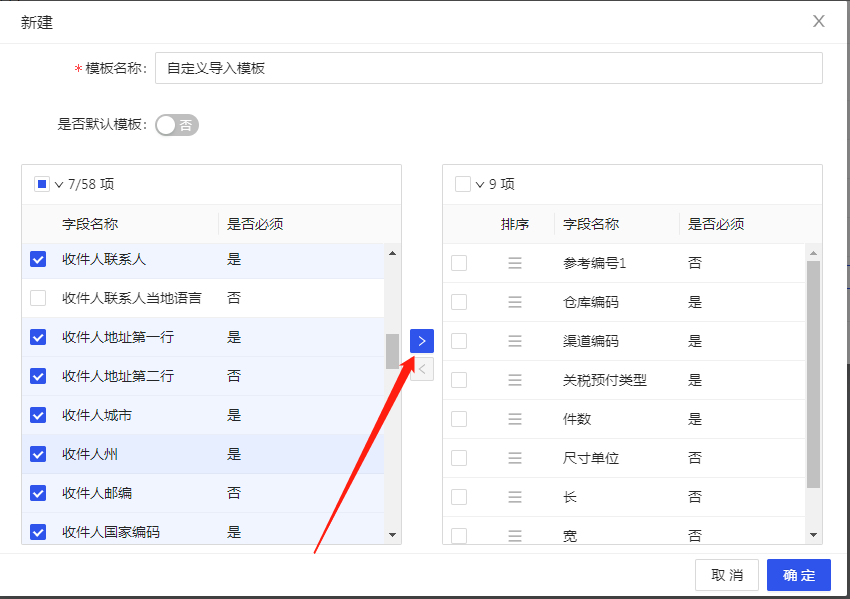
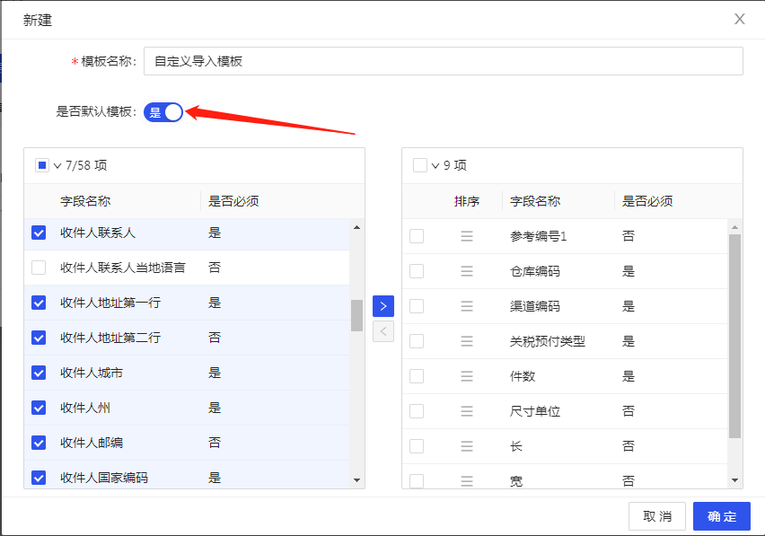
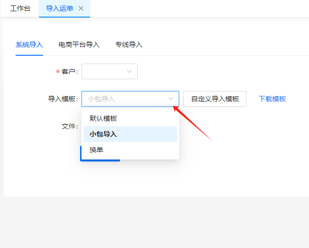

# 导入运单

【**功能概述**】运单批量导入系统  
系统支持3种不同类型的运单导入，客户可下载系统默认的导入模板进行导入，也可以自定义模板字段后下载导入

  
在下载的模板中逐项录入运单信息后保存  

  
点击上传并保存编辑好的Excel表格  

  
保存成功后可到运单列表草稿栏中再次编辑或者进行确定提交  

  
如果模板上传失败，系统会弹出导入失败信息，点击下载，下载文档查看错误信息。  

  
下载的文档在最右端查看错误信息，根据提示内容更改有错误的地方后重新上传  

  
**自定义导入模板**  

  
点击新建  

  
录入模板名称，选中下方所需要的的字段移动到右边进行保存  

  
可以设置该模板为默认下载模板  

  
模板创建成功后选择创建好的导入模板进行下载就可以了  

<!-- 源页面：https://help.dmxsmart.com/docs/tms/UserSideFunctionDescription/Waybill/ImportWaybill -->
