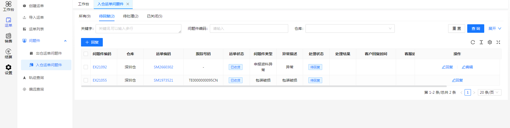
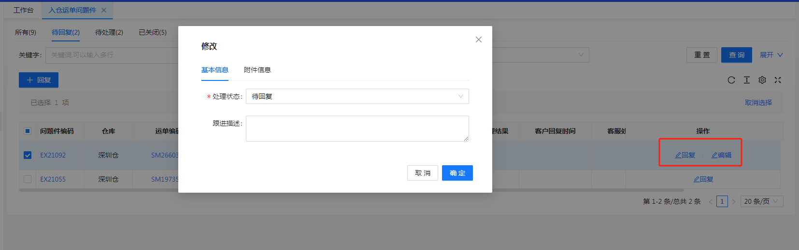
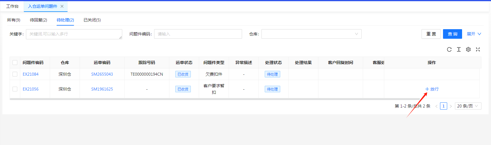
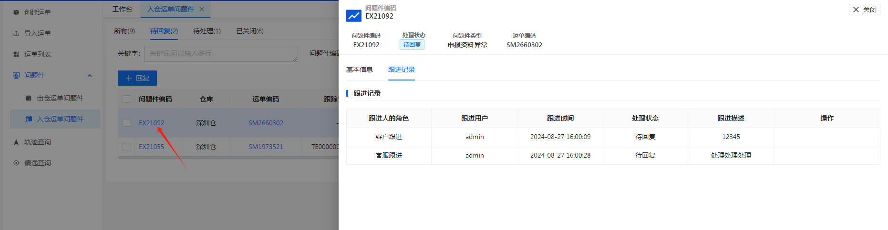

# 问题件

【**功能概述**】异常运单处理，当货物入/出仓后出现异常需要协助或要求暂扣等问题时，由管理端将运单添加为问题件，根据管理端设置可对问题件进行编辑、回复和放行。

  
对问题件编辑或回复  

  
要求暂扣的货物需放行后才能出仓  

  
点击问题件编码可查看问题件历史跟进记录和内容  

  
问题件在双方沟通解决后，客服人员可在管理端关闭异常单，运单处理完成

<!-- 源页面：https://help.dmxsmart.com/docs/tms/UserSideFunctionDescription/Waybill/ProblemPiece -->
