# 运单列表

【**功能概述**】对运单信息进行编辑、确定以及提交等动作。。

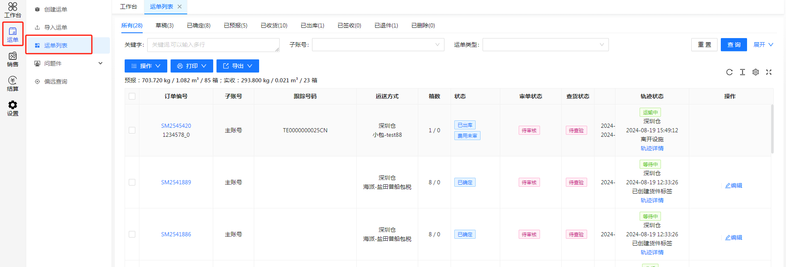

在草稿栏中的运单，我们可以点击后方编辑，对运单进行信息的再次编辑

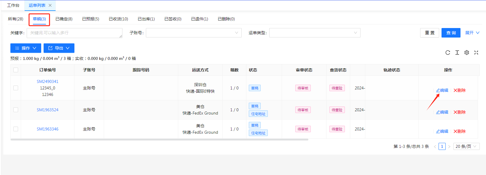

信息编辑完成后选中运单点击确定

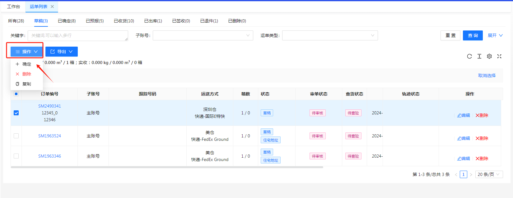

运送渠道对接API的运单会返回跟踪号码和运单标签

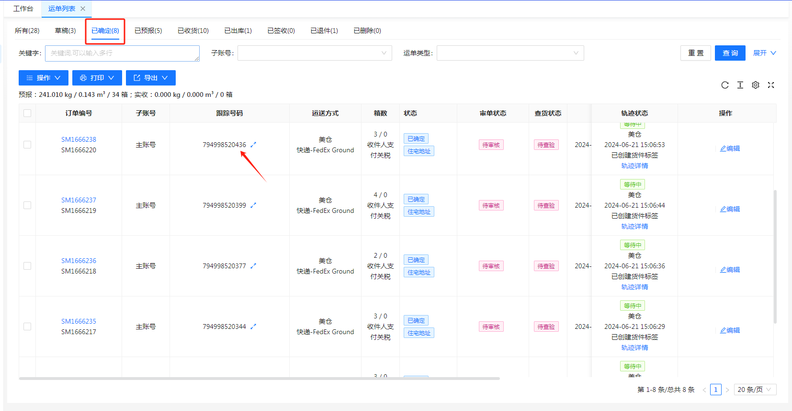

选中运单，点击打印标签，将打印出来的运单标签贴于外包装箱上

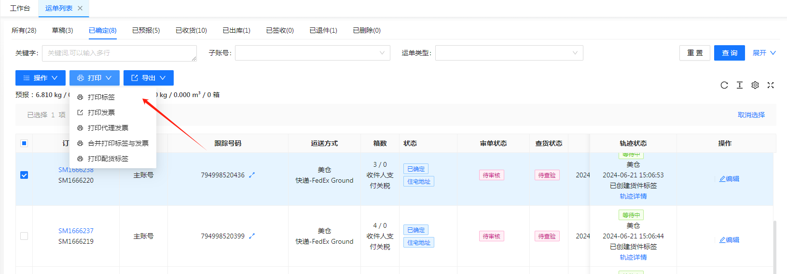

最后点击预报，并将货物交付到收货仓

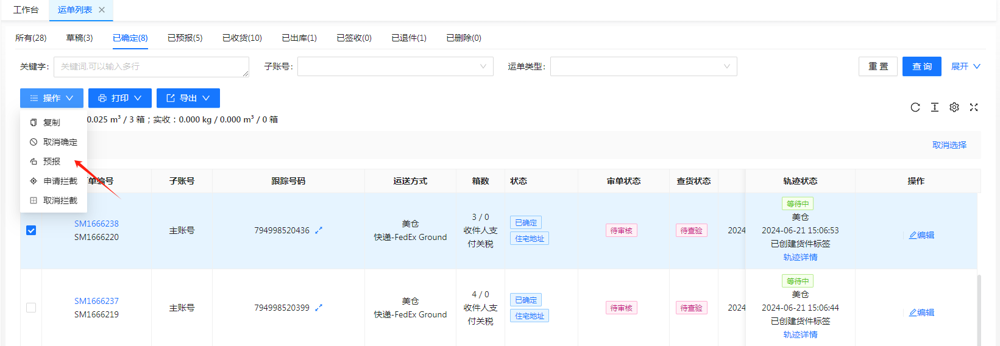

仓库未收货前我们都可以通过**取消预报**或者**取消确定**等操作来取消运单，已收货的运单我们可以通过**申请拦截**来通知仓库对货物进行拦截

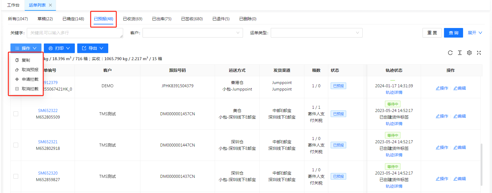

通过上方的查询功能，我们可以查询到货物的处理状态

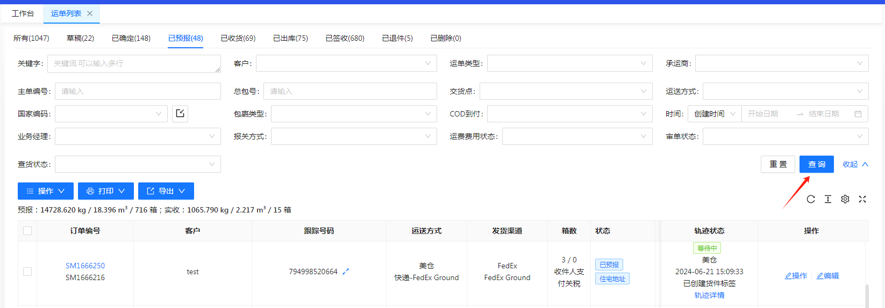

点击运单编号可查看运单详情、费用、跟踪信息等

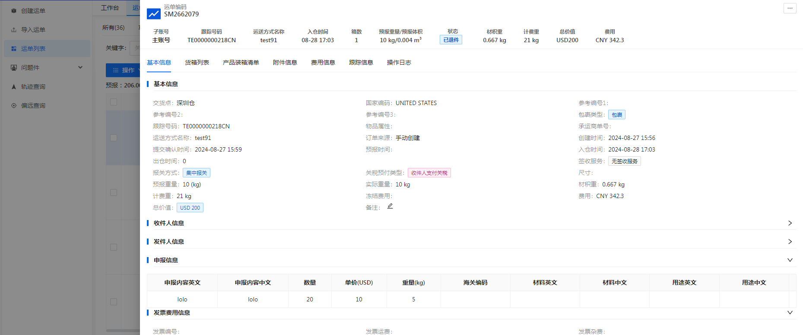

## 运单分类

点击设置标签

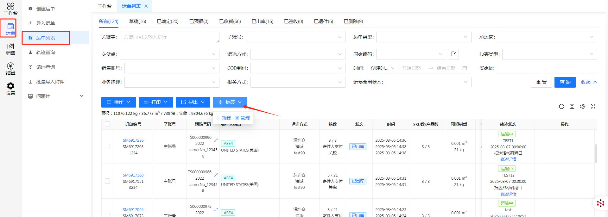

选中运单应用标签

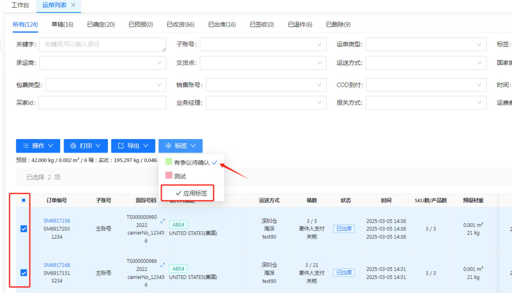

可根据标签搜索运单

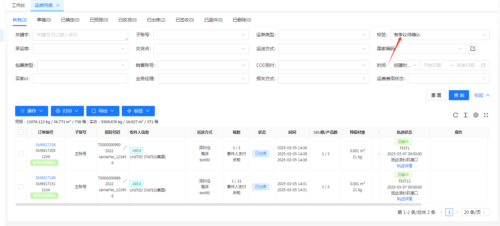

<!-- 源页面：https://help.dmxsmart.com/docs/tms/UserSideFunctionDescription/Waybill/WaybillList -->
