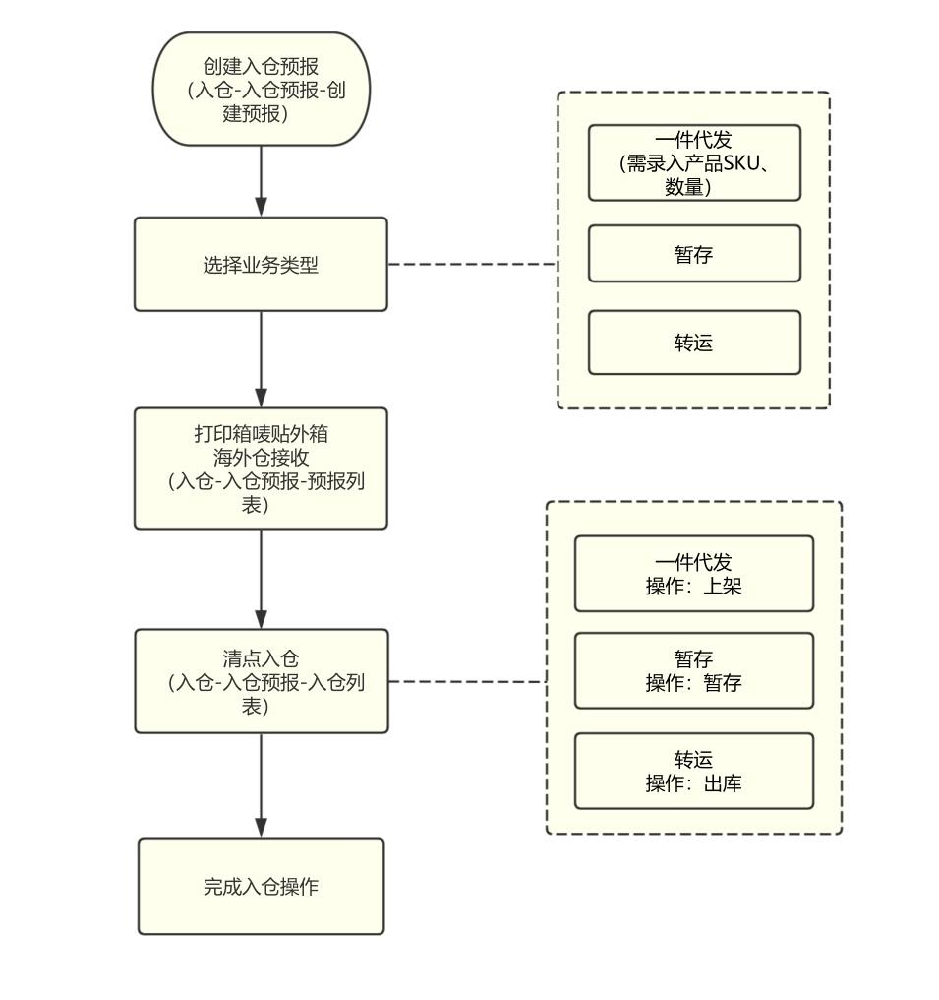
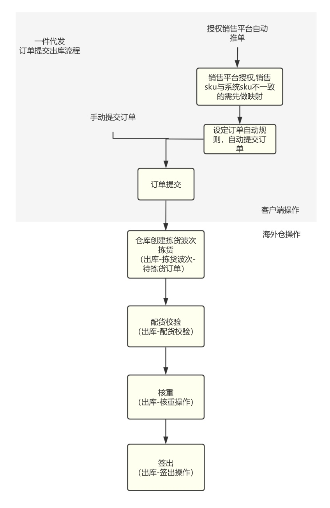
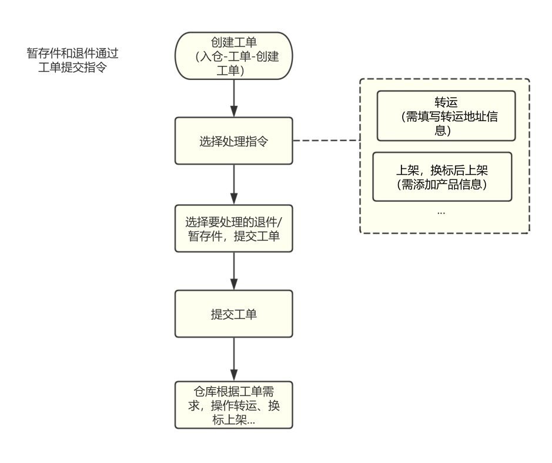
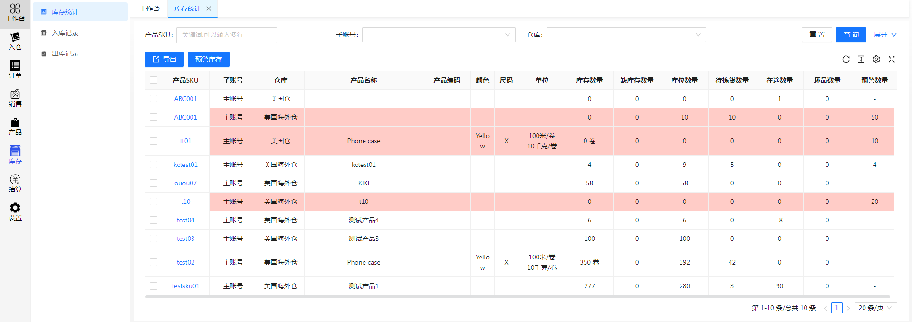
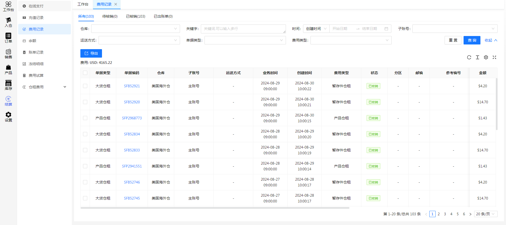
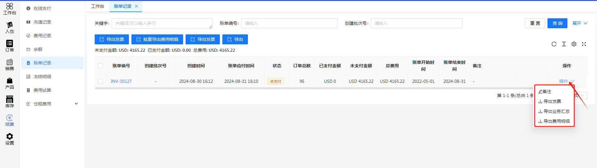
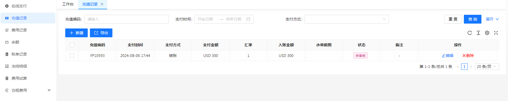
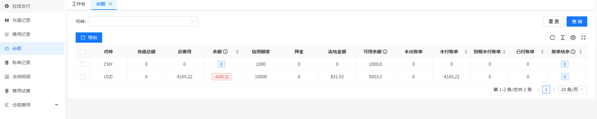

# 入门指引

操作前需在管理端进行相关初始化设置（详见管理端基础数据设置 [点击查看](Management/BasicDataSettings/InitializationProcess.md)）

## 入仓操作

操作入仓前需管理端完成初始化设置，用户端在系统已创建好产品

## 一件代发提交出库

## 退件、暂存件操作

## 查看产品库存

客户端在 **库存-库存统计** 中查看产品库存，点击可设置产品预警库存

## 查看订单费用详情

在 **结算-费用记录** 中查看运单费用详情、费用明细，通过关键字搜索查询每单费用信息，选中单据可一键导出多个单据的费用记录

## 查看账单

在 **结算-账单记录** 中查看账单。账单由管理端创建，客户无法对账单费用进行任何编辑、修改等操作，已生成的账单通过操作可以导出发票、账单明细等动作。

## 账户余额管理

管理端对接微信和企业支付宝账号后，余额充值可在 **结算-在线支付** 中进行在线充值。  
在 **结算-充值记录** 中可以查看到充值记录，客户端可创建充值记录由管理端审核充值。

可下单金额=账户余额+信用额度，当可下单金额为0将无法提交单据，请管理端进行余额充值或是信用额度修改。  
在 结算-余额 中可查看账户余额

<!-- 源页面：https://help.dmxsmart.com/docs/wms/Introduction -->
