# 客户管理

## 1.客户管理

【**功能概述**】在管理端后台给客户开设客户账号，设置客户的登录账号、密码、权限等操作。

【**功能入口**】（**客户**—**客户管理**）

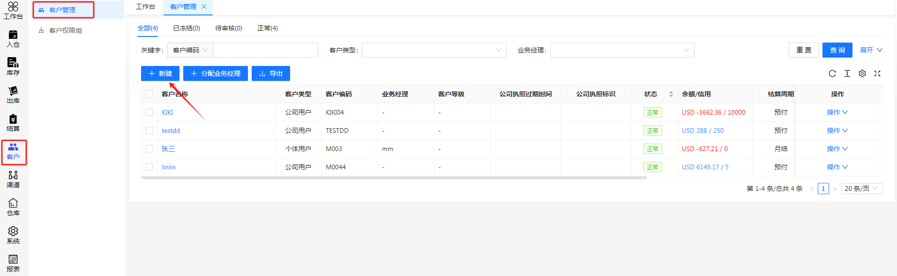

  
录入客户信息,创建登陆账号以及密码

**客户编码**根据客户需求自定义

**客户等级**用于区分不同等级的客户，运费绑定可为不同等级的客户设置不同渠道价格（在系统-字典管理-客户等级中添加客户等级）

**客户权限组**为客户分配不同仓库或者系统菜单的功能权限，不分配会默认拥有最高权限

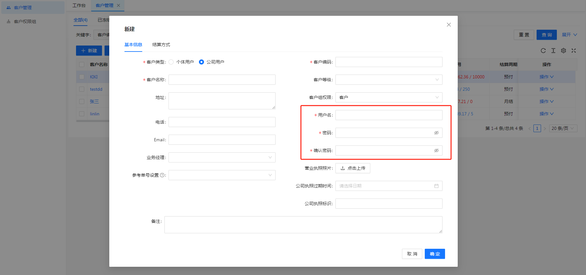

在**结算方式**选择客户结算方式和账单生成方式。

**结算周期**设置客户费用的结算时间，预付、周结、月结等结算周期，并设置信用额度。  
当信用额度用完后客户将无法下单，需充值后才能继续操作订单。

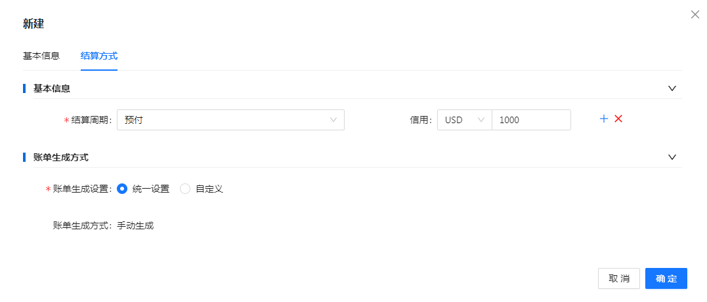

  
创建成功的客户信息会展示在客户列表中，可以对客户信息进行编辑或修改登陆密码。  

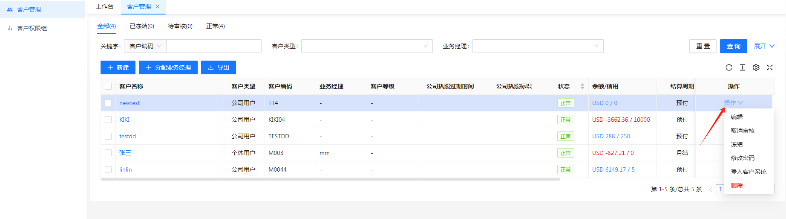

点击客户名称可查看客户的相关信息并设置运送渠道权限。

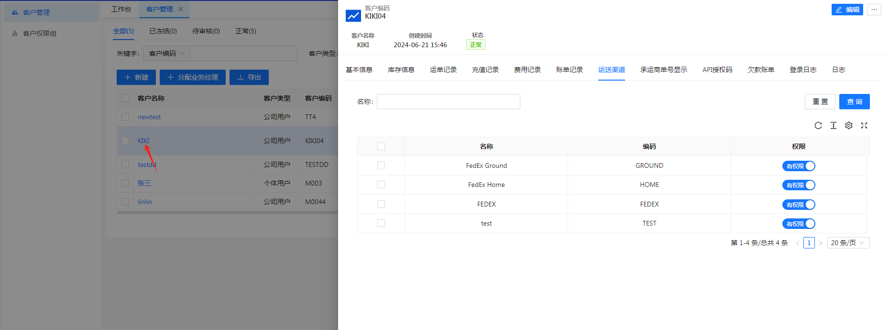

## 2.客户权限组

【**功能概述**】系统支持创建不同仓库或者不同功能菜单权限，用于分配给不同客户进行精确化的客户管理功能

【**功能入口**】（**客户**---**客户权限组**）

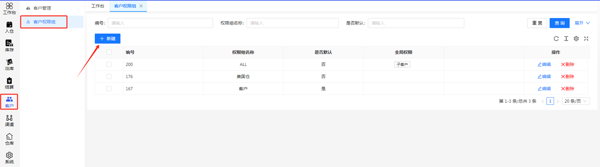

在**基本信息**栏录入权限组名称，选择使用权限的仓库  

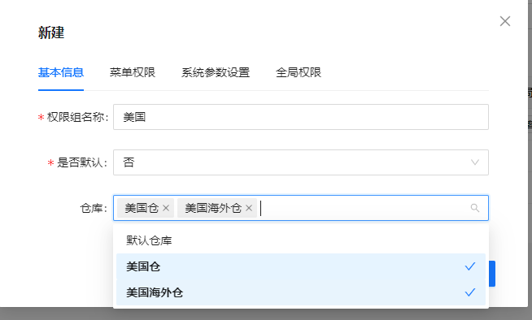

  
**菜单权限**处勾选分配给客户的系统菜单功能  

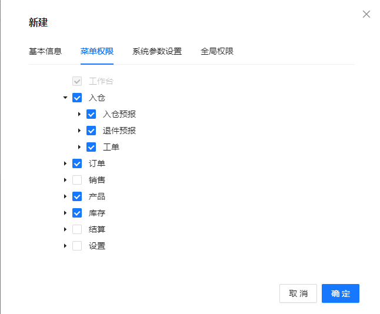

**系统参数设置**中对客户选择欠款控制

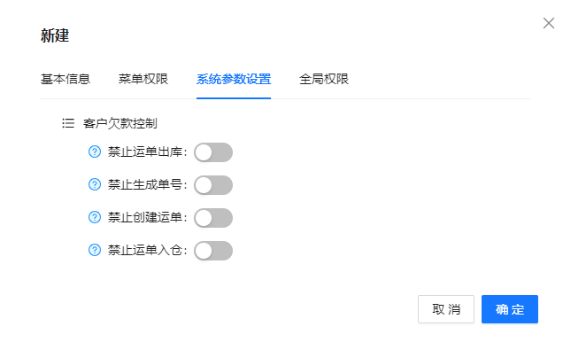

  
**全局权限**中设置是否开启子账号权限，开启此权限后，客户端可以通过创建不同的子账户设置二级账号（员工账号）的操作权限以及业务信息查询。  

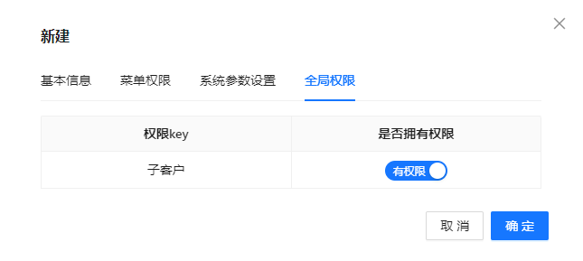

  
分配了该权限的登陆账号将作为客户主账号，通过主账号来创建添加子账户，主账号可以查看所有子账户信息，子账户只能查看自己账号下的业务信息无法查看其它子账户业务。

客户权限组创建成功后，在客户管理处为客户分配仓库和菜单权限。

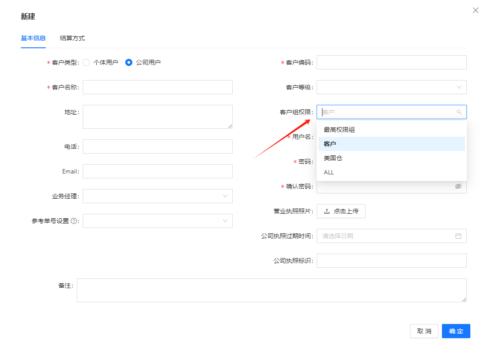

<!-- 源页面：https://help.dmxsmart.com/docs/wms/Management/BasicDataSettings/CustomerM -->
