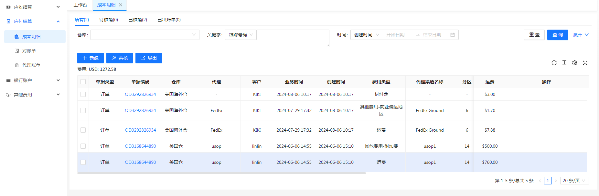
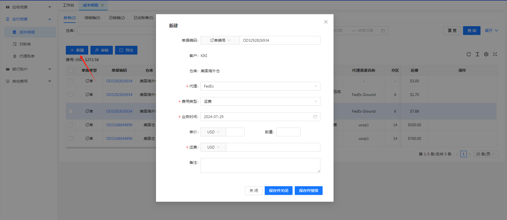
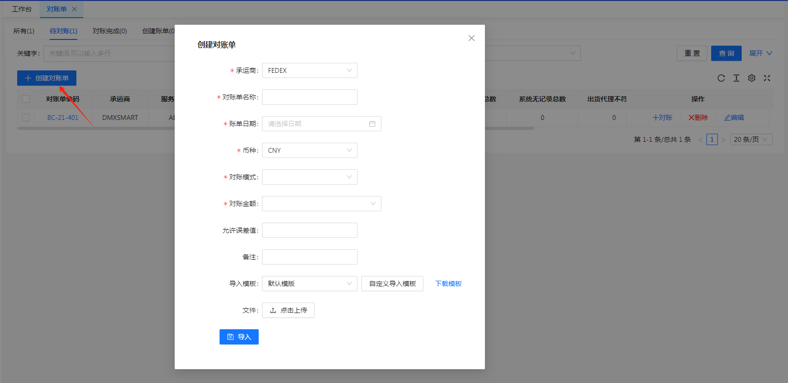
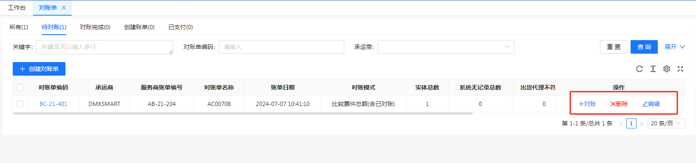
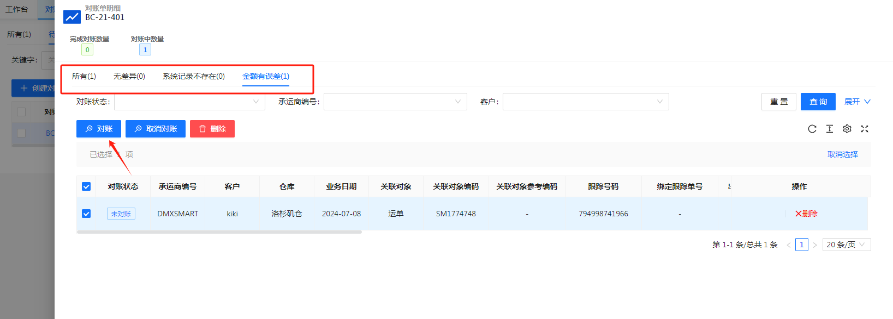
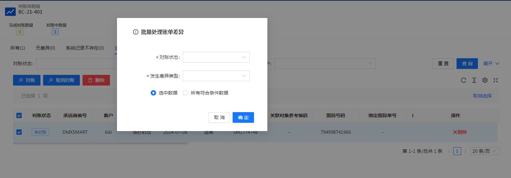
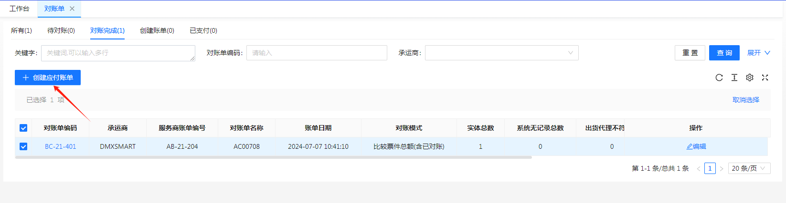
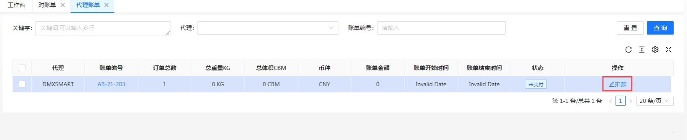

# 应付结算

## 1.成本明细

绑定渠道成本价格后，客户产生的每笔业务预估成本都将展示在代理费用明细中。

【**功能入口**】（**结算—应付结算—成本明细**）

  
点击新建，可以关联相应单据添加成本费用并审核。  

## 2.对账单

上传代理实收账单，与系统的预估成本进行对比、审核。

【**功能入口**】（**结算—应付结算—对账单**）

选择进行对账的承运商、名称、日期、币种、对账模式和对账金额，下载导入模板。导入模板可选择系统内置的模板进行下载也可以自定义导入模板。

创建好的对账单可以对其进行对账、删除和编辑。

点击对账后可在对应栏目中对其对账。

选择对账状态和发生差异类型后，确定保存。对账单将保存为**对账完成**状态。

对账完成后即可选中创建代理账单。

## 3.代理账单

【**功能入口**】（**结算—应付结算—代理账单**）

对账完成生成代理账单，可对账单金额扣款。

<!-- 源页面：https://help.dmxsmart.com/docs/wms/Management/Settlement/AccountsPS -->
