# 应收结算

### 1.充值记录

【**功能概述**】系统支持线上充值，仓库财务需对客户线上支付金额进行审核，才能将支付金额充值到客户账号中。线上支付通道支持微信、支付宝和PayPal。  
仓库管理员如需开通线上支付需要绑定相应支付通道所需的密钥，详情请咨询我司客服或者技术人员。

【**功能入口**】（**结算—应收结算—充值记录**）

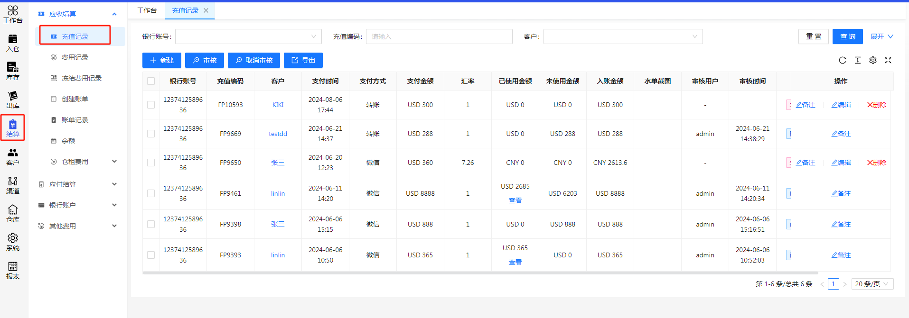

  
可为线下充值的客户手动创建充值单进行充值，并上传水单截图。  

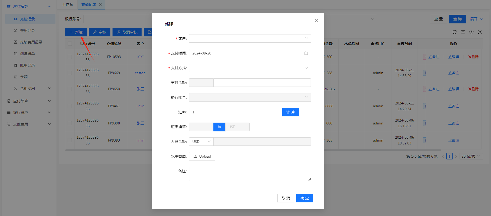

  
如果客户的支付币种与入账到系统的币种不同，我们可以通过录入不同的汇率来进行充值，系统会根据输入的汇率自动进行换算。录入收款银行账号，系统会记录该银行账户的每笔充值流水，便于财务核算公司资产。  
点击可进行汇率换算  

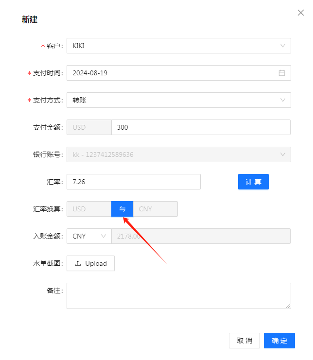

  
支持币种转换汇率计算功能  

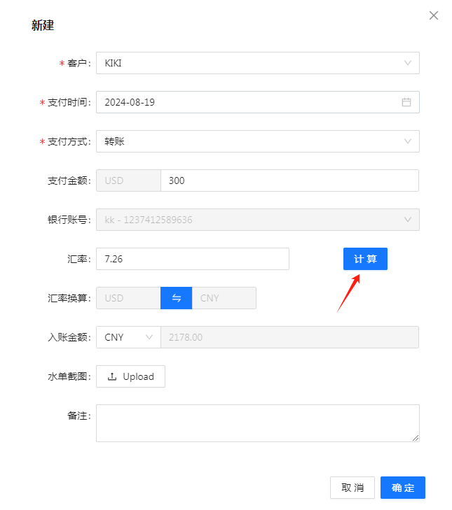

  

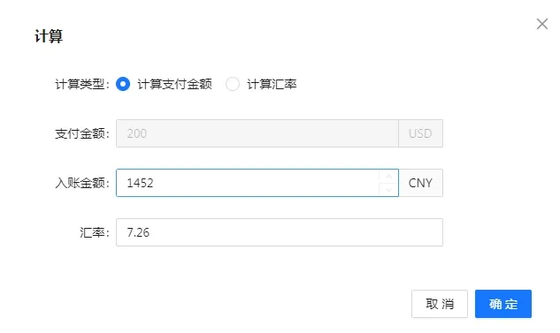

客户的充值单创建成功后，点击审核，入账的金额将转入客户余额中完成充值。  
客户端创建的充值记录由管理端进行审核。

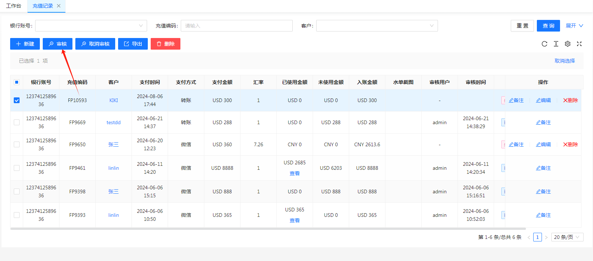

### 2.费用记录

【**功能概述**】客户提交到系统的所有业务产生的费用明细都可以在费用记录中查询到，包括运费、处理费、附加费、仓租、增值服务费等，还可以为客户某一业务创建其它费用。

【**功能入口**】（**结算—应收结算—费用记录**）

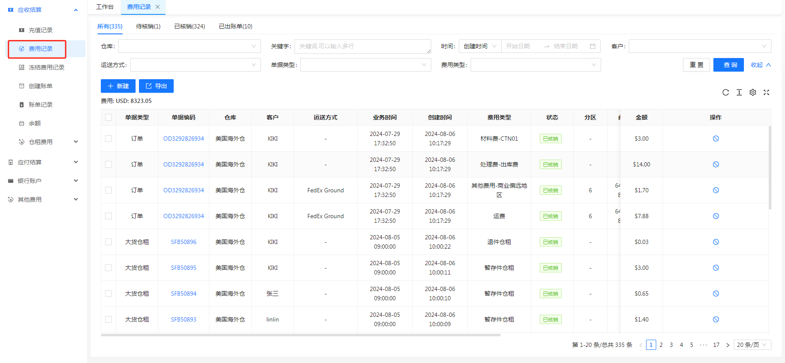

点击**新建**，录入与客户业务相关联的单据，选择费用类型并录入金额保存，费用创建成功

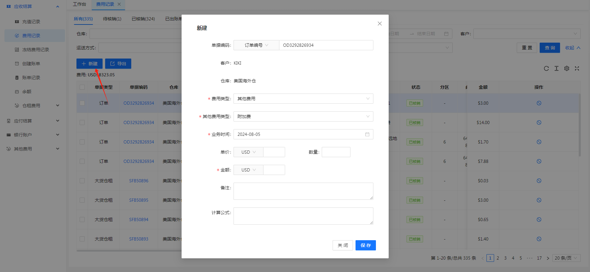

手动创建的费用会添加到**待核销**列表，财务人员需要对费用详情进行核销后，该费用才会生成客户的账单费用，并产生计费。

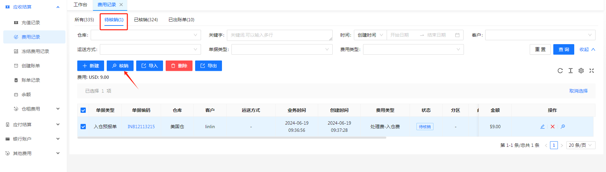

通过系统计费规则自动计算的费用，系统会自动进行核销。

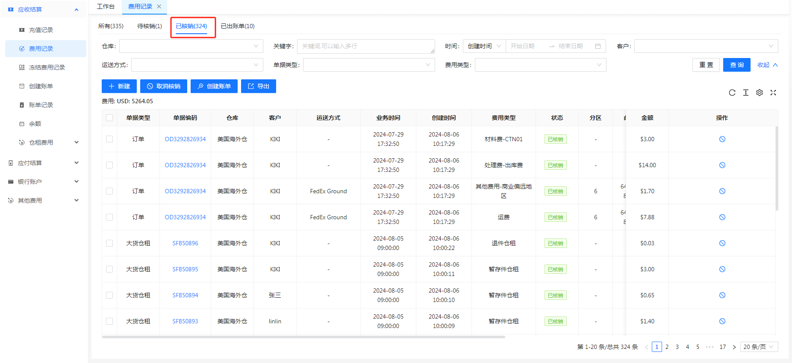

### 3.冻结费用记录

【**功能概述**】预充值的客户，系统会根据客户提交一件代发订单的产品信息预估一笔费用金额进行冻结，包括仓库处理费和尾程运费，在仓库操作订单出库后对冻结金额进行释放，并按实际产生费用扣除客户账户余额。

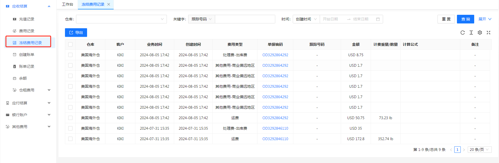

### 4.创建账单

【**功能概述**】通过系统生成每个客户的费用账单，便于客户账单查询、对账以及财务销账。

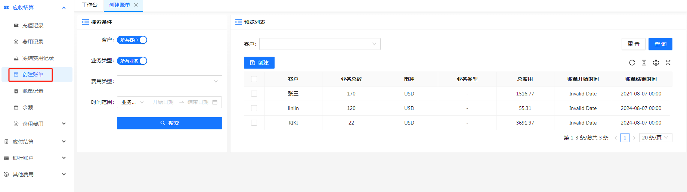

  
选择客户  

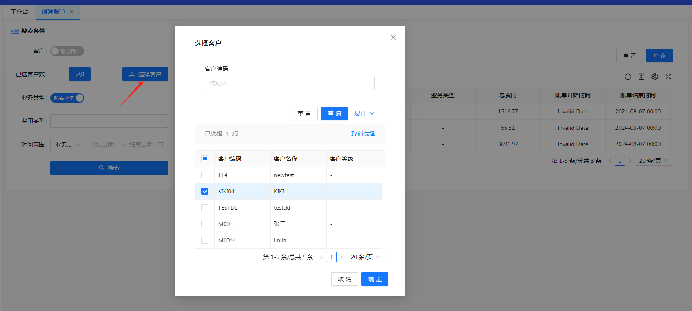

  
业务类型可以选择全部业务或者部分业务，选择费用类型，输入相关联单据编号后点击搜索  

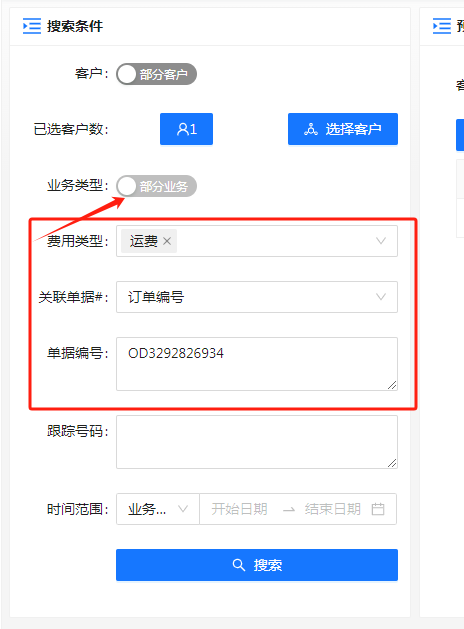

  
设置账单的起始时间，后点击搜索  

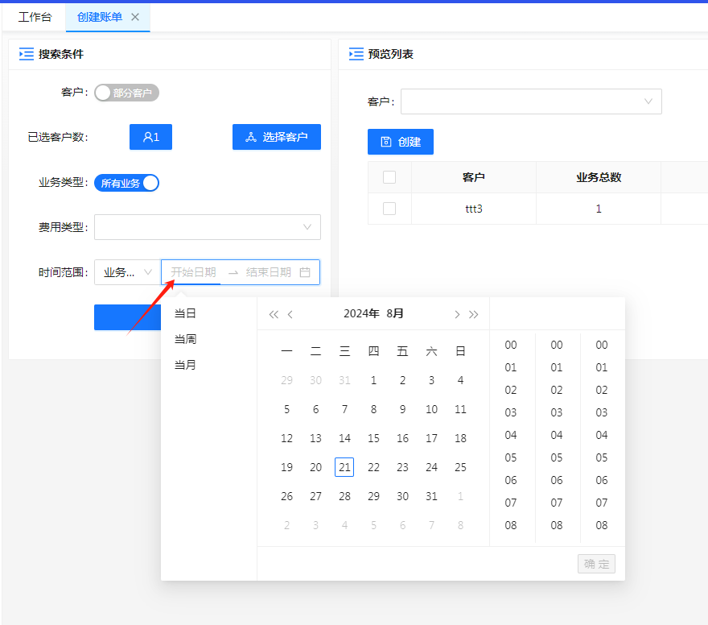

  
系统会根据设置的条件搜索出账单费用后，点击创建，账单创建成功。  

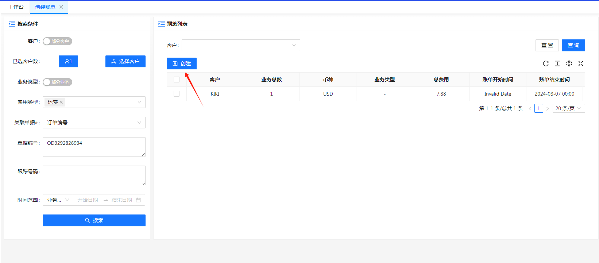

### 5.账单记录

【**功能概述**】根据账单金额对客户进行扣款，账单明细、发票的导出。

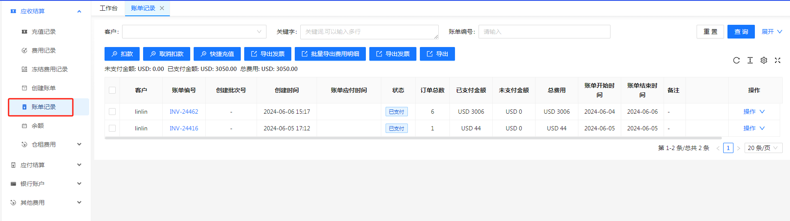

对未支付的账单进行扣款，点击后方**操作**，可以导出账单明细、发票等操作。  
未支付的账单允许删除后重新创建，已扣款的账单不能再进行删除操作。  

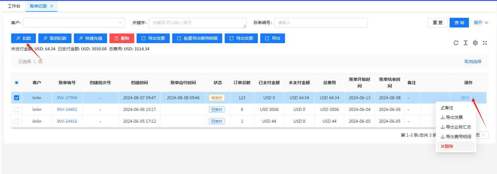

### 6.余额

【**功能概述**】客户账户余额显示，同一客户允许充值不同币种进行结算，可以为客户创建不同币种的信用额度。

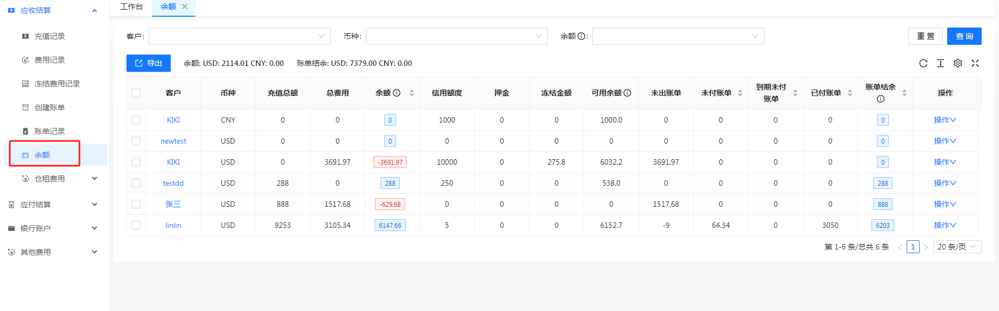

  

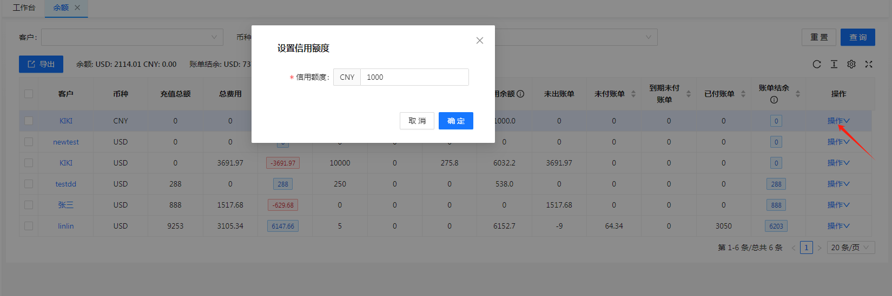

  
**充值总额**：账号充值的总金额  
**总费用**：业务产生的所有费用总额  
**余额**：余额=充值金额-总费用  
**信用额度**：由管理端对客户设置的信用额度  
**可用余额**：客户还可以使用的金额，可用余额=余额+信用额度-冻结总额  
**未付账单金额**：已创建账单费用还未扣款的金额  
**已付账单金额**：已扣款或已支付费用的账单金额  
**账单结余**：客户充值金额扣除已支付的账单金额后的账户结余。账单结余=充值金额-已付账单

### 7.仓租费用

一件代发**产品仓租**以及暂存件**大货仓租**查询

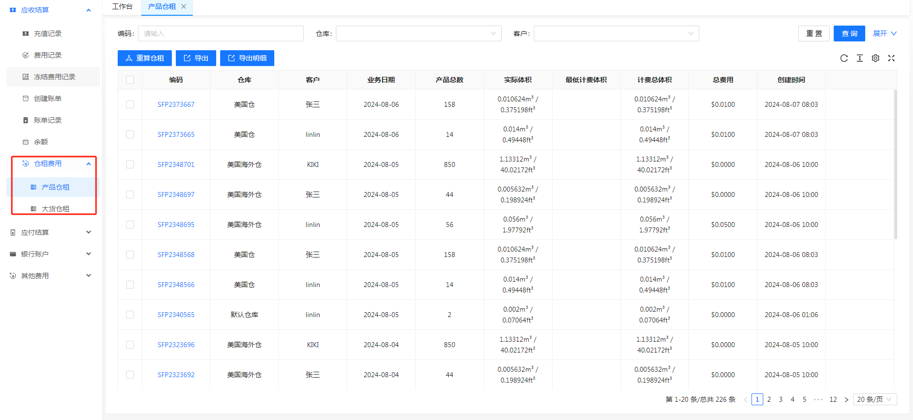

点击重算仓租费用  

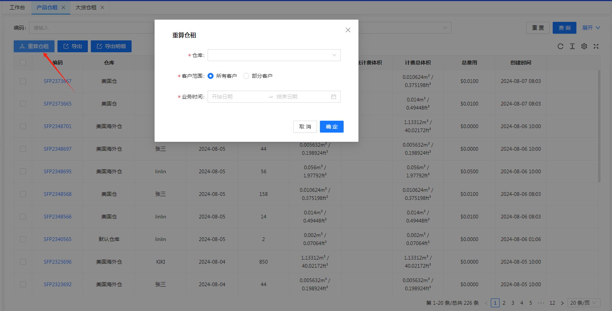

<!-- 源页面：https://help.dmxsmart.com/docs/wms/Management/Settlement/AccountsRS -->
