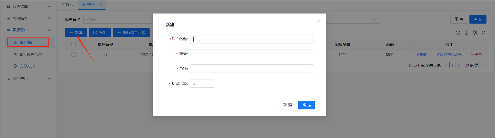
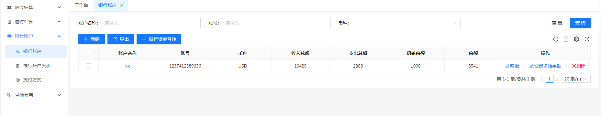
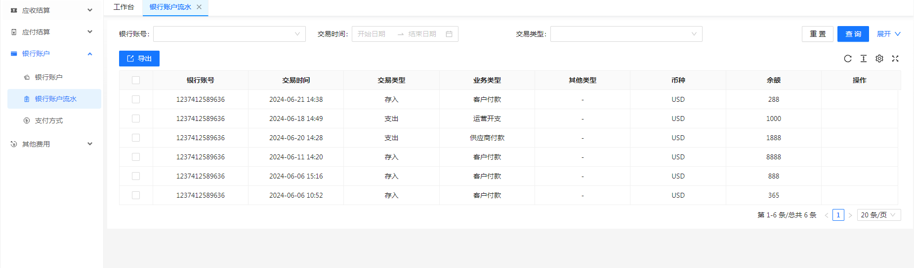
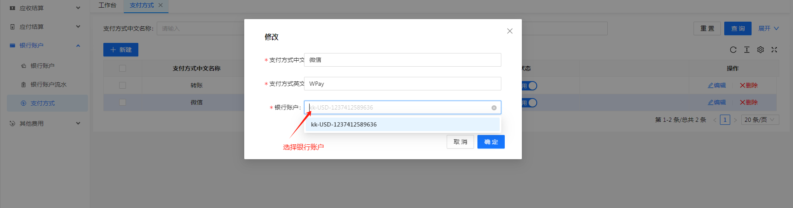
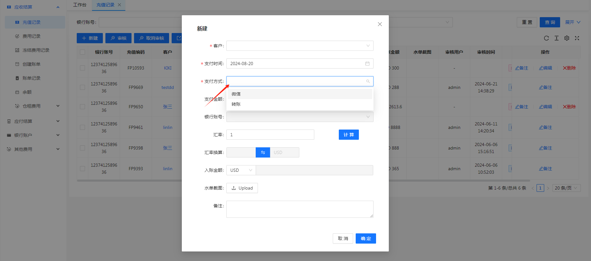

# 银行账户

## 银行账户

【**功能概述**】设置银行账户，将银行账户绑定到不同的支付方式中，统计客户费用收入和代理费用的支出，根据账户的收支流水，对公司资金进行统计。

**【功能入口】（结算—银行账户—银行账户—新建）**

根据银行账户余额，为该账户设置相应的初始余额，设置完成后确定保存。  

客户充值的金额会转入相应银行账户的收入总额，代理和公司运营等支出会显示在支出总额中，通过后方编辑可以对账户信息进行修改。  
银行账户的收支统计，能帮助公司管理层快速统计公司经营情况，为公司决策做出一定的参考意见。

## 银行账户流水

客户每笔充值收入以及公司费用的支出都会记录在账户流水中，便于财务对公司的收支情况进行查询和核对。

## 支付方式

当客户使用不同的支付方式进行充值时，我们需要将不同的支付方式绑定相应的银行账户，才能创建充值单进行充值操作。

绑定了银行账户的支付方式才能在创建充值单时被选取  

<!-- 源页面：https://help.dmxsmart.com/docs/wms/Management/Settlement/BankAccount -->
