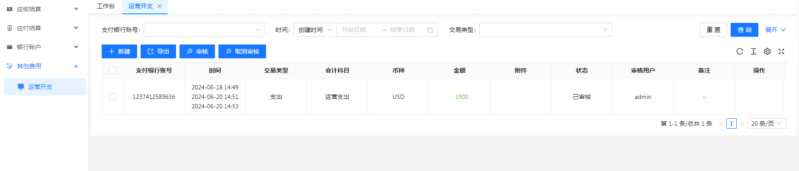
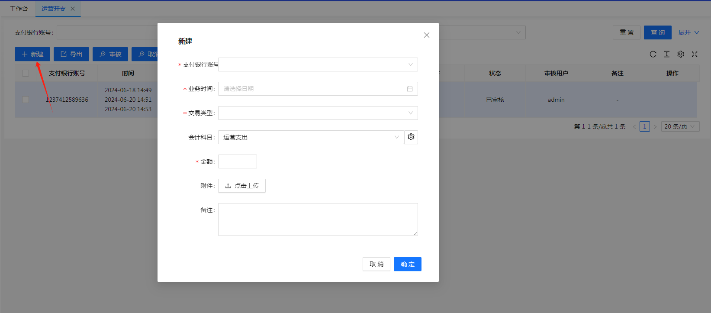
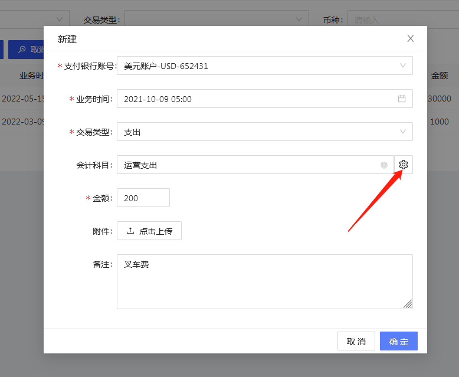
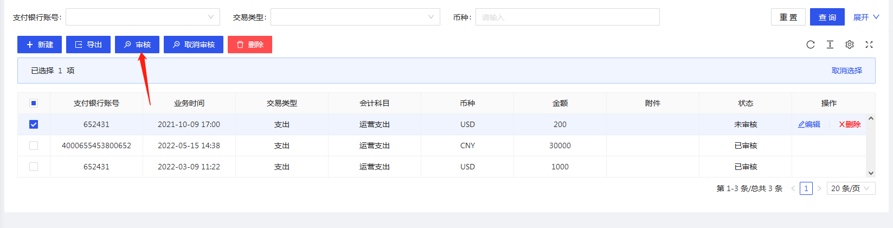
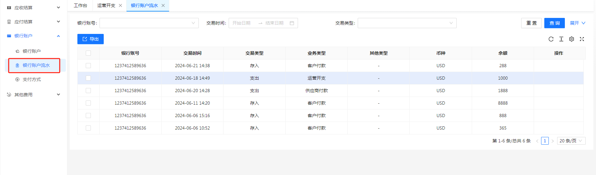

# 其它费用

【**功能概述**】统计公司运营中出现的一些其它开支费用，管理公司的每一笔收支明细，帮助公司财务进行成本核算。

点击**新建**  

选择发生交易的银行账户，交易类型可选择是**支出**或者**收入**，会计科目通过后方**设置**图标新增类型，录入金额后确定保存。  

交易创建成功后，点击审核，账户结算完成并生成相应的交易流水。  

  
可在银行账户流水中查看  

<!-- 源页面：https://help.dmxsmart.com/docs/wms/Management/Settlement/OtherExpenses -->
